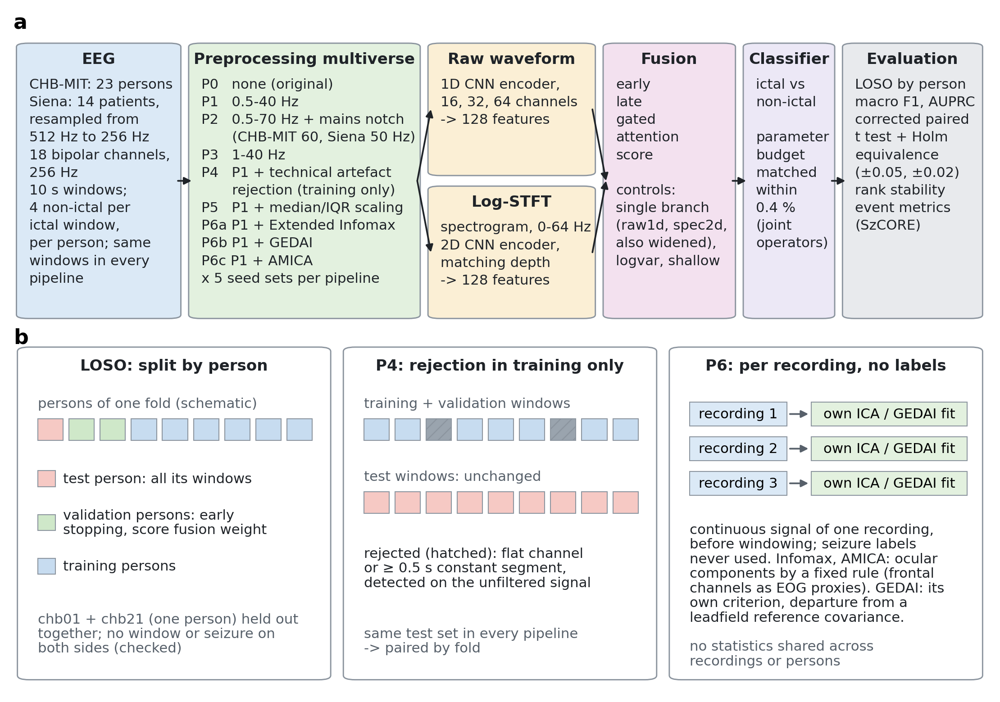
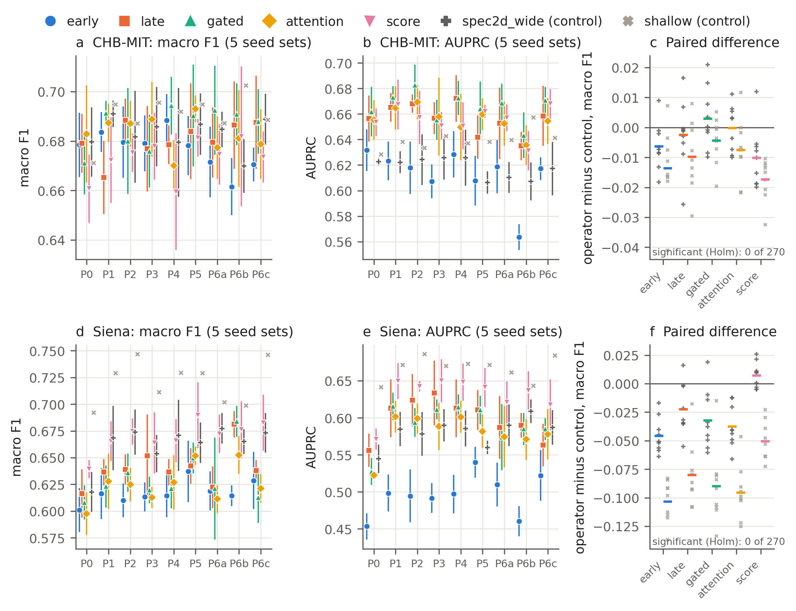
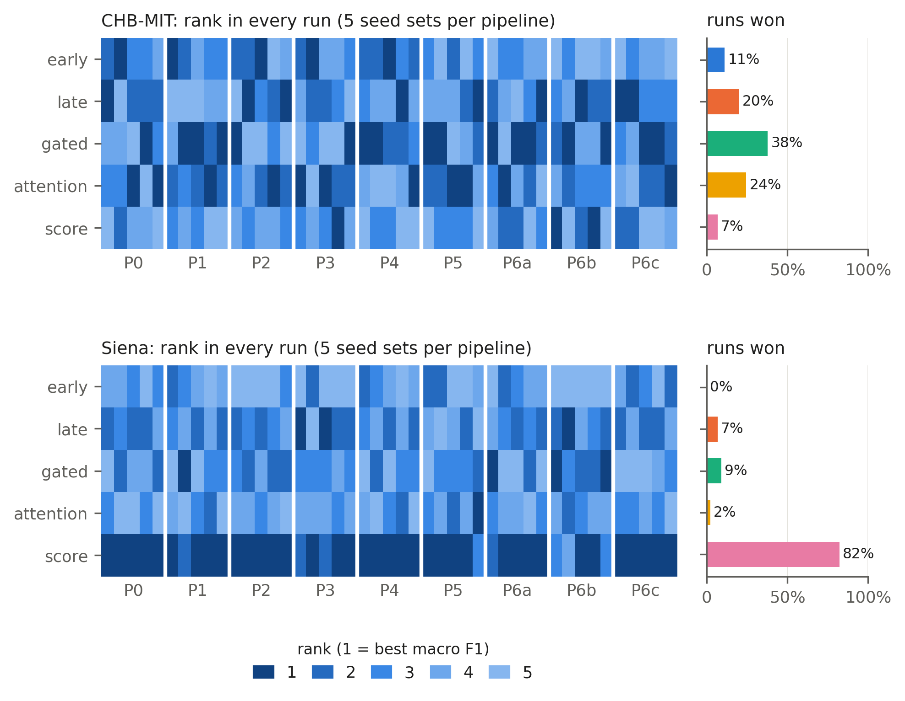
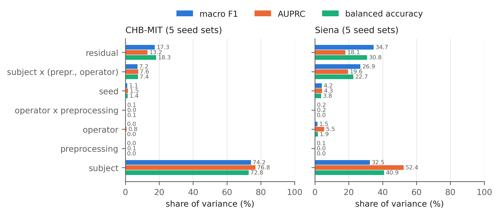
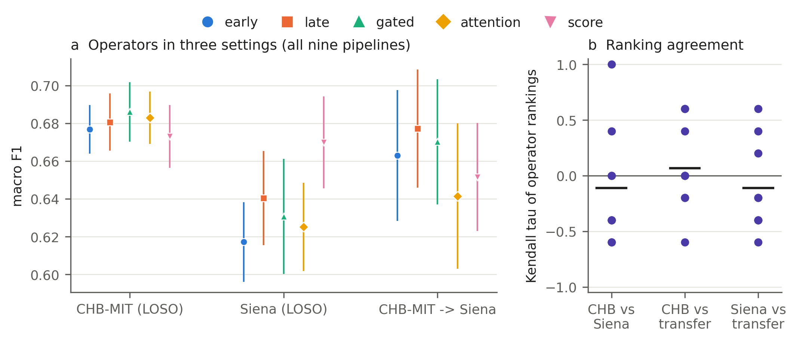

> **DRAFT v2, NOT FOR SUBMISSION.** Restructured around the three research questions the
> advisor set on 10 October 2026. This file holds the Introduction (Section 1), the
> Methods (Section 2, in the advisor's subsections 2.1 to 2.7) and the Results of the
> five-seed runs (Section 3; the seizure-level metrics of P6c on CHB-MIT and of P6c
> after transfer are still being computed) and the Discussion (Section 4). The literature review is
> provisional: the systematic search has run, but title and abstract screening was done
> by an AI assistant, and the human screening and the full texts follow after 17
> October; claims marked [abstract] rest on a source's abstract only and are to be
> checked against its full text. `paper/manuscript.md` is the previous draft
> (Bonn and CHB-MIT, single pipeline) and stays unchanged until this one replaces it;
> where the Bonn benchmark goes (supplementary material or a separate note) is still
> to be decided with the advisor. Every number below is traceable to a file in the
> repository (paths given).

# Do Fusion Operators Matter, and Does the Answer Survive Preprocessing? A Parameter-Matched Multiverse Comparison of Multimodal CNN Fusion for EEG Seizure Detection

Emre Atay Tümer, Hasan Berk Berber, Sevgi Şengül Ayan (order to be agreed)
Antalya Bilim University

## Abstract

Studies of convolutional networks for EEG seizure detection that fuse the raw waveform
with its spectrogram often report that one fusion operator outperforms the others, on
one dataset, one preprocessing pipeline and one training run. We tested whether such
conclusions hold when these choices change. Five fusion operators (early, late, gated,
attention and score fusion), the four jointly trained ones matched in size, and
single-branch and classical controls were compared under nine preprocessing pipelines, including three artefact removal
algorithms (Extended Infomax, GEDAI, AMICA), and five seed sets, with leave-one-subject-out
evaluation on CHB-MIT (23 subjects) and Siena (14 subjects), and by training on CHB-MIT
and testing on Siena. Statistical significance (resampling-corrected paired tests),
practical equivalence (margins of 0.05 and 0.02 macro F1 fixed in advance) and ranking
stability were assessed separately. The operators differed by a median of 0.021
(CHB-MIT) and 0.053 (Siena) macro F1 within a pipeline, and no difference was
significant. The held-out subject explained 74 percent of the variance on CHB-MIT;
preprocessing and the operator explained none, and the seed more. Rankings changed
between seeds (median Kendall's W 0.22 on CHB-MIT), more stable on Siena, where score
fusion ranked first in 82 percent of runs without a significant advantage, and did not
transfer between datasets. Early fusion had the lowest AUPRC in all 18 pipeline-dataset
combinations. Fusion did not improve macro F1 over a spectrogram network of the same
size, and a logistic regression on seven hand-crafted features matched (CHB-MIT) or
exceeded (Siena) every network. With fixed seeds and package versions, GEDAI cleaned 27 percent of
recordings differently on a second machine, enough to change seizure-level sensitivity
by up to 0.054 and the order of the operators. Claims that one fusion operator is
superior, made from a single dataset, pipeline and run, are not supported.

## 1. Introduction

Electroencephalography (EEG) records the brain's electrical activity, and during an
epileptic seizure that activity changes characteristically: amplitude rises, the signal
becomes rhythmic and its power concentrates in particular frequency bands. Automatic
seizure detection is therefore a signal classification problem, and convolutional neural
networks (CNNs) are the dominant approach to it. A recurring design represents each EEG
segment twice, as the raw waveform for a 1D CNN and as its time-frequency image for a 2D
CNN, and combines the two branches with a fusion operator: early fusion of inputs or
early features, late fusion of the final feature vectors, a learned gate or attention
weighting, or a combination of the two branches' predicted scores. Studies of such
models typically report that one operator outperforms the others. Whether such a
statement holds once the analytic decisions around the comparison change is the
question of this paper.

### 1.1 Preprocessing changes what deep models achieve

Deep networks are often expected to learn from minimally processed EEG, yet the choice of
preprocessing changes their results. In the first systematic study of EEG preprocessing
for deep learning, 4,800 models trained on six tasks with four architectures differed
significantly between preprocessing pipelines; models trained on raw data ranked last on
average, and minimal pipelines without artefact handling tended to serve them best (Del
Pup et al. 2025) [abstract]. Artefact removal by independent component analysis, with
Infomax or AMICA and three component rejection strategies, did not consistently improve
deep decoding on three brain-computer interface datasets (Kang et al. 2024) [abstract],
and even the scope of normalisation changed which strategy worked best (Truong and
Delorme 2025) [abstract]. Outside deep learning the same sensitivity is documented by
multiverse analyses, which run and report every defensible combination of analysis
choices instead of one (Steegen et al. 2016; Clayson 2024): across 43 preprocessing
pipelines no single pipeline was best on every quality criterion (Huang et al. 2025)
[abstract]; fourteen pipelines drawn from the N400 literature changed statistical
outcomes, effect sizes and power (Šoškić et al. 2024) [abstract]; and only 13 of 270
analyses of frontal alpha asymmetry in depression were significant (Kołodziej et al.
2021) [abstract]. For event-related potentials, multiverse analyses have been used to
choose pipelines by their effect on data quality and reliability (Clayson et al. 2021)
[abstract]. A comparison of fusion operators made under one preprocessing pipeline
therefore cannot tell whether its ranking belongs to the operators or to the pipeline.

### 1.2 Fusion operators are compared, but not under controlled conditions

Several recent studies compare fusion operators for EEG seizure detection or prediction
directly (Table 1): five strategies within and across patients (An et al. 2026), four
operators under leave-one-subject-out evaluation, where they lie within one standard
deviation of each other (Einizade et al. 2023), three operators with paired tests over
six seeds (Basheer and Mishra 2026), and feature-level against decision-level fusion for
seizure prediction (Daşdemir and Örnek 2025). Among the studies we have read in full,
none matches the parameter counts of the compared operators, tests the differences
between them with a correction for repeated resampling, and tests them for equivalence;
a larger fusion model that beats a smaller one may owe its advantage to capacity rather
than to the way it fuses. Across more than 120 studies of hybrid EEG interfaces, only two
explored more than one fusion strategy and one asked which was best (Lee et al. 2025).
Controlled comparisons in other domains point the same way: in ECG classification 1D and
2D representations were compared with early, late and joint fusion (Narotamo et al.
2024), a controlled benchmark on tabular neuroimaging data found the fusion strategy to
matter more than the architecture (Camastra et al. 2026), and added multimodal
complexity often did not pay off (Rheude et al. 2025).

**Table 1. Closest related work** (from the systematic search of 3 October 2026; studies in bold are the closest to this one; the full
texts of the remaining candidates are still being read).

| Work | Contribution | What it leaves open |
|---|---|---|
| **An et al. (2026), fastSeizureNet** | Compares five fusion strategies for EEG seizure detection, within and across patients, with several backbones | Fuses hand-crafted with deep features rather than a waveform with its spectrogram; strategies not parameter matched and not tested against each other (a Wilcoxon test with Holm correction is used only against prior methods) |
| Einizade et al. (2023), fAttNet | Compares four fusion operators over raw EEG, wavelet packet and hand-engineered views, leave-one-subject-out on TUH | No parameter matching, no statistical test; the operators lie within one standard deviation of each other |
| Basheer and Mishra (2026) | Compares concatenation, element-wise addition and KAN gating, paired t tests over six seeds | Both streams come from the same raw EEG; uncorrected tests against concatenation only; no parameter matching |
| **Daşdemir and Örnek (2025)** | Protocol-controlled comparison of two fusion strategies for EEG | Seizure prediction, not detection; two operators; a 0.20 point accuracy difference without a stated test or parameter matching |
| Wang et al. (2026), *Neurocomputing* | Cross-attention fusion of time-domain and S-transform views, CHB-MIT and Siena | One ablation against concatenation, patient-specific evaluation, no statistical test |
| Chatzichristos et al. (2020) | Attention-gated multi-view fusion | One operator, no alternatives |
| Das et al. (2024); Huang et al. (2024) | 1D+2D fusion; multi-head attention fusion | Fixed design, no operator ablation; gains without matched parameter counts |
| Narotamo et al. (2024) | 1D and 2D representations with early, late and joint fusion | ECG; no parameter matching or corrected and equivalence statistics |
| Camastra et al. (2026), *Brain Sciences* | Controlled fusion benchmark: strategy matters more than architecture | Tabular neuroimaging features; no paired or equivalence testing |
| Ali et al. (2024) | CHB-MIT results depend heavily on evaluation choices | Not about fusion operators |
| Dan et al. (2024), SzCORE | Standard datasets, event-based scoring and metrics for seizure detection | An evaluation framework |
| Kontras et al. (2026), NeuroAtlas | Bonn is saturated (eleven models at AUROC >= 0.99) and has no subject identifiers | Not a fusion comparison |

### 1.3 One seed or one pipeline is a weak basis for a ranking

A comparison built on one training run can be decided by factors unrelated to the methods
compared. Identical training runs of deep networks produce different models: even after
weak models were excluded, accuracy differed by up to 10.8 percent between identical
runs, implementation-level factors alone caused differences of up to 2.9 percent, and
only about one fifth of the surveyed papers used repeated runs to quantify this (Pham et
al. 2020) [abstract]. Every source of nondeterminism in network optimisation, down to a
one-bit change in the initial parameters, produces similar run-to-run variability, which
makes small improvements hard to separate from noise (Summers and Dinneen 2021)
[abstract], and seeds that perform far better or worse than average are easy to find
(Picard 2021) [abstract]. The computing environment adds its own variance: CPU
multithreading makes training nondeterministic (Xiao et al. 2021) [abstract],
floating-point non-associativity in parallel computation causes run-to-run differences
(Shanmugavelu et al. 2024) [abstract], and reproducible training requires control of
both software randomness and hardware nondeterminism (Chen et al. 2022) [abstract]. In
speech recognition, training variance was large enough to call for a change in how
results are reported (van den Berg et al. 2017) [abstract], and seed-induced variability
can be tested for directly (Banerjee et al. 2025) [abstract]. The statistics add a further
trap: under repeated cross-validation the training sets overlap, so standard paired
tests are overconfident unless their variance is corrected (Nadeau and Bengio 2003;
Bouckaert and Frank 2004), and whether a comparison comes out significant can depend on
the number of folds and repeats (Jafrasteh et al. 2025).

### 1.4 Results on one dataset rarely carry over to another

High accuracies reported for automatic seizure detection often do not hold on new
patients or recording sites. When 28 algorithms from the SzCORE challenge were evaluated
on 4,360 hours of held-out continuous EEG from 65 subjects, the best F1 score was 32
percent, far below self-reported results, and the algorithms with the highest aggregate
score were not the most consistent across subjects (Dan et al. 2025, preprint)
[abstract]; the same group proposed standard datasets, cross-validation strategies and
event-based metrics to make such comparisons possible (Dan et al. 2024). Real-time
detectors had been tested in distinct settings until they were compared under one (Lee
et al. 2022, preprint) [abstract]; a prospective test on about 14,590 hours of adult EEG
from another continent reported 76.68 percent with about 56 false alarms per 24 hours
(Yang et al. 2021, preprint) [abstract]; and a systematic review names generalisability
across training data and acquisition hardware among the main obstacles to clinical
translation (Moutonnet et al. 2024, preprint) [abstract]. Within one public corpus, CHB-MIT
results depend heavily on evaluation choices (Ali et al. 2024), and the Bonn corpus,
long a standard benchmark, is saturated and carries no subject identifiers, so it cannot
test generalisation across patients (Kontras et al. 2026).

### 1.5 This study

Our contribution is not another fusion operator, nor only a comparison of existing
ones: it is a test of how far conclusions drawn from such a comparison hold when the
analytic decisions around it change. We hold the backbone, the training protocol and the
parameter budget fixed (within 1.3 percent), vary only the fusion operator, and repeat
the whole comparison under nine preprocessing pipelines, including three artefact
removal algorithms, and five seed sets, on two independent corpora and from one to the
other. We ask three questions.

- **RQ1, performance robustness.** Do fusion operators maintain their predictive
  performance across different EEG preprocessing pipelines?
- **RQ2, ranking robustness.** Are the rankings of fusion operators stable across
  preprocessing choices, artefact removal algorithms and stochastic training?
- **RQ3, cross-dataset generalisation.** Do fusion performance patterns and rankings
  generalise across independent EEG seizure datasets?

Throughout, three properties are kept apart, because each can hold without the
others: **statistical significance** (is there evidence of a difference between two
operators?), **practical equivalence** (does their difference lie within a margin
fixed in advance?) and **ranking stability** (is their order preserved when
preprocessing or seeds change?). In particular, the absence of a significant
difference is not taken as evidence of equivalence.

The study contributes:

1. a parameter-matched comparison of five fusion operators, with single-branch and
   classical controls, crossed with nine preprocessing pipelines and five seed sets on
   CHB-MIT and Siena, and a transfer experiment from one to the other;
2. an analysis that separates the effects of preprocessing, seed and their interaction
   with the operator, and reports each operator's full rank distribution rather than a
   single ranking;
3. a test of the reproducibility of three artefact removal algorithms across machines
   and execution contexts, and of how much their irreproducibility changes the
   comparison itself;
4. corrections to the source data and its documentation: a labelling error in CHB-MIT's
   annotations, two of its cases that are one person and must be held out together, a
   mains notch that has to follow each dataset's line frequency, and six problems in
   Siena's seizure lists, each resolved and documented;
5. the code, the per-fold results of every run, and every analysis, public and
   regenerated by single commands.

## 2. Methods

Figure 1 summarises the design: the
datasets, the nine preprocessing pipelines, the two representations, the fusion
operators and controls, and the evaluation; its panel b shows where each step is
applied and how leakage between training and test data is prevented.

**Figure 1.** Study design. **a**, The multiverse: two datasets harmonised to 18 bipolar channels at 256 Hz and 10 s windows; nine preprocessing pipelines, each trained with five seed sets; a 1D CNN on the raw waveform and a 2D CNN on the log-STFT, combined by five fusion operators under a matched parameter budget, with single-branch and classical controls; evaluation by leave-one-subject-out (LOSO) at the window and the seizure level. **b**, Where each step is applied and how leakage is prevented: whole persons are held out (chb01 and chb21 together), and validation persons serve only early stopping and the score fusion weight; P4 rejects windows from training and validation data only, so every pipeline is tested on the same windows; P6 cleans each recording on its own, without seizure labels.

### 2.1 Datasets and EEG harmonisation

**CHB-MIT** (Shoeb 2009; Goldberger et al. 2000) holds 686 scalp recordings, 982.9 h,
from 24 paediatric cases at 256 Hz in a bipolar montage. Two cases, chb01 and chb21,
are documented as the same person and are treated as one subject, which gives 23
subjects. We use the standard 18-channel bipolar (double banana) montage and keep the
683 recordings that contain all 18 channels, with 185 of the 198 annotated seizures in
the windowed corpus; the three dropped recordings belong to part of subject chb12's
data recorded in a different montage. Seizure annotations were parsed by order rather
than by their printed number, which corrects a labelling error in `chb09_08.edf`
(`src/chbmit.py: parse_summary`).

**Siena Scalp EEG** (Detti et al. 2020) holds 41 recordings, 141.0 h by the EDF
headers, from 14 adult patients, with 47 annotated seizures, recorded at 512 Hz in a
referential 10-20 montage (older electrode names T3 to T6 are mapped to T7, T8, P7,
P8). Six problems in the published seizure lists (a seizure ending after its
recording, two conflicting onset or end times, two start times that disagree with the
EDF headers, an onset given only clinically) were resolved before any analysis, each
as either a correction verified against the recording or a stated decision rule;
Supplementary Table S4 lists every decision, how it was checked, its remaining
uncertainty, and how much the alternative would change the windows (`docs/SIENA.md`).

**Harmonisation.** Siena is converted to the CHB-MIT form before anything else: the
18 bipolar channels are formed as electrode differences of the referential signals,
and the continuous recording is resampled from 512 to 256 Hz with a polyphase filter
(`scipy.signal.resample_poly`, factor 1/2; `src/siena.py: read_bipolar`). Both
corpora then pass through identical code. Seizure times are converted to seconds from
each recording's first sample using the EDF header start time (modulo 24 h for
recordings past midnight).

**Windows and labels.** Recordings are cut into non-overlapping 10 s windows. A window
is ictal if it overlaps an annotated seizure at all. Non-ictal windows are subsampled
per subject to four per ictal window of that subject, with a fixed seed, and every
subject's true recording duration is kept for the event metrics (Section 2.5). This
gives 6,380 windows (1,276 ictal) for CHB-MIT and 1,640 windows (328 ictal) for Siena.
The same windows are used by every pipeline, which is checked whenever a pipeline's
corpus is built, so all comparisons between pipelines are paired window by window.

**Differences between the datasets.** The two corpora differ in age (mostly children
against adults), seizure types, recording length per patient (Siena's
recordings are cut around seizures for a seizure prediction study), centre,
equipment and mains frequency (60 Hz in Boston, 50 Hz in Italy). Results are
compared between them as an independent replication and a transfer test (RQ3), not
interpreted as an age or population effect.

### 2.2 Preprocessing multiverse

Following the multiverse approach (Steegen et al. 2016), nine defensible
preprocessing pipelines are crossed with every model, operator and seed instead of
choosing one. Each pipeline changes one hypothesis-driven aspect; windows, labels,
spectrogram settings, models, training and evaluation are fixed (`src/preprocess.py`).

| Pipeline | Band-pass | Notch | Artefact handling | Normalisation | Question |
|---|---|---|---|---|---|
| P0 | none | none | none | z-score | original benchmark |
| P1 | 0.5 to 40 Hz | none | none | z-score | standard EEG band |
| P2 | 0.5 to 70 Hz | mains (CHB-MIT 60 Hz, Siena 50 Hz) | none | z-score | information above 40 Hz |
| P3 | 1 to 40 Hz | none | none | z-score | low frequency content and drift |
| P4 | 0.5 to 40 Hz | none | technical artefact rejection (training only) | z-score | artefact rejection |
| P5 | 0.5 to 40 Hz | none | none | median and IQR | normalisation |
| P6a | 0.5 to 40 Hz | none | Extended Infomax ICA | z-score | artefact removal |
| P6b | 0.5 to 40 Hz | none | GEDAI | z-score | artefact removal |
| P6c | 0.5 to 40 Hz | none | AMICA | z-score | artefact removal |

**Filters.** Zero-phase Butterworth filters (order 4, forward and backward) are
applied to each continuous recording before it is windowed, so that no filter
transient falls at a window edge. P2's notch removes each dataset's own mains
frequency and its first harmonic; with a fixed 60 Hz notch Siena's P2 windows kept a
50 Hz line 318 times stronger than the 40 to 48 Hz background, so P2 was defined per
dataset and its Siena runs were repeated.

**Normalisation.** Each channel of each window is standardised on its own: z-score
(P0 to P4, P6) or median and interquartile range (P5). No statistic is computed across
windows, recordings or persons, so normalisation cannot carry information from test to
training data.

**P4, technical artefact rejection.** Amplitude was measured before a criterion was
chosen: every amplitude threshold removes seizures selectively (500 uV rejects 72
percent of CHB-MIT's ictal and 48 percent of its non-ictal windows), because ictal
windows have larger amplitudes. P4 therefore rejects only technical artefacts: a flat
channel (standard deviation below 1 uV in the window) or a constant run of at least
0.5 s on any channel (a signal dropout), detected on the unfiltered signal. In CHB-MIT
this rejects 42 of 1,276 ictal (3.3 percent) and 39 of 5,104 non-ictal windows (0.8
percent); the difference reflects which recordings have dropouts, not physiology
(Supplementary Table S3). In Siena it rejects one window. Rejected windows are removed
from training and validation only; the test windows are those of every other
pipeline.

**P6, three artefact removal algorithms.** P6 applies Extended Infomax ICA (Lee et al.
1999; MNE-Python, Gramfort et al. 2013), GEDAI (Ros et al. 2025) or AMICA (Palmer et
al. 2008; `jamica`) to the same 0.5 to 40 Hz signal, recording by recording.
Infomax and AMICA share every setting and one component rejection rule: 16 components
(the 18-channel bipolar montage has rank 16, because it contains two closed electrode
loops per hemisphere), fitted on every 8th sample, with components removed when their
correlation with any of the four frontopolar channels, used as EOG proxies since
neither dataset has an EOG channel, has |z| > 3 (MNE `find_bads_eog`). Muscle
components are not removed, because the gamma band carries the strongest ictal signal
in CHB-MIT. GEDAI is not an ICA: it removes what departs from a leadfield-based
reference covariance, by its own criterion, so the shared rule cannot apply. Its
reference covariance C, defined for a referential layout, is mapped onto the bipolar
montage as D C D^T (D the electrode difference matrix), and the channel mean is removed
before and restored after cleaning. GEDAI's threshold preset was fixed before any
classification run, on signal preservation alone: on six CHB-MIT subjects the default
removed more than half of the power of 39 percent of recordings, the conservative
preset of 17 percent, and neither removed more from ictal than from non-ictal windows
(Supplementary Table S2); P6b uses the conservative preset. The comparison among P6a,
P6b and P6c is therefore a comparison of whole cleaning procedures: for Infomax and
AMICA it isolates the decomposition algorithm, while GEDAI differs also in how it
decides what to remove. Signal retention and compute are in Supplementary Table S1, and the power removed by band
and class in Supplementary Table S5.

**No leakage through P6.** Each recording is decomposed and cleaned on its own, from
its own unlabelled signal; seizure annotations are never used, and no decomposition,
threshold or statistic is shared between recordings or persons. A test person's
recordings are therefore cleaned exactly as they would be without any training data.

### 2.3 EEG representations and fusion strategies

**Representations.** Each 10 s window enters the network twice: as the 18-channel
waveform (2,560 samples per channel) and as its log-magnitude short-time Fourier
transform, log(1 + |STFT|), computed per channel with a 1 s Hann window, 0.5 s hop and
256-point FFT and cropped at 64 Hz (65 frequency bins by 19 frames;
`src/chbmit_prep.py`). The 64 Hz ceiling is kept in every pipeline, so input shapes and
parameter counts never change.

**Architecture.** A 1D convolutional encoder (channel widths 16, 32, 64) processes the
waveform and a 2D convolutional encoder of matching depth the spectrogram; each yields
a 128-dimensional pooled feature vector. Five interchangeable fusion operators combine
them:

- **Early:** the waveform passes a small strided 1D encoder, is broadcast along the
  spectrogram's time axis and concatenated to it as an extra channel before the 2D
  backbone (architecturally an intermediate fusion, since the two inputs share no
  tensor shape).
- **Late:** the two feature vectors are concatenated and classified by a small MLP.
- **Gated:** a learned scalar gate per branch reweights the concatenated features.
- **Attention:** a learned attention module weights the branches from both feature
  vectors jointly.
- **Score:** the two branches are trained as independent classifiers and their
  probabilities blended with a weight chosen on the validation split only.

**Parameter matching.** Every jointly trained model (the four joint operators and two
widened single-branch controls) is sized to a common budget by solving the fusion
head's hidden width numerically (`src/models.py`): with 18 input channels the models
have 102,236 to 103,712 parameters, the four joint operators within 0.36 percent of
each other. Score fusion, an ensemble of two independently sized classifiers, keeps
its natural size: it blends the probabilities of the two default-width single-branch
controls below (28,850 and 34,546 parameters, 63,396 together, about 62 percent of the
budget).

**Controls.** The two single-branch networks at their default width (raw1d, spec2d)
and widened to the fusion budget (raw1d_wide, spec2d_wide), which asks whether fusion
beats a unimodal model of the same size; and two classical baselines without
representation learning, a logistic regression on log variance (logvar) and on seven
hand-crafted features (log variance, line length and relative power in five bands;
shallow).

### 2.4 Experimental protocol

**Leave one subject out.** Each subject is held out once as the test set (23 folds on
CHB-MIT, chb01 and chb21 together; 14 on Siena). From the remaining subjects, whole
subjects are set aside as an inner validation set (4 of 22 on CHB-MIT, 3 of 13 on
Siena), chosen deterministically to cover the range of seizure burdens; it serves
early stopping and the score fusion weight only. No subject's windows and no seizure's
windows ever appear on both sides of a split, which a leakage checker confirms for
every split and which was itself validated on a deliberately leaky split
(`src/chbmit_corpus.py`).

**Training.** AdamW (Loshchilov and Hutter 2019), learning rate 1e-3, weight decay
1e-4, batch size 32, class-weighted cross-entropy; early stopping on validation macro
F1 with patience 12 after a minimum of 20 epochs, at most 60 epochs. The minimum guards
against a model stopping in a trivial single-class solution, found in an early audit.

**Seeds.** Every pipeline is run with five seed sets. A run's seed for each fold and
model is derived from the seed set, fold and model (`src/config.py: fold_seed`), so it
does not depend on execution order. The ranking of the operators was unstable across
three seed sets (Kendall's W below 0.5 in seven of nine CHB-MIT pipelines), the
condition fixed beforehand for extending to five.

**Cross-dataset experiment (RQ3).** Each model is trained once on all CHB-MIT subjects
(with the same inner validation rule) and tested on every Siena window and recording,
for every pipeline and seed set (`src/cross_dataset.py`). The pipeline is applied to
each dataset as defined, including each dataset's own mains notch in P2. Results are
reported per Siena patient.

### 2.5 Evaluation metrics

**Window level (primary).** Macro F1 and the area under the precision-recall curve
(AUPRC) are primary; balanced accuracy (the mean of sensitivity and specificity) is
reported alongside, with AUROC and the Brier score as secondary. A window is
predicted ictal when its ictal probability exceeds 0.5. Metrics are computed per fold
on the held-out subject's windows and averaged over folds within a run.

**Seizure level (secondary, clinical).** Every model saved for a fold is applied to
every 10 s window of every recording of the held-out subject, not only the subsampled
test windows, after the pipeline's own preprocessing; a window is positive when its
probability exceeds 0.5, with no further post-processing. Detections are scored
against the annotated seizures with SzCORE's event scoring (Dan et al. 2024;
`timescoring` 0.0.7, defaults: 30 s tolerance before onset and 60 s after offset, any
overlap counts, events closer than 90 s merged, events longer than 5 min split).
Seizure-level sensitivity is the share of seizures detected; the false alarm rate is
false-positive events per hour on the true recording time. The scored recordings hold
187 seizures in 979.9 h (CHB-MIT) and 47 seizures in 141.0 h (Siena); scoring the
window labels themselves as predictions detects all of them without a false alarm,
which checks the reference, the windows and the scoring together. On Siena only
sensitivity is reported: its recordings are cut around seizures, so a false alarm
rate would not describe continuous monitoring. The criterion, the merging of
consecutive detections and the counting of false alarms were fixed, and committed,
before any multiverse run (`docs/EVENTS.md`), and are the same for every operator and
pipeline.

### 2.6 Statistical analysis

**Pairwise comparisons.** Leave-one-subject-out folds share training data, so the
standard paired test overstates significance; in a simulation of two equivalent
classifiers the naive paired Wilcoxon test rejected in 37.6 percent of cases at a
nominal 5 percent (`src/sim_cv_correlation.py`). Pairs of operators are therefore
compared with the resampling-corrected paired t test (Nadeau and Bengio 2003; test to
training ratio 1/22 on CHB-MIT, 1/13 on Siena), with Holm correction over the ten
operator pairs within each pipeline.

**Practical equivalence.** For each pair the two one-sided test with the same
corrected variance gives the smallest margin within which the pair is equivalent at
alpha = 0.05; a pair is equivalent if that margin is at most 0.05 macro F1 (main
analysis) and, as a stricter sensitivity analysis, 0.02. Both margins were fixed and
committed before any multiverse result existed. A pair is robustly equivalent if it is
equivalent in every pipeline.

**Ranking stability.** In every run (pipeline and seed set) the five operators are
ranked by mean macro F1. We report each operator's full rank distribution (counts per
rank, median, best and worst rank, share of runs won and lost), Kendall's W across
seed sets within each pipeline, and Kendall's tau between the seed-averaged rankings of
every pair of pipelines. Whether preprocessing changes the ranking more than the seed
does is tested by comparing the mean tau between seed sets of the same pipeline with
the mean tau between pipelines, against a null distribution from 10,000 permutations
of the pipeline labels within each seed set; the same test is run among P6a, P6b and
P6c alone.

**Fusion x Preprocessing.** A repeated-measures ANOVA on macro F1 (seed means) treats
the held-out subjects as the repeated units and pipeline and operator as within-subject
factors; each effect is tested against its interaction with subject, with
Greenhouse-Geisser correction. Effect sizes are reported as partial eta squared.

**Variance components.** For macro F1, AUPRC and balanced accuracy, the fully crossed
subject x pipeline x operator x seed design is decomposed as y = mu + subject +
pipeline + operator + seed + every interaction, all treated as random effects
(generalizability theory) and estimated by the method of moments from the expected
mean squares. With one observation per cell the four-way interaction is the residual.
Every component is reported unrounded, as an estimated variance, as a standard
deviation in the metric's own units (a practical size) and as a share of the total;
negative estimates, which arise when an effect's mean square is smaller than its error
term, are reported as such and set to zero in the shares.

**Prediction stability.** The agreement (Cohen's kappa) of window-level predictions
between pipelines at the same seed set is compared with the agreement between seed
sets in the same pipeline.

Statistical significance is reported from the corrected tests and the ANOVA, practical
size from the equivalence margins and the variance components in metric units, and
ranking stability from the rank analyses; a result in one of these three is never
used as evidence for another. All analyses are implemented in `src/multiverse.py` and
were validated on synthetic runs with known effects (39 checks).

### 2.7 Reproducibility and computational cost

**Software and seeds.** Training used Python 3.12, numpy 1.26.4 and PyTorch 2.8.0
(CUDA 12.8 build); artefact removal numpy 2.5.3, MNE 1.13.2, GEDAI 0.60 and jamica
0.3.0, in a separate environment because they need a newer numpy (`requirements.txt`,
`requirements-ica.txt`). Seeds are fixed per run, fold and model, and per recording for
artefact removal (from the file name).

**Determinism and device.** All runs of one analysis use one machine, one device and
16 CPU threads. On the CPU a run was reproduced bit for bit, also with two runs
sharing the machine. The multiverse ran on one GPU (NVIDIA RTX 5070) with PyTorch's
deterministic algorithms; adaptive average pooling has no deterministic CUDA backward,
yet two GPU runs of the same fold were identical. Before switching to the GPU, its
agreement with the CPU was tested at identical seeds against the difference caused by
the seed alone: over five folds the mean absolute macro F1 difference between CPU and
GPU was 0.074, and between two CPU seed sets 0.066, so the GPU behaves as one more seed
rather than as a systematic shift (`docs/PIPELINE.md`). CPU and GPU runs are never
mixed in one analysis.

**Reproducibility of artefact removal.** Fixing seeds and package versions did not
make P6 reproducible across machines and execution contexts (`docs/ICA_REPRO.md`).
AMICA reproduced up to rounding. Extended Infomax removed different components in
recordings whose component lay near the |z| = 3 rule: 2.5 percent of recordings between
two machines and 1.2 percent between two runs on the same machine with different
process parallelism. GEDAI was deterministic on each machine but gave a different
result on the second machine in 27 percent of recordings, often by a large amount.
A third machine of another architecture (ARM) agreed with the other two on recordings
where they agreed, and often with neither where they differed. Multiplying the input by
(1 + 1e-7 N(0, 1)), a rounding-level perturbation, changed GEDAI's result on exactly the
recordings that differed between machines, also on a full-rank montage, and Infomax's
component decision on recordings where it had differed; AMICA was unchanged. The
differences therefore come from the methods' sensitivity to rounding near a decision
threshold on particular recordings, not from one machine or library.
Window-level results are unaffected, because every P6 training and test window comes
from one set of signals, cleaned once. The event metrics, which need every recording
cleaned again, were computed on the machine that produced those signals; they then
reproduce the training-time cleaning exactly for GEDAI, within 1.4 percent of the
amplitude for AMICA, and differ for Infomax in 8 of 670 CHB-MIT recordings
(`events/meta.json`, `window_check`).

**Computational cost.** Artefact removal of the 670 CHB-MIT recordings with selected
windows took 4.7 (GEDAI), 8.5 (Infomax) and 73 (AMICA) CPU hours on a laptop CPU
(Supplementary Table S1). One CHB-MIT run (23 folds, nine models) took about 1.5 h on
the GPU, one Siena run about a quarter of an hour, and one cross-dataset run about
5 min; one fold took 3.7 min on the GPU against 12 min on the CPU.

**Availability.** Code, the per-fold results of every run, and all analyses are in the
public repository, whose README lists the commands that regenerate each table and figure.
Following our own recommendation (Section 4.5), the repository also holds, per recording
and artefact removal method, the outcome of the cleaning the models were trained and
tested on (components removed, GEDAI's threshold, power kept;
`results_v2/qc/p6_recording_logs.csv`) and of the recleaning used for the event metrics
(`p6_recording_logs_events.csv`), so that a reader can check a reproduction recording
by recording.

## 3. Results

All numbers below come from the 45 runs per dataset (nine pipelines by five seed sets;
23 folds on CHB-MIT, 14 on Siena; `results_v2/multiverse/chbmit_cuda`,
`results_v2/multiverse/siena_cuda`) and the 45 cross-dataset runs
(`results_v2/cross`). Means over runs are given with the standard deviation over runs.

### 3.1 Performance across preprocessing pipelines (RQ1)

**Table 2. Window-level performance of the fusion operators**, mean and SD over the 45
runs of each dataset (fold means within a run). Per pipeline: Figure 2 and
Supplementary Table S6.

| Operator | CHB-MIT macro F1 | CHB-MIT AUPRC | CHB-MIT bal. acc. | Siena macro F1 | Siena AUPRC | Siena bal. acc. |
|---|---|---|---|---|---|---|
| early | 0.677 ± 0.013 | 0.613 ± 0.024 | 0.682 ± 0.011 | 0.617 ± 0.021 | 0.496 ± 0.035 | 0.642 ± 0.022 |
| late | 0.681 ± 0.015 | 0.656 ± 0.019 | 0.679 ± 0.012 | 0.640 ± 0.025 | 0.599 ± 0.040 | 0.679 ± 0.018 |
| gated | 0.686 ± 0.016 | 0.666 ± 0.018 | 0.683 ± 0.013 | 0.631 ± 0.031 | 0.591 ± 0.034 | 0.674 ± 0.022 |
| attention | 0.683 ± 0.014 | 0.655 ± 0.020 | 0.682 ± 0.013 | 0.625 ± 0.023 | 0.580 ± 0.034 | 0.667 ± 0.020 |
| score | 0.673 ± 0.017 | 0.655 ± 0.017 | 0.678 ± 0.015 | 0.670 ± 0.024 | 0.631 ± 0.033 | 0.689 ± 0.022 |

The operators performed within a narrow band. On CHB-MIT the best and worst operator of
a pipeline differed by 0.013 to 0.035 macro F1 (median 0.021), and each operator's mean
varied across the nine pipelines with an SD of 0.007 to 0.008. On Siena the spread was
larger, 0.042 to 0.070 within a pipeline (median 0.053) and an SD of 0.011 to 0.024
across pipelines. Preprocessing had no detectable main effect: in the repeated-measures
ANOVA the pipeline effect was F = 0.29 on CHB-MIT (Greenhouse-Geisser p = 0.83, partial
eta squared 0.013) and F = 1.09 on Siena (p = 0.36, 0.077), and its variance component
was estimated below zero on CHB-MIT (-2.7e-5) and at 0.06 percent of the variance on
Siena (SD 0.003 macro F1).

One pattern held in every pipeline of both datasets: early fusion had the lowest AUPRC,
in 9 of 9 pipelines on CHB-MIT (0.564 to 0.632 against at least 0.631 for every other
operator) and in 9 of 9 on Siena (0.453 to 0.540 against at least 0.522), although its
macro F1 at the 0.5 threshold was close to the others on CHB-MIT. Its ranking of
windows by ictal probability is therefore consistently the weakest, while its
thresholded decisions are not.

**Fusion against the controls.** Table 3 gives the controls over the same runs.
Combining the two representations did not improve macro F1 over the spectrogram branch
alone: the spectrogram network widened to the fusion budget reached 0.683 on CHB-MIT,
within the range of the jointly trained operators (0.677 to 0.686), and 0.663 on Siena,
above every jointly trained operator (0.617 to 0.640) and below only score fusion
(0.670); it exceeded the best operator of a run in 9 (CHB-MIT) and 16 (Siena) of 45
runs. The waveform branch alone was weaker (0.662 and 0.612). Fusion did improve the
ranking of windows on CHB-MIT, where late, gated, attention and score fusion reached an
AUPRC of 0.655 to 0.666 against at most 0.618 for a single branch; on Siena the gain was
smaller and not consistent (late fusion 0.599 and score fusion 0.631 against 0.581).
Widening a single branch to the fusion budget changed little (on CHB-MIT, raw1d 0.663
and 0.662, spec2d 0.679 and 0.683 macro F1), so the comparison is not limited by the
smaller size of the default-width branches. The classical shallow model, a logistic
regression with 126 parameters on seven hand-crafted features per channel, had the
highest mean macro F1 and balanced accuracy on both datasets: on CHB-MIT 0.690, above
the best operator of a run in 12 of 45 runs and above every operator's seed mean in 5
of 9 pipelines, although its AUPRC (0.640) was below that of four operators; on Siena
0.720 with an AUPRC of 0.667, above the best operator in 43 of 45 runs and in all nine
pipelines. Score fusion, which blends the two default-width single-branch networks, had
the lowest Brier score of all models (0.265 and 0.304), and early fusion the highest
among the operators on CHB-MIT (0.330 against 0.294 to 0.300), in line with its weaker
ranking of windows.

**Table 3. Controls**, mean and SD over the same 45 runs per dataset as Table 2
(`results_v2/results/controls_*.csv`). Parameters with 18 input channels; the classical
models are logistic regressions (18 log variances; seven features per channel).

| Control | Parameters | CHB-MIT macro F1 | CHB-MIT AUPRC | CHB-MIT bal. acc. | Siena macro F1 | Siena AUPRC | Siena bal. acc. |
|---|---|---|---|---|---|---|---|
| raw1d | 28,850 | 0.663 ± 0.014 | 0.604 ± 0.019 | 0.678 ± 0.013 | 0.609 ± 0.034 | 0.565 ± 0.040 | 0.659 ± 0.024 |
| spec2d | 34,546 | 0.679 ± 0.010 | 0.598 ± 0.017 | 0.676 ± 0.010 | 0.660 ± 0.022 | 0.576 ± 0.031 | 0.680 ± 0.019 |
| raw1d_wide | 103,712 | 0.662 ± 0.012 | 0.605 ± 0.017 | 0.673 ± 0.010 | 0.612 ± 0.028 | 0.577 ± 0.033 | 0.657 ± 0.019 |
| spec2d_wide | 102,236 | 0.683 ± 0.014 | 0.618 ± 0.016 | 0.680 ± 0.013 | 0.663 ± 0.026 | 0.581 ± 0.027 | 0.681 ± 0.021 |
| logvar | 18 | 0.631 ± 0.009 | 0.577 ± 0.016 | 0.708 ± 0.006 | 0.630 ± 0.034 | 0.572 ± 0.036 | 0.705 ± 0.027 |
| shallow | 126 | 0.690 ± 0.008 | 0.640 ± 0.008 | 0.739 ± 0.007 | 0.720 ± 0.019 | 0.667 ± 0.015 | 0.770 ± 0.017 |

**Figure 2.** Window-level performance of each fusion operator in each preprocessing pipeline: macro F1 (left) and AUPRC (right) on CHB-MIT (top, 23 LOSO folds) and Siena (bottom, 14 folds); mean and SD over five seed sets, each run averaged over its folds. Early fusion has the lowest AUPRC in every pipeline of both datasets.

### 3.2 Statistical significance and practical equivalence

No pair of operators differed significantly in any pipeline of either dataset: 0 of 90
pipeline-pair comparisons per dataset after Holm correction (smallest corrected p 0.19
on CHB-MIT, 0.095 on Siena). The absence of a difference is not equivalence. On
CHB-MIT, 73 of the 90 comparisons were equivalent within 0.05 macro F1 and two pairs,
late-attention and gated-attention, were equivalent in every pipeline; within the
strict 0.02 margin only 1 of 90 was. On Siena, with fourteen subjects, 21 of 90 were
equivalent within 0.05, none in every pipeline, and none within 0.02. The smallest
margin at which equivalence could be shown had a median of 0.040 on CHB-MIT (0.020 to
0.066) and 0.081 on Siena (0.021 to 0.148): the data can exclude large differences
between operators on CHB-MIT, but not differences of 0.02, and on Siena not even many of
0.05.

### 3.3 Ranking stability (RQ2)

Figure 3 shows the rank of every operator in every run. On CHB-MIT no operator held its
place: gated fusion ranked first in 38 percent of runs, attention in 24, late in 20,
early in 11 and score in 7, and every operator was last in at least 13 percent of runs.
Changing only the seed reordered the operators almost completely: Kendall's W across the
five seed sets of one pipeline had a median of 0.22 (0.14 to 0.62 over pipelines), and
two rankings from different seeds of the same pipeline agreed with a mean Kendall tau of
0.10. Rankings from different pipelines agreed with a mean tau of 0.03; the difference,
0.07, did not exceed what permuting the pipeline labels produces (p = 0.073), so
preprocessing did not change the ranking more than the seed did. The same held among
the three artefact removal pipelines alone (difference -0.07, p = 0.88).

On Siena the ranking was more stable. Score fusion ranked first in 82 percent of runs
and never last (mean rank 1.29); Kendall's W had a median of 0.58 (0.40 to 0.78), seed
rankings agreed with a mean tau of 0.37 and pipeline rankings with 0.34 (p = 0.074).
Among the three artefact removal pipelines, however, the ranking changed more between
algorithms than between seeds (difference 0.18, p = 0.029). Score fusion's consistent
first place did not amount to a significant difference (Section 3.2): its advantage over
the next operator, 0.030 macro F1 on average, lies within the range that fourteen
subjects can neither confirm nor exclude, and the operator main effect was F = 2.87
(uncorrected p = 0.032, Greenhouse-Geisser p = 0.092, partial eta squared 0.18).

**Fusion x Preprocessing.** On CHB-MIT the interaction was F = 1.73 with an uncorrected
p = 0.008 but strong non-sphericity (Greenhouse-Geisser epsilon 0.34), which gives
p = 0.069; partial eta squared was 0.073 and the interaction's variance component 0.09
percent (SD 0.004 macro F1). With three seed sets the same test had given p = 0.034; the
evidence for an interaction did not survive the extension to five. On Siena there was
no interaction (F = 1.05, p = 0.39). The window-level predictions themselves changed
about as much between pipelines as between seeds: Cohen's kappa 0.56 between pipelines
and 0.58 between seeds on CHB-MIT, 0.44 and 0.50 on Siena.

**Figure 3.** Ranking stability. Left, rank of each operator by macro F1 in every run (within each pipeline, one column per seed set; darker is better). Right, share of the 45 runs of each dataset in which the operator ranked first. On CHB-MIT the first place changes with the seed; on Siena score fusion ranks first in 82 percent of runs without a significant advantage (Section 3.2).

### 3.4 Sources of variance

Figure 4 decomposes the variance of each metric. On CHB-MIT the held-out subject
accounted for 74.2 percent of the variance of macro F1 (SD 0.126), the interaction of
subject with pipeline and operator for 7.2 percent and the residual for 17.3 percent;
all seed terms together accounted for 1.1 percent (SD 0.015), the Fusion x
Preprocessing interaction for 0.09 percent, and the estimates for pipeline and operator
were negative (-2.7e-5 and -2.4e-5), that is, below their error terms. AUPRC (subject
76.8 percent, operator 0.8, seed 1.5) and balanced accuracy (72.9, 0, 1.4) showed the
same structure. On Siena the subject accounted for 32.5 percent and its interactions with
pipeline and operator for 26.9 percent; the operator held 1.5 percent of the variance of
macro F1 (SD 0.016) and 5.5 percent of AUPRC, the seed 4.2 percent and preprocessing 0.06
percent. In both datasets the seed accounted for more variance than preprocessing, and
on CHB-MIT more than the operator.

**Figure 4.** Sources of variance of macro F1, AUPRC and balanced accuracy, as percentages of the total (method-of-moments estimates for a fully crossed random-effects model of subject, preprocessing, operator and seed; negative estimates shown as 0; seed: all seed terms together). The held-out subject dominates on both datasets; preprocessing, operator and their interaction explain almost nothing.

### 3.5 Artefact removal

Figure 5 summarises the three artefact removal pipelines. Infomax and AMICA removed a
median of one component per recording and kept a median of 78 percent of the signal's
power; GEDAI kept 99.9 percent in most recordings but removed more than half of the
power in 21 percent of them. AMICA cost 73 CPU hours on the 670 CHB-MIT recordings,
Infomax 8.5 and GEDAI 4.7. Against P1, the same signal without artefact removal, the
change in macro F1 was small and depended on the operator: on CHB-MIT late fusion gained
0.014 to 0.022 under all three algorithms and early fusion lost 0.012 to 0.022; on Siena
GEDAI raised late and gated fusion by 0.045 and 0.061. AUPRC fell under every algorithm
for most operators, by up to 0.060 (early fusion under GEDAI, CHB-MIT).

What the methods remove (Supplementary Table S5): Infomax and AMICA removed mostly delta
power (a median of 15 to 18 percent of it on CHB-MIT) and, within a recording, slightly
less from ictal than from non-ictal windows (a median difference of 0.010 and 0.017 of
the power kept, Wilcoxon p < 0.001); GEDAI's conservative preset removed almost nothing
on CHB-MIT and showed no difference between the classes within recordings. Over the
whole corpus, however, GEDAI's default preset kept a median of 63 percent of the power
of CHB-MIT's ictal windows against 93 percent of the non-ictal ones, removing mainly
delta and theta power, because the recordings it cleaned heavily held many of the
seizures; within recordings it showed no difference. On Siena the conservative preset
behaved the same way over the corpus (68 against 99.7 percent) without a difference
within recordings (p = 0.68). A cleaning step that treats the classes alike within each
recording can still remove ictal signal selectively from the corpus as a whole.

Artefact removal was not reproducible across machines (Section 2.7, `docs/ICA_REPRO.md`):
GEDAI cleaned 27 percent of recordings differently on the second machine, Infomax
changed its component decision in 2.5 percent, AMICA in none. On the recordings that
differed, a rounding-level perturbation of the input on one machine changed the result
in the same way, and a third machine often gave a third result. Scoring the same models on
recordings cleaned on the two machines changed seizure-level sensitivity by up to 0.054
and the operators' order by sensitivity (Kendall tau 0.60 to 1.00) for GEDAI, by at most
0.005 for Infomax, and not at all for AMICA.

**Figure 5.** Artefact removal in P6 (CHB-MIT). **a**, Share of each recording's power kept after cleaning (670 recordings). **b**, CPU hours for the 670 recordings on a laptop CPU. **c**, Change in macro F1 against P1, the same 0.5 to 40 Hz signal without artefact removal, paired by seed set; mean and SD over five seed sets. **d**, Share of recordings cleaned differently (different components removed, or retained power differing by more than 0.001) on a second machine and in a second run on the same machine, with the same code, package versions and seeds (Section 2.7).

### 3.6 Seizure-level detection

*(All nine pipelines, five seed sets each, except P6c on CHB-MIT with three; its last
two seed sets follow.)* On CHB-MIT the operators detected 68 to 79 percent of seizures
on average, with 5.3 to 7.7 false alarms per hour at the 0.5 threshold without
post-processing (`results_v2/results/events_chbmit.csv`). Early fusion detected the
most seizures (mean 0.79, the highest in 81 percent of runs) but also raised the most
false alarms in every run (7.7 per hour against 5.3 to 5.7 for the others): at the
common threshold it labels more windows ictal, consistent with its weaker probability
ranking (Section 3.1). Artefact removal did not change this picture: under Infomax and
AMICA the operators detected 66 to 75 percent of seizures with 4.9 to 7.2 false alarms
per hour, under GEDAI 71 to 80 percent with 5.5 to 8.7. On Siena the operators detected
84 to 87 percent of seizures, with no consistent order.

### 3.7 Cross-dataset generalisation (RQ3)

Models trained on all of CHB-MIT and tested on Siena reached a macro F1 of 0.641
(attention) to 0.677 (late) on average over pipelines and seeds (Figure 6a), higher than
the same operators trained on Siena itself for early, late, gated and attention fusion,
and lower for score fusion (0.652 against 0.670). The ranking did not transfer. Score
fusion, first in 82 percent of Siena's own runs, was first in 11 percent of the transfer
runs, where late fusion led (38 percent) and attention was most often last (40 percent).
Between the seed-averaged rankings of the same pipeline, Kendall tau was -0.11 on average
between CHB-MIT and Siena, 0.07 between CHB-MIT and the transfer, and -0.11 between Siena
and the transfer (Figure 6b): neither dataset's ranking predicted the other's, nor the
ranking after transfer.

**Figure 6.** Cross-dataset comparison. **a**, Macro F1 of each operator on CHB-MIT (LOSO), on Siena (LOSO), and trained on CHB-MIT and tested on Siena; mean and SD over the runs of all nine pipelines and five seed sets. **b**, Kendall tau between the seed-averaged operator rankings of the same pipeline in two settings; one point per pipeline (points can overlap), bar: mean.

## 4. Discussion

We asked whether conclusions about fusion operators for EEG seizure detection hold when
the preprocessing, the artefact removal algorithm, the training seed and the dataset
change. On both datasets the answer is largely no: the operators performed within a few
hundredths of macro F1 of each other, no difference between them was significant, and
their order changed with the seed, with the artefact removal algorithm on Siena, and
between datasets. We take the advisor's questions in turn.

### 4.1 How large are the differences between fusion operators?

Small. Within a pipeline the best and worst operator differed by a median of 0.021
macro F1 on CHB-MIT and 0.053 on Siena, and no pairwise difference survived the
corrected test. The operator's share of the variance was estimated below zero on
CHB-MIT and at 1.5 percent on Siena. One operator did stand apart in one respect: early
fusion ranked windows by ictal probability worst in every pipeline of both datasets
(lowest AUPRC in 18 of 18 cases), while its thresholded macro F1 was unremarkable and
its seizure-level sensitivity, at the price of more false alarms, the highest. Early
fusion is the only operator that combines the two representations before either branch
has learned its own features, and its weaker ranking of windows is the one property of
an operator that the multiverse preserved. Whether two operators are *equivalent* is a
separate question, and the answer depends on the dataset: on CHB-MIT most pairs were
equivalent within 0.05 macro F1 in most pipelines and two in all, but within 0.02 almost
none, and on Siena few were equivalent even within 0.05. The data therefore rule out
large differences between operators on CHB-MIT, but not differences of the size that
published comparisons typically report as improvements.

The controls put these differences in proportion (Section 3.1, Table 3). A
single-branch spectrogram network of the same size performed as well as the jointly
trained operators in macro F1 on CHB-MIT and better on Siena, and a logistic regression
on seven hand-crafted features performed as well as or better than every network.
Fusion did improve the ranking of windows on CHB-MIT, so it is not without value; but
which operator is used matters less than whether the representations are fused at all,
and neither matters as much as the subject. This agrees with a broader evaluation of
multimodal models in which added fusion complexity often did not pay off (Rheude et
al. 2025). An improvement of one fusion operator over
another says little without a parameter-matched unimodal control and a simple classical
baseline evaluated in the same way.

### 4.2 Are the differences preserved when preprocessing changes?

Preprocessing had no detectable main effect on performance and did not reorder the
operators more than a change of seed did. The interaction between operator and
preprocessing, significant with three seed sets on CHB-MIT, was no longer significant
after correction with five (p = 0.069), and its variance component was 0.09 percent. The
one place where preprocessing mattered more than the seed was the choice among the three
artefact removal algorithms on Siena (p = 0.029), where GEDAI raised late and gated
fusion by about 0.05 macro F1. This agrees with the wider literature, where
preprocessing changes results but no pipeline is best throughout (Section 1.1), and it
adds that, for a comparison of operators, the pipeline mostly adds noise rather than a
systematic advantage for one operator.

### 4.3 How much does the random seed change the rankings?

More than preprocessing does. On CHB-MIT the rankings from five seeds of the same
pipeline agreed barely above chance (median Kendall's W 0.22), all seed terms together
explained more of the variance than preprocessing and the operator, and the
window-level predictions changed as much between seeds as between pipelines. A ranking
obtained from one training run is therefore close to a random draw on CHB-MIT. The
consequence for the literature is direct: a comparison of operators that reports one run
per operator, as most do, cannot distinguish a better operator from a lucky seed at the
differences observed here. Five seeds were enough to show this, and to withdraw a result
that three seeds had suggested (Section 3.3).

### 4.4 Why does the subject dominate?

The held-out subject explained 74 percent of the variance on CHB-MIT and, together with
its interactions with pipeline and operator, about 60 percent on Siena. Seizures differ
between people in morphology, location and duration, and the recordings in their
equipment, montage quality and artefacts; a model trained on the other subjects works
well or badly on a given person largely for reasons that no fusion operator or
preprocessing step changes. The interaction of subject with pipeline and operator, 7
percent on CHB-MIT and 27 percent on Siena, means that the operator that suits one
person is often not the one that suits another. Averaging over subjects hides this
heterogeneity, and with 23 and 14 subjects it also limits the precision of every
comparison between operators: the equivalence bounds of Section 3.2 are as wide as they
are because the subjects differ so much.

### 4.5 Does the choice of artefact removal algorithm affect reliability?

In two ways. The three algorithms changed performance differently by operator
(Section 3.5), and on Siena they reordered the operators more than the seed did. Less
expected, they differed in reproducibility. With the same code, package versions and
seeds, GEDAI cleaned about a quarter of recordings differently on a second machine, and
Infomax changed its component decision in 2.5 percent of recordings between machines
and in about 1 percent between two runs on one machine; scoring the same trained models on the two cleanings changed seizure-level
sensitivity by up to 0.054 and the order of the operators. Fixed seeds and pinned
versions are the reproducibility measures a methods section usually reports; for
ICA-based cleaning they are not sufficient, because decisions made at a threshold (a
component's |z| against an EOG proxy, GEDAI's noise threshold) amplify rounding
differences between machines. A perturbation of the input of one part in ten million
reproduced the differences, so no machine gives the correct result and none can be
chosen to avoid them. The window-level results of this study rest on one
cleaning and are unaffected; but a study that cleans its training data on one machine
and its test data on another, or that compares its numbers with another group's, can
see differences of the size of the effect it studies. We recommend that studies using
artefact removal store the cleaned signals, or at least the decomposition and the
removed components, alongside the code.

### 4.6 Do results from one dataset carry over to another?

Performance did, rankings did not. Models trained on CHB-MIT reached on Siena the macro
F1 of models trained on Siena itself, but the order of the operators on CHB-MIT, on
Siena and after transfer were unrelated (mean Kendall tau between -0.11 and 0.07). Score
fusion is the clearest case: first in 82 percent of Siena's own runs, it was first in 11
percent of the transfer runs and among the weaker operators on CHB-MIT. Its advantage on
Siena is therefore a property of training and testing on Siena, not a property of the
operator. Part of it is inherited from its spectrogram branch: on Siena the
spectrogram network alone (0.660 macro F1) already outperformed every jointly trained
operator, and score fusion averages it with the waveform network, with a weight chosen
on Siena's validation subjects. Whether end-to-end training of the joint operators
overfits Siena's 14 subjects, which training the branches independently would avoid,
we did not test. The two datasets differ in age, seizure types, recording protocol and mains
frequency (Section 2.1), so we do not attribute the difference to any one of these.

### 4.7 Statistical significance, practical size and ranking stability

The three properties we kept apart gave different answers, and reporting any one alone
would have misled. On Siena score fusion was first in four of five runs, a stable
ranking, yet its advantage was not significant and could not be shown to exceed or fall
below 0.05 macro F1. On CHB-MIT the interaction was significant before correction and
with three seeds, yet its practical size was 0.004 macro F1. And on CHB-MIT several pairs
of operators were practically equivalent while their order changed from seed to seed,
which is what equivalence implies: when two operators are equally good, their order is
decided by noise. A stable ranking is not evidence of a meaningful difference, a
significant effect is not evidence of a large one, and the absence of a significant
difference is not evidence of equivalence.

### 4.8 What this means for comparisons of fusion operators

We did not find a fusion operator that is better than the others across preprocessing,
seeds and datasets, and our results do not support claims that one is. That is itself
the main finding: a claim of superiority based on one dataset, one pipeline and one
training run, the common design in this literature, would have reached a different
conclusion in different runs of our study. Comparisons of this kind should report
several seeds and, where feasible, several preprocessing choices; test differences with
corrected and equivalence tests rather than naive paired tests; report the rank
distribution rather than one ranking; include a parameter-matched unimodal control and
a simple classical baseline; and state the margin below which a difference is
considered irrelevant before looking at the results.

### 4.9 What do the results mean clinically?

*(Draft. All nine pipelines on CHB-MIT, P6c with three of five seed sets. Statements
marked [ref] need a source from the literature review.)*

None of the systems studied here is close to clinical use, and the study was not
designed to produce one: the threshold was fixed at 0.5, there was no post-processing,
and the models were trained on other people's seizures only. At that operating point
the operators detected 68 to 79 percent of CHB-MIT's seizures with 5.3 to 7.7 false
alarms per hour, that is 126 to 185 false alarms per day of monitoring, and about 2
percent of all detections were seizures. Clinically acceptable systems are usually
described with false alarm rates below about one per hour, often far lower, at a high
sensitivity [ref]; no person in CHB-MIT reached a mean below one false alarm per hour.
Post-processing (smoothing consecutive windows, a minimum event duration) and a
threshold chosen per patient typically trade a little sensitivity for far fewer false
alarms [ref]; we left both out on purpose, so that the operators are compared on their
raw output, and the absolute numbers should be read in that light.

Three results nevertheless bear on clinical use. First, the operators that differed by
a few hundredths of macro F1 at the window level differed by little more at the seizure
level, except early fusion, which detected the most seizures (0.79) at the most false
alarms (7.7 per hour); which of these is preferable is a clinical choice between missed
seizures and alarm fatigue [ref], not a property that window-level metrics reveal.
Second, the person mattered more than any modelling choice: mean sensitivity ranged
from 0.24 (chb06) to 1.00 across persons and the false alarm rate from 1.3 to 12.3 per
hour, while the operators' means spanned 0.68 to 0.79 and 5.3 to 7.7. For a patient,
whether the detector works depends far more on who they are than on the fusion
operator, which supports patient-specific adaptation over the search for a better
generic operator [ref]. Third, an artefact removal step that does not reproduce across
machines (Section 4.5) is a clinical risk as much as a scientific one: the same model
could detect a different set of a patient's seizures depending on where the recording
is cleaned.

Siena cannot answer the clinical question of false alarms: its recordings are cut
around seizures, so we report only its sensitivity (84 to 87 percent), which is
consistent with CHB-MIT's and says nothing about specificity in continuous monitoring.
Neither dataset contains the long, artefact-rich ambulatory or intensive-care
recordings in which seizure detectors are used, and the persons are few (23 and 14).

### 4.10 Limitations

*(draft; to be completed with the results)*

- **Sample size.** Twenty-three CHB-MIT and fourteen Siena subjects make the corrected
  confidence intervals wide: differences between operators that are small can be neither
  shown nor excluded at the equivalence margins, so many pairs are neither different nor
  demonstrably equivalent.
- **One design family.** All operators share one pair of representations (raw waveform
  and log-magnitude STFT), one backbone family and one parameter budget; other
  representations (wavelets, other time-frequency transforms) or larger models may
  behave differently. Widening a single branch to the fusion budget did not change its
  performance (Section 3.1), but deeper backbones were not tested.
- **Windows, not sessions.** Window-level metrics use non-ictal windows subsampled to
  four per ictal window, so they do not reflect the true prevalence of seizures; the
  seizure-level metrics on the full recordings address this but are secondary. A window
  is labelled ictal if it overlaps a seizure at all; excluding partly ictal windows is
  implemented but was not run.
- **Siena.** Its recordings are cut around seizures, so false alarms per hour cannot be
  interpreted and are not reported; the summed recording time (141.0 h by the EDF
  headers) differs from the dataset description (128.4 h) for reasons that remain
  unexplained for three patients. Six problems in its seizure lists were resolved by
  decisions documented in Supplementary Table S4.
- **CHB-MIT.** Thirteen of its 198 seizures lie in recordings without the standard
  montage and are not used; chb24 is not listed in the subject information file and is
  treated as a distinct person.
- **Artefact removal.** The settings (16 components, frontopolar channels as EOG proxies,
  no muscle rejection) and the projection of GEDAI's reference onto a bipolar montage are
  our choices for montages without EOG; GEDAI was designed for referential, high-density
  recordings. Infomax's and GEDAI's results do not reproduce across machines (Section
  2.7); window-level results rest on one cleaning, but the seizure-level metrics of P6a
  differ from the training-time cleaning in 8 of 670 recordings.
- **Device.** All multiverse runs used one GPU; GPU and CPU results differ at the level
  of a seed change, so absolute numbers are not interchangeable with the CPU results of
  earlier drafts.
- **Seeds.** Five seed sets bound the seed variance only roughly; the rank analyses
  report it rather than average it away.
- **Literature.** Title and abstract screening of the systematic search was done by an
  AI assistant (agreement with an independent AI pass, kappa 0.81); a human screening
  and the full texts of the remaining candidates are in progress, and claims marked
  [abstract] in Section 1 rest on abstracts.

## Use of AI assistance

An AI assistant (Claude, Anthropic) was used to help write code and to edit the text.
The authors designed the study, made every methodological decision, checked the code,
results and text, and take full responsibility for them.
