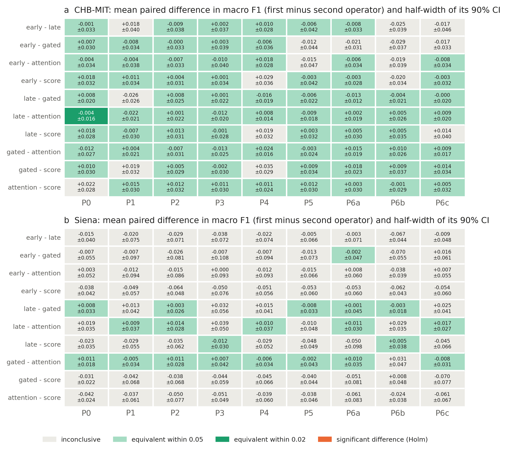
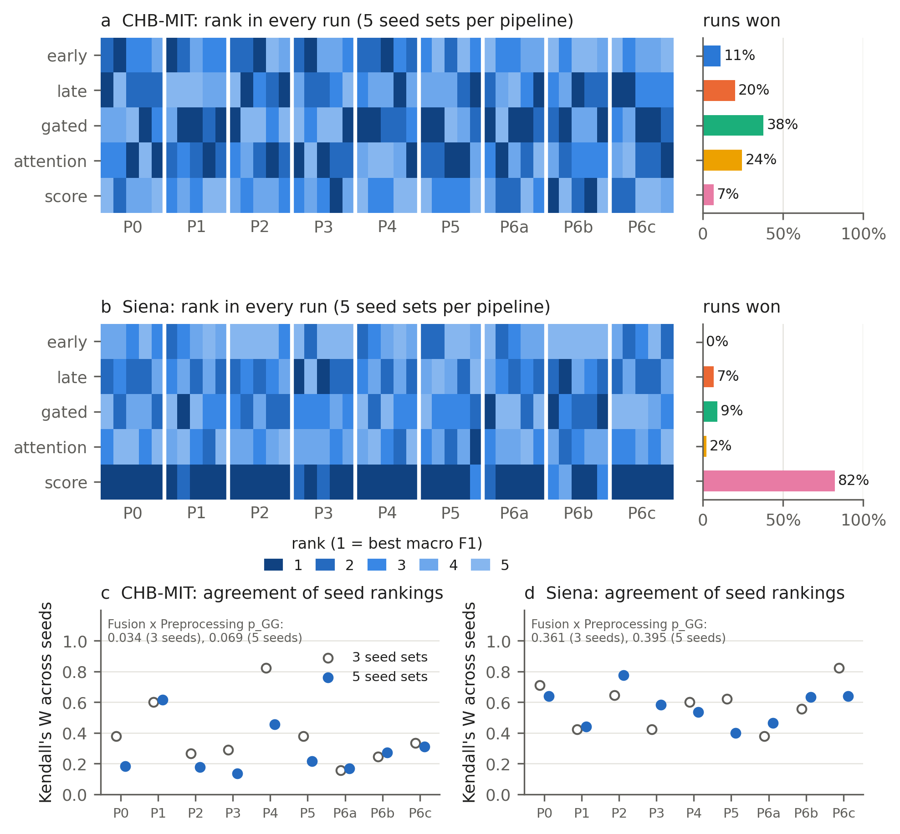
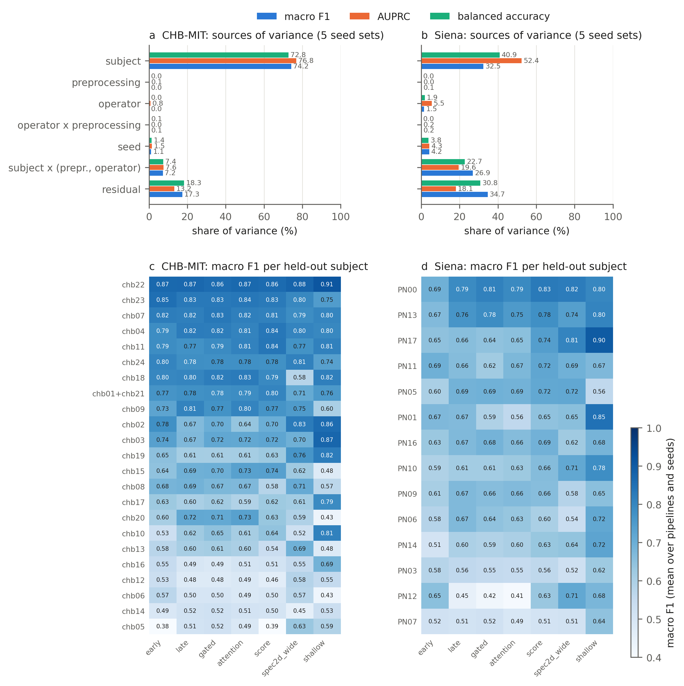
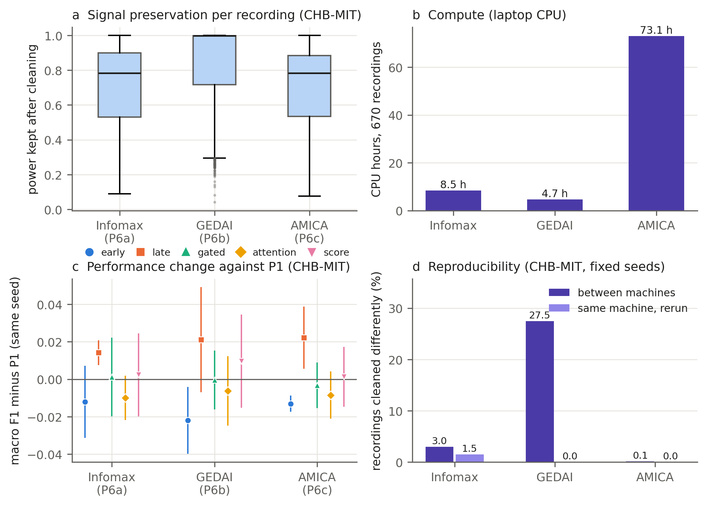
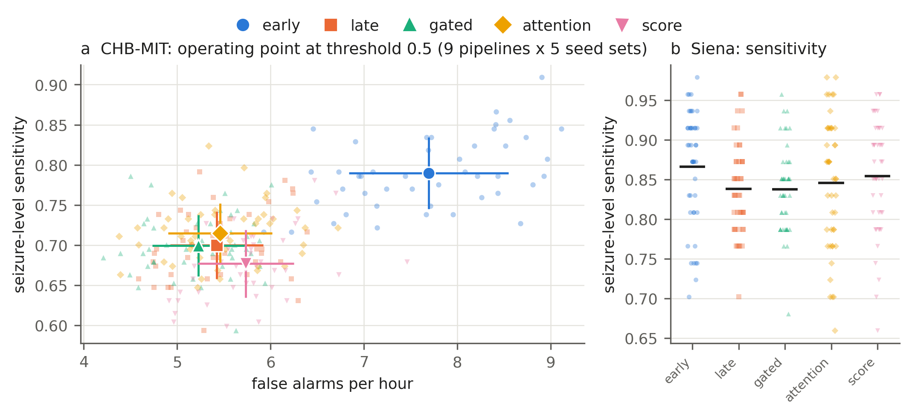
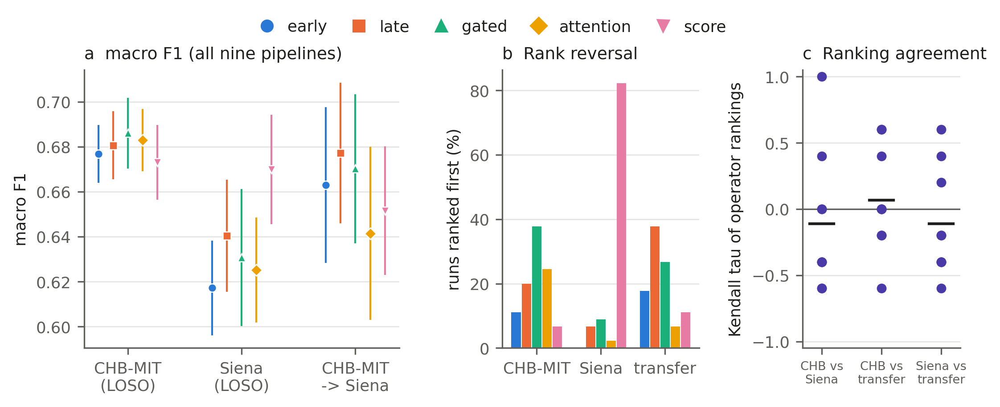
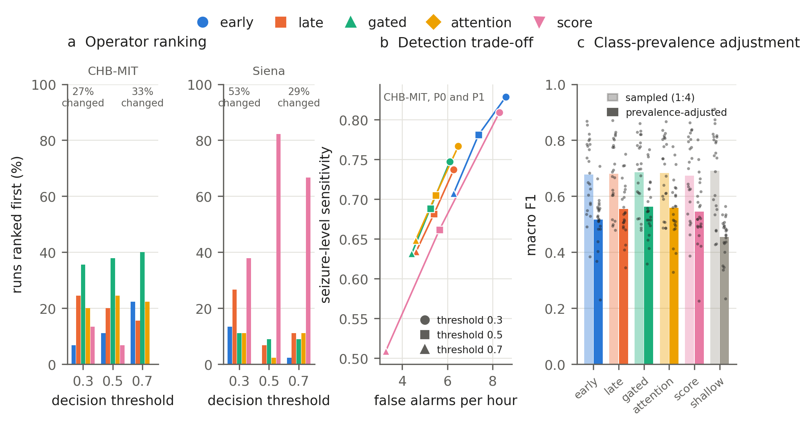

> **DRAFT v2, NOT FOR SUBMISSION.** Restructured around the three research questions the
> advisor set on 10 October 2026. This file holds the Introduction (Section 1), the
> Methods (Section 2, in the advisor's subsections 2.1 to 2.7) and the Results of the
> five-seed runs (Section 3) and the Discussion (Section 4). The literature review is
> provisional: the systematic search has run, but title and abstract screening was done
> by an AI assistant, and the human screening and the full texts follow after 17
> October; claims marked [abstract] rest on a source's abstract only and are to be
> checked against its full text. `paper/manuscript.md` is the previous draft
> (Bonn and CHB-MIT, single pipeline) and stays unchanged until this one replaces it;
> the Bonn benchmark moves to Supplementary Note 1 (advisor, 16 October 2026). Every number below is traceable to a file in the
> repository (paths given).

# Do Fusion Operators Matter, and Does the Answer Survive Preprocessing? A Parameter-Matched Multiverse Comparison of Multimodal CNN Fusion for EEG Seizure Detection

Emre Atay Tümer, Hasan Berk Berber, Sevgi Şengül Ayan
Antalya Bilim University

## Abstract

Studies of convolutional networks for EEG seizure detection that fuse the raw waveform
with its spectrogram often report that one fusion operator outperforms the others, on
one dataset, one preprocessing pipeline and one training run. We tested whether such
conclusions hold when these choices change. Five fusion operators (early, late, gated
and attention fusion, matched in parameter count, and score fusion, an ensemble of the
two single-branch networks) and single-branch and classical controls were compared
under nine preprocessing pipelines, including three artefact removal algorithms
(Extended Infomax, GEDAI, AMICA), and five seed sets, with leave-one-subject-out
evaluation on CHB-MIT (23 subjects) and Siena (14 subjects) and by training on CHB-MIT
and testing on Siena. Statistical significance (resampling-corrected tests), practical
equivalence (margins fixed in advance) and ranking stability were assessed separately.
The operators differed by a median of 0.021 (CHB-MIT) and 0.053 (Siena) macro F1 within
a pipeline, and no difference was significant. Variability associated with the
held-out subject made up 74 percent of the variance on CHB-MIT; the estimated shares of
preprocessing and the operator were zero, that of the seed 1 percent. Rankings changed between seeds (median Kendall's W 0.22 on CHB-MIT), were
more stable on Siena, where score fusion ranked first in 82 percent of runs without a
significant advantage, and did not transfer between datasets. Early fusion had the
lowest AUPRC in all 18 pipeline-dataset combinations. The controls stood to the
operators as the operators stood to each other: a spectrogram network of the same size
and a logistic regression on seven hand-crafted features reached similar or higher
mean macro F1 at the 0.5 threshold, the latter above the best operator in 43 of 45
Siena runs and the highest there at every threshold tested, but no difference was
significant. With fixed seeds and package versions, GEDAI's threshold-based cleaning
was deterministic on each machine but not across machines: it cleaned 27 percent of
recordings differently on a second machine, enough to change seizure-level sensitivity
by up to 0.054 and the order of the operators. Claims that one fusion operator is
superior, made from a single dataset, pipeline and run, are not supported.

## 1. Introduction

Electroencephalography (EEG) records the brain's electrical activity, and during an
epileptic seizure that activity changes characteristically: amplitude rises, the signal
becomes rhythmic and its power concentrates in particular frequency bands. Automatic
seizure detection is therefore a signal classification problem, and convolutional neural
networks (CNNs) are the dominant approach to it. A recurring design represents each EEG
segment twice, as the raw waveform for a 1D CNN and as its time-frequency image for a 2D
CNN, and combines the two branches with a fusion operator: early fusion of inputs or
early features, late fusion of the final feature vectors, a learned gate or attention
weighting, or a combination of the two branches' predicted scores. Studies of such
models typically report that one operator outperforms the others. Whether such a
statement holds once the analytic decisions around the comparison change is the
question of this paper.

### 1.1 Preprocessing changes what deep models achieve

Deep networks are often expected to learn from minimally processed EEG, yet the choice of
preprocessing changes their results. In the first systematic study of EEG preprocessing
for deep learning, 4,800 models trained on six tasks with four architectures differed
significantly between preprocessing pipelines; models trained on raw data ranked last on
average, and minimal pipelines without artefact handling tended to serve them best (Del
Pup et al. 2025) [abstract]. Artefact removal by independent component analysis, with
Infomax or AMICA and three component rejection strategies, did not consistently improve
deep decoding on three brain-computer interface datasets (Kang et al. 2024) [abstract],
and even the scope of normalisation changed which strategy worked best (Truong and
Delorme 2025) [abstract]. Outside deep learning the same sensitivity is documented by
multiverse analyses, which run and report every defensible combination of analysis
choices instead of one (Steegen et al. 2016; Clayson 2024): across 43 preprocessing
pipelines no single pipeline was best on every quality criterion (Huang et al. 2025)
[abstract]; fourteen pipelines drawn from the N400 literature changed statistical
outcomes, effect sizes and power (Šoškić et al. 2024) [abstract]; and only 13 of 270
analyses of frontal alpha asymmetry in depression were significant (Kołodziej et al.
2021) [abstract]. For event-related potentials, multiverse analyses have been used to
choose pipelines by their effect on data quality and reliability (Clayson et al. 2021)
[abstract]. A comparison of fusion operators made under one preprocessing pipeline
therefore cannot tell whether its ranking belongs to the operators or to the pipeline.

### 1.2 Fusion operators are compared, but not under controlled conditions

Several recent studies compare fusion operators for EEG seizure detection or prediction
directly (Table 1): five strategies within and across patients (An et al. 2026), four
operators under leave-one-subject-out evaluation, where they lie within one standard
deviation of each other (Einizade et al. 2023), three operators with paired tests over
six seeds (Basheer and Mishra 2026), and feature-level against decision-level fusion for
seizure prediction (Daşdemir and Örnek 2025). Among the studies we have read in full,
none matches the parameter counts of the compared operators, tests the differences
between them with a correction for repeated resampling, and tests them for equivalence;
a larger fusion model that beats a smaller one may owe its advantage to capacity rather
than to the way it fuses. Across more than 120 studies of hybrid EEG interfaces, only two
explored more than one fusion strategy and one asked which was best (Lee et al. 2025).
Controlled comparisons in other domains point the same way: in ECG classification 1D and
2D representations were compared with early, late and joint fusion (Narotamo et al.
2024), a controlled benchmark on tabular neuroimaging data found the fusion strategy to
matter more than the architecture (Camastra et al. 2026), and added multimodal
complexity often did not pay off (Rheude et al. 2025).

**Table 1. Closest related work** (from the systematic search of 3 October 2026; studies in bold are the closest to this one; the full
texts of the remaining candidates are still being read).

| Work | Contribution | What it leaves open |
|---|---|---|
| **An et al. (2026), fastSeizureNet** | Compares five fusion strategies for EEG seizure detection, within and across patients, with several backbones | Fuses hand-crafted with deep features rather than a waveform with its spectrogram; strategies not parameter matched and not tested against each other (a Wilcoxon test with Holm correction is used only against prior methods) |
| Einizade et al. (2023), fAttNet | Compares four fusion operators over raw EEG, wavelet packet and hand-engineered views, leave-one-subject-out on TUH | No parameter matching, no statistical test; the operators lie within one standard deviation of each other |
| Basheer and Mishra (2026) | Compares concatenation, element-wise addition and KAN gating, paired t tests over six seeds | Both streams come from the same raw EEG; uncorrected tests against concatenation only; no parameter matching |
| **Daşdemir and Örnek (2025)** | Protocol-controlled comparison of two fusion strategies for EEG | Seizure prediction, not detection; two operators; a 0.20 point accuracy difference without a stated test or parameter matching |
| Wang et al. (2026), *Neurocomputing* | Cross-attention fusion of time-domain and S-transform views, CHB-MIT and Siena | One ablation against concatenation, patient-specific evaluation, no statistical test |
| Chatzichristos et al. (2020) | Attention-gated multi-view fusion | One operator, no alternatives |
| Das et al. (2024); Huang et al. (2024) | 1D+2D fusion; multi-head attention fusion | Fixed design, no operator ablation; gains without matched parameter counts |
| Narotamo et al. (2024) | 1D and 2D representations with early, late and joint fusion | ECG; no parameter matching or corrected and equivalence statistics |
| Camastra et al. (2026), *Brain Sciences* | Controlled fusion benchmark: strategy matters more than architecture | Tabular neuroimaging features; no paired or equivalence testing |
| Ali et al. (2024) | CHB-MIT results depend heavily on evaluation choices | Not about fusion operators |
| Dan et al. (2024), SzCORE | Standard datasets, event-based scoring and metrics for seizure detection | An evaluation framework |
| Kontras et al. (2026), NeuroAtlas | Bonn is saturated (eleven models at AUROC >= 0.99) and has no subject identifiers | Not a fusion comparison |

### 1.3 One seed or one pipeline is a weak basis for a ranking

A comparison built on one training run can be decided by factors unrelated to the methods
compared. Identical training runs of deep networks produce different models: even after
weak models were excluded, accuracy differed by up to 10.8 percent between identical
runs, implementation-level factors alone caused differences of up to 2.9 percent, and
only about one fifth of the surveyed papers used repeated runs to quantify this (Pham et
al. 2020) [abstract]. Every source of nondeterminism in network optimisation, down to a
one-bit change in the initial parameters, produces similar run-to-run variability, which
makes small improvements hard to separate from noise (Summers and Dinneen 2021)
[abstract], and seeds that perform far better or worse than average are easy to find
(Picard 2021) [abstract]. The computing environment adds its own variance: CPU
multithreading makes training nondeterministic (Xiao et al. 2021) [abstract],
floating-point non-associativity in parallel computation causes run-to-run differences
(Shanmugavelu et al. 2024) [abstract], and reproducible training requires control of
both software randomness and hardware nondeterminism (Chen et al. 2022) [abstract]. In
speech recognition, training variance was large enough to call for a change in how
results are reported (van den Berg et al. 2017) [abstract], and seed-induced variability
can be tested for directly (Banerjee et al. 2025) [abstract]. The statistics add a further
trap: under repeated cross-validation the training sets overlap, so standard paired
tests are overconfident unless their variance is corrected (Nadeau and Bengio 2003;
Bouckaert and Frank 2004), and whether a comparison comes out significant can depend on
the number of folds and repeats (Jafrasteh et al. 2025).

### 1.4 Results on one dataset rarely carry over to another

High accuracies reported for automatic seizure detection often do not hold on new
patients or recording sites. When 28 algorithms from the SzCORE challenge were evaluated
on 4,360 hours of held-out continuous EEG from 65 subjects, the best F1 score was 32
percent, far below self-reported results, and the algorithms with the highest aggregate
score were not the most consistent across subjects (Dan et al. 2025, preprint)
[abstract]; the same group proposed standard datasets, cross-validation strategies and
event-based metrics to make such comparisons possible (Dan et al. 2024). Real-time
detectors had been tested in distinct settings until they were compared under one (Lee
et al. 2022, preprint) [abstract]; a prospective test on about 14,590 hours of adult EEG
from another continent reported 76.68 percent with about 56 false alarms per 24 hours
(Yang et al. 2021, preprint) [abstract]; and a systematic review names generalisability
across training data and acquisition hardware among the main obstacles to clinical
translation (Moutonnet et al. 2024, preprint) [abstract]. Within one public corpus, CHB-MIT
results depend heavily on evaluation choices (Ali et al. 2024), and the Bonn corpus,
long a standard benchmark, is saturated and carries no subject identifiers, so it cannot
test generalisation across patients (Kontras et al. 2026).

### 1.5 This study

Our contribution is not another fusion operator, nor only a comparison of existing
ones: it is a test of how far conclusions drawn from such a comparison hold when the
analytic decisions around it change. We hold the backbone, the training protocol and the
parameter budget fixed (the four jointly trained operators within 0.4 percent; score
fusion, an ensemble of the two branches, is compared alongside them but is not
parameter-matched), vary only the fusion operator, and repeat
the whole comparison under nine preprocessing pipelines, including three artefact
removal algorithms, and five seed sets, on two independent corpora and from one to the
other. We ask three questions.

- **RQ1, performance robustness.** Do fusion operators maintain their predictive
  performance across different EEG preprocessing pipelines?
- **RQ2, ranking robustness.** Are the rankings of fusion operators stable across
  preprocessing choices, artefact removal algorithms and stochastic training?
- **RQ3, cross-dataset generalisation.** Do fusion performance patterns and rankings
  generalise across independent EEG seizure datasets?

Throughout, three properties are kept apart, because each can hold without the
others: **statistical significance** (is there evidence of a difference between two
operators?), **practical equivalence** (does their difference lie within a margin
fixed in advance?) and **ranking stability** (is their order preserved when
preprocessing or seeds change?). In particular, the absence of a significant
difference is not taken as evidence of equivalence.

The study contributes:

1. a comparison of five fusion operators, four of them jointly trained and matched in
   parameter count and the fifth a decision-level ensemble outside that matching, with
   single-branch and classical controls, crossed with nine preprocessing pipelines and five seed sets on
   CHB-MIT and Siena, and a transfer experiment from one to the other;
2. an analysis that separates the effects of preprocessing, seed and their interaction
   with the operator, and reports each operator's full rank distribution rather than a
   single ranking;
3. a test of the reproducibility of three artefact removal algorithms across machines
   and execution contexts, and of how much their irreproducibility changes the
   comparison itself;
4. corrections to the source data and its documentation: a labelling error in CHB-MIT's
   annotations, two of its cases that are one person and must be held out together, a
   mains notch that has to follow each dataset's line frequency, and six problems in
   Siena's seizure lists, each resolved and documented;
5. the code, the per-fold results of every run, and every analysis, public and
   regenerated by single commands.

## 2. Methods

Figure 1 summarises the design: the
datasets, the nine preprocessing pipelines, the two representations, the fusion
operators and controls, and the evaluation; its panel b shows where each step is
applied and how leakage between training and test data is prevented.

**Figure 1.** Study design. **a**, The multiverse: two datasets harmonised to 18 bipolar channels at 256 Hz and 10 s windows; nine preprocessing pipelines, each trained with five seed sets; a 1D CNN on the raw waveform and a 2D CNN on the log-STFT, combined by five fusion operators, four jointly trained under a matched parameter budget and score fusion as a decision-level ensemble of the two branches at their own size, with single-branch and classical controls; evaluation by leave-one-subject-out (LOSO) at the window and the seizure level. **b**, Where each step is applied and how leakage is prevented: whole persons are held out (chb01 and chb21 together), and validation persons serve only early stopping and the score fusion weight; P4 rejects windows from training and validation data only, so every pipeline is tested on the same windows; P6 cleans each recording on its own, without seizure labels.

### 2.1 Datasets and EEG harmonisation

**CHB-MIT** (Shoeb 2009; Goldberger et al. 2000) holds 686 scalp recordings, 982.9 h,
from 24 paediatric cases at 256 Hz in a bipolar montage. Two cases, chb01 and chb21,
are documented as the same person and are treated as one subject, which gives 23
subjects. We use the standard 18-channel bipolar (double banana) montage and keep the
683 recordings that contain all 18 channels, with 185 of the 198 annotated seizures in
the windowed corpus; the three dropped recordings belong to part of subject chb12's
data recorded in a different montage. Seizure annotations were parsed by order rather
than by their printed number, which corrects a labelling error in `chb09_08.edf`
(`src/chbmit.py: parse_summary`).

**Siena Scalp EEG** (Detti et al. 2020) holds 41 recordings, 141.0 h by the EDF
headers, from 14 adult patients, with 47 annotated seizures, recorded at 512 Hz in a
referential 10-20 montage (older electrode names T3 to T6 are mapped to T7, T8, P7,
P8). Six problems in the published seizure lists (a seizure ending after its
recording, two conflicting onset or end times, two start times that disagree with the
EDF headers, an onset given only clinically) were resolved before any analysis, each
as either a correction verified against the recording or a stated decision rule;
Supplementary Table S4 lists every decision, how it was checked, its remaining
uncertainty, and how much the alternative would change the windows (`docs/SIENA.md`).

**Harmonisation.** Siena is converted to the CHB-MIT form before anything else: the
18 bipolar channels are formed as electrode differences of the referential signals,
and the continuous recording is resampled from 512 to 256 Hz with a polyphase filter
(`scipy.signal.resample_poly`, factor 1/2; `src/siena.py: read_bipolar`). Both
corpora then pass through identical code. Seizure times are converted to seconds from
each recording's first sample using the EDF header start time (modulo 24 h for
recordings past midnight).

**Windows and labels.** Recordings are cut into non-overlapping 10 s windows. A window
is ictal if it overlaps an annotated seizure at all. Non-ictal windows are subsampled
per subject to four per ictal window of that subject, with a fixed seed, and every
subject's true recording duration is kept for the event metrics (Section 2.5). This
gives 6,380 windows (1,276 ictal) for CHB-MIT and 1,640 windows (328 ictal) for Siena,
exactly four non-ictal windows per ictal window in every subject. The CHB-MIT windows
come from 670 of the 683 recordings; no window was drawn from the other 13, all of them
without seizures. The same windows are used by every pipeline, which is checked
whenever a pipeline's corpus is built, so all comparisons between pipelines are paired
window by window.

**Class prevalence.** The fixed ratio gives every pipeline, operator and subject the
same class distribution, so that window-level results are comparable across them.
Consequently, the window-level evaluation reflects this controlled sampling
distribution, with 20 percent ictal windows, rather than the natural prevalence of
seizures in continuous EEG, which is far lower (0.4 percent of all 10 s windows of the
CHB-MIT recordings, 0.6 percent in Siena's recordings, which are cut around seizures). Window-level metrics, and macro F1 at a fixed threshold in particular, should
therefore be interpreted within this experimental setting and not as the performance
expected on continuous recordings. The seizure-level evaluation (Section 2.5) runs on
the original, complete recording timelines and complements it.

**Differences between the datasets.** The two corpora differ in age (mostly children
against adults), seizure types, recording length per patient (Siena's
recordings are cut around seizures for a seizure prediction study), centre,
equipment and mains frequency (60 Hz in Boston, 50 Hz in Italy). Results are
compared between them as an independent replication and a transfer test (RQ3), not
interpreted as an age or population effect: because the datasets differ in several of
these respects at once, no difference between them can be attributed to any single
one.

### 2.2 Preprocessing multiverse

Following the multiverse approach (Steegen et al. 2016), nine defensible
preprocessing pipelines are crossed with every model, operator and seed instead of
choosing one. Each pipeline changes one hypothesis-driven aspect; windows, labels,
spectrogram settings, models, training and evaluation are fixed (`src/preprocess.py`).

| Pipeline | Band-pass | Notch | Artefact handling | Normalisation | Question |
|---|---|---|---|---|---|
| P0 | none | none | none | z-score | original benchmark |
| P1 | 0.5 to 40 Hz | none | none | z-score | standard EEG band |
| P2 | 0.5 to 70 Hz | mains (CHB-MIT 60 Hz, Siena 50 Hz) | none | z-score | information above 40 Hz |
| P3 | 1 to 40 Hz | none | none | z-score | low frequency content and drift |
| P4 | 0.5 to 40 Hz | none | technical artefact rejection (training only) | z-score | artefact rejection |
| P5 | 0.5 to 40 Hz | none | none | median and IQR | normalisation |
| P6a | 0.5 to 40 Hz | none | Extended Infomax ICA | z-score | artefact removal |
| P6b | 0.5 to 40 Hz | none | GEDAI | z-score | artefact removal |
| P6c | 0.5 to 40 Hz | none | AMICA | z-score | artefact removal |

**Order of operations.** Each continuous recording is band-pass filtered, notch
filtered (P2) and cleaned (P6), in that order; it is then cut into the fixed windows,
P4's rejection rule is applied, and each window is normalised. The spectrogram is
computed from the normalised window.

**Filters.** Zero-phase Butterworth filters (order 4, forward and backward) are
applied to each continuous recording before it is windowed, so that no filter
transient falls at a window edge. P2's notch removes each dataset's own mains
frequency and its first harmonic; with a fixed 60 Hz notch Siena's P2 windows kept a
50 Hz line 318 times stronger than the 40 to 48 Hz background, so P2 was defined per
dataset and its Siena runs were repeated.

**Normalisation.** Each channel of each window is standardised on its own: z-score
(P0 to P4, P6) or median and interquartile range (P5). No statistic is computed across
windows, recordings or persons, so normalisation cannot carry information from test to
training data.

**P4, technical artefact rejection.** Amplitude was measured before a criterion was
chosen: every amplitude threshold removes seizures selectively (500 uV rejects 72
percent of CHB-MIT's ictal and 48 percent of its non-ictal windows), because ictal
windows have larger amplitudes. P4 therefore rejects only technical artefacts: a flat
channel (standard deviation below 1 uV in the window) or a constant run of at least
0.5 s on any channel (a signal dropout), detected on the unfiltered signal. In CHB-MIT
this rejects 42 of 1,276 ictal (3.3 percent) and 39 of 5,104 non-ictal windows (0.8
percent); the difference reflects which recordings have dropouts, not physiology
(Supplementary Table S3). In Siena it rejects one window. Rejected windows are removed
from training and validation only; the test windows are those of every other
pipeline.

**P6, three artefact removal algorithms.** P6 applies Extended Infomax ICA (Lee et al.
1999; MNE-Python, Gramfort et al. 2013), GEDAI (Ros et al. 2025) or AMICA (Palmer et
al. 2008; `jamica`) to the same 0.5 to 40 Hz signal, recording by recording.
Infomax and AMICA share every setting and one component rejection rule: 16 components
(the 18-channel bipolar montage has rank 16, because it contains two closed electrode
loops per hemisphere), fitted on every 8th sample, with components removed when their
correlation with any of the four frontopolar channels, used as EOG proxies since
neither dataset has an EOG channel, has |z| > 3 (MNE `find_bads_eog`). Muscle
components are not removed, because the gamma band carries the strongest ictal signal
in CHB-MIT. GEDAI is not an ICA: it removes what departs from a leadfield-based
reference covariance, by its own criterion, so the shared rule cannot apply. Its
reference covariance C, defined for a referential layout, is mapped onto the bipolar
montage as D C D^T (D the electrode difference matrix), and the channel mean is removed
before and restored after cleaning. GEDAI's threshold preset was fixed before any
classification run, on signal preservation alone: on six CHB-MIT subjects the default
removed more than half of the power of 39 percent of recordings, the conservative
preset of 17 percent; the conservative preset removed no more from ictal than from
non-ictal windows, whereas the default kept a lower median share of the ictal power
(0.78 against 1.00; Supplementary Table S2); P6b uses the conservative preset. The comparison among P6a,
P6b and P6c is therefore a comparison of whole cleaning procedures: for Infomax and
AMICA it isolates the decomposition algorithm, while GEDAI differs also in how it
decides what to remove. Signal retention and compute are in Supplementary Table S1, and the power removed by band
and class in Supplementary Table S5.

**No leakage through P6.** Each recording is decomposed and cleaned on its own, from
its own unlabelled signal; seizure annotations are never used, and no decomposition,
threshold or statistic is shared between recordings or persons. A test person's
recordings are therefore cleaned exactly as they would be without any training data.

**Offline processing.** Filtering and artefact cleaning are applied to complete
recordings before windows are extracted, so a window's cleaned signal depends on data
recorded after it. These experiments therefore evaluate the robustness of offline
preprocessing and do not represent a causal, real-time seizure detection pipeline, in
which only past signal is available.

### 2.3 EEG representations and fusion strategies

**Representations.** Each 10 s window enters the network twice: as the 18-channel
waveform (2,560 samples per channel) and as its log-magnitude short-time Fourier
transform, log(1 + |STFT|), computed per channel with a 1 s Hann window, 0.5 s hop and
256-point FFT and cropped at 64 Hz (65 frequency bins by 19 frames;
`src/chbmit_prep.py`). The 64 Hz ceiling is kept in every pipeline, so input shapes and
parameter counts never change.

**Architecture.** A 1D convolutional encoder (channel widths 16, 32, 64) processes the
waveform and a 2D convolutional encoder of matching depth the spectrogram; each yields
a 128-dimensional pooled feature vector. Five interchangeable fusion operators combine
them:

- **Early:** the waveform passes a small strided 1D encoder, is broadcast along the
  spectrogram's time axis and concatenated to it as an extra channel before the 2D
  backbone (architecturally an intermediate fusion, since the two inputs share no
  tensor shape).
- **Late:** the two feature vectors are concatenated and classified by a small MLP.
- **Gated:** a learned scalar gate per branch reweights the concatenated features.
- **Attention:** a learned attention module weights the branches from both feature
  vectors jointly.
- **Score:** the two branches are trained as independent classifiers and their
  probabilities blended, p = w p_waveform + (1 - w) p_spectrogram, with the weight w
  chosen on the validation subjects only, by minimising their log loss over a 41-point
  grid from 0 to 1.

**Parameter matching.** Every jointly trained model (the four joint operators and two
widened single-branch controls) is sized to a common budget by solving the fusion
head's hidden width numerically (`src/models.py`): with 18 input channels the models
have 102,236 to 103,712 parameters, the four joint operators within 0.36 percent of
each other. Score fusion, an ensemble of two independently sized classifiers, keeps
its natural size: it blends the probabilities of the two default-width single-branch
controls below (28,850 and 34,546 parameters, 63,396 together, about 62 percent of the
budget). Score fusion is retained as a complementary decision-level strategy: because
its architecture and training differ from those of the jointly trained models, it is
part of the broader practical comparison of operators but not of the strictly
parameter-matched architectural comparison, which concerns early, late, gated and
attention fusion (102,547; 102,768; 102,921 and 102,767 parameters).

**Controls.** The two single-branch networks at their default width (raw1d, spec2d)
and widened to the fusion budget (raw1d_wide, spec2d_wide), which asks whether fusion
beats a unimodal model of the same size; and two classical baselines without
representation learning, a logistic regression on log variance (logvar) and on seven
hand-crafted features (log variance, line length and relative power in five bands;
shallow), 19 and 127 parameters with the intercept. The networks see the same windows
and preprocessing as the operators. The logistic regressions (standardised features,
class-balanced weights, C = 1, no tuning) need no early stopping, so they are fitted
on all training subjects, including the four (Siena: three) that the networks set aside
for validation; this favours the classical baselines, if anything.

### 2.4 Experimental protocol

**Leave one subject out.** All evaluation is subject-independent. Each subject is held
out once as the test set (23 folds on CHB-MIT, 14 on Siena), and all recordings of one
individual are assigned to the same partition (chb01 and chb21 are held out together).
Within each outer fold, validation subjects are selected exclusively from the remaining
training subjects, and the held-out subject is excluded from all training, early
stopping and model selection. The selection is deterministic and does not look at
any result: the remaining subjects are ordered by their number of ictal windows, and
round(0.2 n) of them (4 of 22 on CHB-MIT, 3 of 13 on Siena) are taken at evenly spaced
positions of that order, so the validation set spans the range of seizure burdens and
always contains ictal windows. It serves early stopping and the score fusion weight
only. No subject's windows and no seizure's windows ever appear in two of the
training, validation and test partitions; an automatic check of every fold confirms
this for both datasets and that every stored run held out the same subjects in the
same folds (`src/audit_methods.py`), and the leakage checker was itself validated on a
deliberately leaky split (`src/chbmit_corpus.py`).

**Training.** AdamW (Loshchilov and Hutter 2019), learning rate 1e-3, weight decay
1e-4, batch size 32, class-weighted cross-entropy; early stopping on validation macro
F1 with patience 12 after a minimum of 20 epochs, at most 60 epochs. The minimum guards
against a model stopping in a trivial single-class solution, found in an early audit.
These settings, and the architectures, were fixed before the multiverse runs and not
tuned: there was no hyperparameter search or optimisation, the same values were used
for every model, pipeline and dataset, and the validation subjects served only early
stopping and the score fusion weight. The reported performance is therefore that of a
fixed, untuned configuration rather than the best each operator could reach.

**Seeds.** Every pipeline is run with five seed sets. A run's seed for each fold and
model is derived from the seed set, fold and model (`src/config.py: fold_seed`), so it
does not depend on execution order. It sets the weight initialisation, the order of
the mini-batches and the dropout masks. It does not change the data: the window
sampling (one fixed seed), the validation subjects (deterministic) and the artefact
cleaning (a seed per recording) are the same in every seed set, so differences between
seed sets reflect stochastic training alone. The ranking of the operators was unstable across
three seed sets (Kendall's W below 0.5 in seven of nine CHB-MIT pipelines); after these
three-seed results, the extension to five seed sets was decided,
to estimate the seed variance more reliably. It was not a rule fixed beforehand.

**Cross-dataset experiment (RQ3).** Each model is trained once on all CHB-MIT subjects
(with the same inner validation rule) and tested on every Siena window and recording,
for every pipeline and seed set (`src/cross_dataset.py`). The pipeline is applied to
each dataset as defined, including each dataset's own mains notch in P2. Siena is
used for testing only: the validation subjects are drawn from CHB-MIT, and no Siena
window enters training, early stopping, the score fusion weight or any other choice.
Results are reported per Siena patient. The experiment asks whether the relative
performance of the operators persists when the dataset changes. Because the datasets
differ in population, acquisition and recording protocol (Section 2.1), it measures
their combined distribution shift and does not isolate any single source of it.

### 2.5 Evaluation metrics

**Window level (primary).** Macro F1 and the area under the precision-recall curve
(AUPRC) are primary; balanced accuracy (the mean of sensitivity and specificity) is
reported alongside, with AUROC and the Brier score as secondary. A window is
predicted ictal when its ictal probability exceeds 0.5, for every model and control
alike. AUPRC is computed as average precision (scikit-learn) from the predicted ictal
probability, with the ictal class as the positive class; it assesses how well the
probabilities rank ictal above non-ictal windows across all thresholds, complementing
the threshold-dependent macro F1. Metrics are computed per fold on the held-out
subject's windows and averaged over folds within a run, each fold with equal weight.
The subject is the unit of generalisation and of the statistical tests; pooling
windows instead would let the subjects with the most seizures dominate the average.

Window-level classification and seizure-level detection are evaluated separately
because they address different aspects of performance: macro F1 and AUPRC describe
classification under the controlled window sampling (Section 2.1), whereas
seizure-level sensitivity and false alarms per hour are assessed on the original
recording timelines with event-scoring rules fixed in advance. A model can classify
windows well and still miss seizures or raise many false alarms.

**Seizure level (secondary, clinical).** Every model saved for a fold is applied to
every 10 s window of every recording of the held-out subject, not only the subsampled
test windows, after the pipeline's own preprocessing; a window is positive when its
probability exceeds 0.5, with no further post-processing. Detections are scored
against the annotated seizures with SzCORE's event scoring (Dan et al. 2024;
`timescoring` 0.0.7, defaults: 30 s tolerance before onset and 60 s after offset, any
overlap counts, events closer than 90 s merged, events longer than 5 min split).
Seizure-level sensitivity is the share of seizures detected; the false alarm rate is
false-positive events per hour on the true recording time. The scored recordings hold
187 seizures in 979.9 h (CHB-MIT) and 47 seizures in 141.0 h (Siena). On CHB-MIT these
are the 185 annotated seizures of the 683 recordings in the target montage (of 198 in
the dataset, Section 2.1); one of them, in chb11_99, lasts 752 s and is split by the
5 min rule into three reference events, and in no other recording does merging or
splitting change the count (`results_v2/audit/methods_audit.md`). Scoring the
window labels themselves as predictions detects all of them without a false alarm,
which checks the reference, the windows and the scoring together. On Siena only
sensitivity is reported: its recordings are cut around seizures, so a false alarm
rate would not describe continuous monitoring. The criterion, the merging of
consecutive detections and the counting of false alarms were fixed, and committed,
before any multiverse run (`docs/EVENTS.md`), and are the same for every operator and
pipeline.

### 2.6 Statistical analysis

**Pairwise comparisons.** Leave-one-subject-out folds share training data, so the
standard paired test overstates significance; in a simulation of two equivalent
classifiers the naive paired Wilcoxon test rejected in 37.6 percent of cases at a
nominal 5 percent (`src/sim_cv_correlation.py`). On the Bonn corpus, studied in an
earlier stage of this project, the naive test found 13 to 22 significant pairs among
55 per task and the corrected test none among the deep models (Supplementary Note 1).
Because LOSO training sets overlap substantially, pairs of operators are compared with
the resampling-corrected paired t test (Nadeau and Bengio 2003) rather than treating
the held-out folds as independent observations. The test inflates the variance of the
mean fold difference from var(d)/k to (1/k + n_test/n_train) var(d), on k - 1 degrees
of freedom. We count subjects: n_test/n_train = 1/22 on CHB-MIT and 1/13 on Siena, the
held-out subject against the subjects outside it. Since 4 (Siena: 3) of these serve as
validation subjects, the networks are fitted on 18 (10); with that conservative ratio,
1/18 and 1/10, no operator pair becomes significant and the pairs equivalent within
0.05 fall from 73 to 70 of 90 on CHB-MIT and from 21 to 19 on Siena
(`results_v2/audit/methods_audit.md`). Subjects contribute different numbers of
windows, but each fold enters the test as one observation (Section 2.5). Seed sets are
averaged within each fold before testing, so the five seed sets and nine pipelines
never inflate the number of independent observations, which is always the number of
subjects.

Multiplicity is addressed with Holm correction within predefined families: the ten
operator pairs of one pipeline, for one dataset and metric, form one family (nine
families per dataset); the 30 comparisons of the six controls with the five operators
in one pipeline form another.

**Practical equivalence.** For each pair the two one-sided test with the same
corrected variance gives the smallest margin within which the pair is equivalent at
alpha = 0.05; a pair is equivalent if that margin is at most 0.05 macro F1 (main
analysis) and, as a stricter sensitivity analysis, 0.02. Both margins were fixed and
committed before any multiverse result existed. A pair is robustly equivalent if it is
equivalent in every pipeline. Statistical significance and practical equivalence are
assessed separately: failure to reject equal performance is not interpreted as
evidence of equivalence. The corrected test, the equivalence bound, the Holm
adjustment and Kendall's W were checked against independent re-implementations
(`src/audit_methods.py`).

**Ranking stability.** In every run (pipeline and seed set) the five operators are
ranked by mean macro F1. We report each operator's full rank distribution (counts per
rank, median, best and worst rank, share of runs won and lost), Kendall's W across
seed sets within each pipeline, and Kendall's tau between the seed-averaged rankings of
every pair of pipelines. Whether preprocessing changes the ranking more than the seed
does is tested by comparing the mean tau between seed sets of the same pipeline with
the mean tau between pipelines, against a null distribution from 10,000 permutations
of the pipeline labels within each seed set; the same test is run among P6a, P6b and
P6c alone.

**Fusion x Preprocessing.** A repeated-measures ANOVA on macro F1 (seed means) treats
the held-out subjects as the repeated units and pipeline and operator as within-subject
factors; each effect is tested against its interaction with subject, with
Greenhouse-Geisser correction. Effect sizes are reported as partial eta squared.

**Variance components.** For macro F1, AUPRC and balanced accuracy, the fully crossed
subject x pipeline x operator x seed design is decomposed as y = mu + subject +
pipeline + operator + seed + every interaction, all treated as random effects
(generalizability theory) and estimated by the method of moments from the expected
mean squares. With one observation per cell the four-way interaction is the residual.
Every component is reported unrounded, as an estimated variance, as a standard
deviation in the metric's own units (a practical size) and as a share of the total;
negative estimates, which arise when an effect's mean square is smaller than its error
term, are reported as such and set to zero in the shares. The components are
descriptive estimates of the variability associated with the held-out subject, the
pipeline, the operator and stochastic training. A share of zero is therefore not proof
that an effect is absent, and the subject component is read as subject-associated
variability: it collects everything that differs between held-out subjects, of which
individual physiology is only one part, together with seizure count and type, recording
length and recording conditions.

**Prediction stability.** The agreement (Cohen's kappa) of window-level predictions
between pipelines at the same seed set is compared with the agreement between seed
sets in the same pipeline.

Statistical significance is reported from the corrected tests and the ANOVA, practical
size from the equivalence margins and the variance components in metric units, and
ranking stability from the rank analyses; a result in one of these three is never
used as evidence for another. All analyses are implemented in `src/multiverse.py` and
were validated on synthetic runs with known effects (39 checks).

**Post hoc sensitivity analyses.** To examine the sensitivity of the main conclusions to
evaluation choices, we conducted four exploratory post hoc analyses after completion of
the primary multiverse experiments. First, the stored window-level predictions of every
model, in all nine pipelines, five seed sets and both datasets, were re-evaluated at
decision thresholds of 0.3 and 0.7, in addition to the prespecified threshold of 0.5.
Operator rankings and paired comparisons were recalculated with the original
subject-level evaluation units (the corrected test on fold values, seed sets averaged).
Holm-adjusted comparisons were examined both within each threshold (the ten operator
pairs of one dataset, pipeline and threshold, the family used above) and, as an
additional multiplicity sensitivity check, across the three thresholds (the thirty
comparisons of one dataset and pipeline). Second, seizure-level sensitivity and
false-alarm rates were re-evaluated at the same thresholds for pipelines P0 and P1 (five
seed sets each), applying the saved models to the complete recordings of both datasets
without retraining or post-processing; false alarms per hour are reported for CHB-MIT
only. Third, we estimated the effect of the 1:4 non-ictal-to-ictal sampling on macro F1
for CHB-MIT by reweighting each held-out subject's confusion matrix at the 0.5
threshold: every non-ictal test window was weighted by the ratio of its case's non-ictal
windows in the complete recordings to those sampled (15 to 334), ictal windows by one,
so that true positives and false negatives keep their counts while false positives and
true negatives are scaled to the full non-ictal count. Macro F1 was computed per
held-out subject and averaged with equal weight, as in the primary analysis; a pooled
version, which sums the confusion matrices of all subjects first, is reported alongside
(Supplementary Table S10b). These prevalence-adjusted estimates assume that the sampled
non-ictal windows are representative of the non-ictal windows not included in the
primary evaluation; they do not constitute direct evaluation on the complete
natural-prevalence window distribution. Finally, subject-level paired bootstrap
intervals were computed as an alternative assessment of inferential sensitivity: 10,000
resamples of the held-out subjects, in which both operators' results of a drawn subject
enter together, with percentile 95 percent intervals, and a variant that also resamples
the five seed sets within each drawn subject. Unlike the corrected test, the bootstrap
does not model the overlap of the LOSO training sets. Because these analyses were
specified after inspection of the primary results, they were treated as exploratory
robustness assessments rather than confirmatory hypothesis tests. The primary corrected
comparisons and the prespecified equivalence analyses remained unchanged
(`src/sensitivity_preds.py`, `src/posthoc_checks.py`; Supplementary Tables S9 and S10).

### 2.7 Reproducibility and computational cost

**Software and hardware.** Two environments were used (Table 2); artefact removal
needs a newer numpy than the training code and runs in its own environment
(`requirements.txt`, `requirements-ica.txt`). The software versions and the hardware of
every run are recorded in its `meta.json`.

**Table 2.** Computational environments.

| | Training and window-level evaluation | Artefact removal (P6) and seizure-level evaluation |
|---|---|---|
| Used for | all LOSO and cross-dataset runs (135 runs) | the P6 corpora; applying the saved models to every window of every recording |
| Machine | lab PC: 2 x Intel Xeon (Skylake-SP), 64 logical CPUs; NVIDIA GeForce RTX 5070 | laptop: Intel Core Ultra 7 155U, 14 logical CPUs; no CUDA GPU |
| Operating system | Windows 10 (build 19045) | Windows 11 (build 26300) |
| Python | 3.12.10 | 3.12.7 |
| Numerical libraries | PyTorch 2.8.0 (CUDA 12.8 build), numpy 1.26.4, scipy 1.16.1, scikit-learn 1.7.2 | PyTorch 2.8.0 (CPU build), numpy 2.5.3 (OpenBLAS), scipy 1.16.1, scikit-learn 1.7.2, MNE 1.13.2, GEDAI 0.60, jamica 0.3.0, timescoring 0.0.7 |
| Threads | 16 CPU threads | 14 (BLAS) |
| Seeds | per seed set, fold and model (`fold_seed`) | per recording, from its file name (crc32) |
| Determinism | PyTorch deterministic algorithms on the GPU | CPU only |

**Determinism and device.** All training runs of one analysis use one machine, one device and
16 CPU threads, and CPU and GPU runs are never mixed in one analysis. On the CPU a run
was reproduced bit for bit, also with two runs sharing the machine. The multiverse ran
on the GPU with PyTorch's deterministic algorithms; adaptive average pooling has no
deterministic CUDA backward, yet two GPU runs of the same fold were identical. Before
switching to the GPU, its agreement with the CPU was tested at identical seeds: over
five folds the mean absolute macro F1 difference between CPU and GPU was 0.074,
slightly larger than the 0.066 between two CPU seed sets (`python -m src.compare_runs`;
`docs/PIPELINE.md`). The criterion fixed beforehand, a CPU-GPU difference no larger than
the difference between seed sets, was therefore narrowly missed. The CPU-GPU difference
is comparable in size to the variation between stochastic training runs; this similarity
does not establish that hardware-related numerical differences and seed effects arise
from the same mechanism, and we make no claim about the cause.

**Reproducibility conditions.** Reproducibility was examined at the level of the
preprocessing and of the downstream predictions (Table 3). Identical preprocessing
configurations were run in different computational environments, and the differences
in the cleaned signals were followed into the classification and seizure-level
metrics.

**Table 3.** What was held fixed and what varied in each reproducibility comparison.

| Comparison | Held fixed | Varied | Measured |
|---|---|---|---|
| Training, repeat on CPU | code, data, seeds, machine, threads | nothing (also two runs sharing the machine) | fold metrics: bit-identical |
| Training, repeat on GPU | code, data, seeds, machine, GPU, deterministic mode | nothing | fold metrics: identical |
| Training, CPU against GPU | code, data, seeds, machine | device (CPU or GPU) | macro F1 difference, against that between seed sets |
| Artefact removal, two machines | code, input recordings, package versions, seeds, BLAS kernel | machine (laptop, lab PC), thread count | components removed, power kept, per recording; 670 CHB-MIT recordings |
| Artefact removal, same machine | code, input, versions, seeds, machine | process parallelism (run alone or in parallel workers) | as above |
| Artefact removal, third machine | code, input, versions, seeds | architecture (ARM, macOS) | as above, on a subset of recordings |
| Rounding perturbation | everything | input multiplied by 1 + 1e-7 N(0, 1) | as above |
| Effect on outcomes | trained models, test recordings | cleaned signals (training-time against event-time cleaning) | seizure-level sensitivity, false alarms, rankings |

**Reproducibility of artefact removal.** Fixing seeds and package versions did not
make P6 reproducible across machines and execution contexts (`docs/ICA_REPRO.md`).
AMICA removed the same components in every recording on every machine and in every
execution context; the power it kept differed by at most 0.003 between machines and
0.0007 between two runs on the same machine. Extended Infomax removed different components in
recordings whose component lay near the |z| = 3 rule: 2.5 percent of recordings between
two machines and 1.2 percent between two runs on the same machine with different
process parallelism. GEDAI was deterministic on each machine but gave a different
result on the second machine in 27 percent of recordings, often by a large amount.
A third machine of another architecture (ARM) agreed with the other two on recordings
where they agreed, and often with neither where they differed. Multiplying the input by
(1 + 1e-7 N(0, 1)), a rounding-level perturbation, changed GEDAI's result on exactly the
recordings that differed between machines, also on a full-rank montage, and Infomax's
component decision on recordings where it had differed; AMICA was unchanged. This is
consistent with a sensitivity of the methods to rounding near a decision threshold on
particular recordings rather than with a fault of one machine or library, but it does
not identify the numerical mechanism, and the differences are reported as an empirical
reproducibility limitation. All three methods were compared on the same criteria: the
components removed and the share of signal power kept, per recording.
Window-level results are unaffected, because every P6 training and test window comes
from one set of signals, cleaned once. The event metrics, which need every recording
cleaned again, were computed on the machine that produced those signals; they then
reproduce the training-time cleaning exactly for GEDAI, within 1.4 percent of the
amplitude for AMICA, and differ for Infomax in 8 of 670 CHB-MIT recordings
(`events/meta.json`, `window_check`).

**Computational cost.** Artefact removal of the 670 CHB-MIT recordings with selected
windows took 4.7 (GEDAI), 8.5 (Infomax) and 73 (AMICA) CPU hours on a laptop CPU
(Supplementary Table S1). One CHB-MIT run (23 folds, nine models) took about 1.5 h on
the GPU, one Siena run about a quarter of an hour, and one cross-dataset run about
5 min; training one fold (all nine models) took 3.5 to 6 min on the GPU against 16 to
17 min on the CPU (`perfold.csv`).

**Availability.** Code, the per-fold results of every run, and all analyses are in the
public repository, whose README lists the commands that regenerate each table and figure.
Following our own recommendation (Section 4.5), the repository also holds, per recording
and artefact removal method, the outcome of the cleaning the models were trained and
tested on (components removed, GEDAI's threshold, power kept;
`results_v2/qc/p6_recording_logs.csv`) and of the recleaning used for the event metrics
(`p6_recording_logs_events.csv`), so that a reader can check a reproduction recording
by recording.

## 3. Results

The evaluation comprised nine preprocessing pipelines, five seed sets and five fusion
operators, together with single-branch neural-network and classical controls. Each
pipeline-seed configuration was evaluated with leave-one-subject-out (LOSO)
cross-validation on CHB-MIT (23 subjects) and Siena (14 subjects), giving 45 runs per
dataset; 45 further runs evaluated transfer from CHB-MIT to Siena
(`results_v2/multiverse/chbmit_cuda`, `results_v2/multiverse/siena_cuda`,
`results_v2/cross`). Means over runs are given with the standard deviation over runs.

The results are presented in seven stages. We first examine whether fusion operators
offer a meaningful performance advantage and whether it justifies their architectural
complexity. We then distinguish statistical significance from practical equivalence,
assess the stability of the operators' ranking across pipelines and seeds, and identify
the principal sources of performance variability. Finally, we examine the effects and
the reproducibility of artefact removal, the seizure-level detection, and whether the
performance patterns generalise across datasets.

### 3.1 Fusion complexity does not consistently translate into superior performance

The five fusion operators reached broadly comparable window-level performance across
the preprocessing multiverse, although their relative behaviour differed between
datasets (Table 4, Figure 2).

On CHB-MIT, mean macro F1 over the 45 runs ranged from 0.673 ± 0.017 for score fusion to
0.686 ± 0.016 for gated fusion; early, late and attention fusion reached 0.677 ± 0.013,
0.681 ± 0.015 and 0.683 ± 0.014. Within a pipeline, the best and the worst operator
differed by 0.013 to 0.035 macro F1 (median 0.021), and each operator's mean varied
little across pipelines (SD 0.007 to 0.008).

On Siena, the operators differed more. Score fusion reached the highest mean macro F1
(0.670 ± 0.024), followed by late (0.640 ± 0.025), gated (0.631 ± 0.031), attention
(0.625 ± 0.023) and early fusion (0.617 ± 0.021). Within a pipeline the best and the worst
operator differed by 0.042 to 0.070 (median 0.053), and the variation across pipelines
was larger than on CHB-MIT (SD 0.011 to 0.024). The separation between operators was
therefore dataset-dependent, and its size has to be weighed against its uncertainty
(Section 3.2) rather than read as superiority from mean performance alone.

Increasing architectural complexity did not consistently improve performance. The
spectrogram network widened to the fusion budget reached a mean macro F1 of 0.683 on
CHB-MIT, within the range of the jointly trained operators (0.677 to 0.686), and 0.663
on Siena, above every jointly trained operator (0.617 to 0.640) and below only score
fusion (0.670); it exceeded the best operator of a run in 9 (CHB-MIT) and 16 (Siena) of
45 runs. The waveform network was weaker (0.662 and 0.612 at the fusion budget, 0.663 and
0.609 at default width), and widening either branch to the fusion budget changed little
(Supplementary Table S7). The shallow classifier, a logistic regression with 127
parameters on seven hand-crafted features per channel, was equally competitive: its
mean macro F1 was 0.690 on CHB-MIT, above the best operator of a run in 12 of 45 runs,
and 0.720 on Siena, above the best operator in 43 of 45 runs and in all nine pipelines.
This advantage depends on the decision threshold on CHB-MIT, where the shallow
classifier's macro F1 is the lowest of all models at 0.3 (0.642) and the highest at 0.7
(0.715), but not on Siena, where it is the highest at 0.3, 0.5 and 0.7
(`results_v2/sensitivity_preds/summary.md`).

These descriptive advantages did not amount to statistically significant superiority.
Tested like the operator pairs (corrected test, Holm across the 30 control-operator
comparisons of a pipeline; `src/controls_stats.py`), no control differed significantly
from any operator in any pipeline of either dataset, in macro F1 or AUPRC; the smallest
corrected p was 0.12 (shallow against early fusion on Siena), and equivalence within
0.05 macro F1 could be shown in 34 of 270 comparisons on CHB-MIT and 13 of 270 on Siena
(Figure 2c, f). The controls therefore stood to the operators as the operators stood to
each other, and the additional complexity of multimodal fusion was not accompanied by a
reliable improvement in macro F1 under the conditions evaluated.

Classification at a threshold and the ranking of windows by probability behaved
differently. On CHB-MIT gated fusion had the highest mean AUPRC (0.666 ± 0.018) and early
fusion the lowest (0.613 ± 0.024); on Siena early fusion reached 0.496 ± 0.035 against
0.631 ± 0.033 for score fusion. Early fusion had the lowest AUPRC in all nine pipelines
of both datasets (0.564 to 0.632 on CHB-MIT against at least 0.631 for every other
operator, 0.453 to 0.540 on Siena against at least 0.522), although its macro F1 at the
0.5 threshold differed much less. On CHB-MIT the fused models ranked windows better on
average than a single branch (late, gated, attention and score fusion 0.655 to 0.666
against at most 0.618); on Siena the difference from the best single branch (0.581) was
inconsistent, from -0.085 (early fusion) to +0.050 (score fusion). Score fusion, which
blends the two default-width single-branch networks, had the lowest Brier score of all
models (0.265 and 0.304), and early fusion the highest among the operators on CHB-MIT
(0.330 against 0.294 to 0.300). Fusion complexity, thresholded classification and
probability ranking are therefore distinct properties: an operator can reach a
competitive macro F1 without discriminating equally well across thresholds.

**Table 4. Window-level performance of the fusion operators and the main controls**,
mean and SD over the 45 runs of each dataset (fold means within a run). Per pipeline:
Figure 2 and Supplementary Table S6; all six controls with their parameter counts:
Supplementary Table S7.

| Model | CHB-MIT macro F1 | CHB-MIT AUPRC | CHB-MIT bal. acc. | Siena macro F1 | Siena AUPRC | Siena bal. acc. |
|---|---|---|---|---|---|---|
| early | 0.677 ± 0.013 | 0.613 ± 0.024 | 0.682 ± 0.011 | 0.617 ± 0.021 | 0.496 ± 0.035 | 0.642 ± 0.022 |
| late | 0.681 ± 0.015 | 0.656 ± 0.019 | 0.679 ± 0.012 | 0.640 ± 0.025 | 0.599 ± 0.040 | 0.679 ± 0.018 |
| gated | 0.686 ± 0.016 | 0.666 ± 0.018 | 0.683 ± 0.013 | 0.631 ± 0.031 | 0.591 ± 0.034 | 0.674 ± 0.022 |
| attention | 0.683 ± 0.014 | 0.655 ± 0.020 | 0.682 ± 0.013 | 0.625 ± 0.023 | 0.580 ± 0.034 | 0.667 ± 0.020 |
| score | 0.673 ± 0.017 | 0.655 ± 0.017 | 0.678 ± 0.015 | 0.670 ± 0.024 | 0.631 ± 0.033 | 0.689 ± 0.022 |
| raw1d_wide (control) | 0.662 ± 0.012 | 0.605 ± 0.017 | 0.673 ± 0.010 | 0.612 ± 0.028 | 0.577 ± 0.033 | 0.657 ± 0.019 |
| spec2d_wide (control) | 0.683 ± 0.014 | 0.618 ± 0.016 | 0.680 ± 0.013 | 0.663 ± 0.026 | 0.581 ± 0.027 | 0.681 ± 0.021 |
| shallow (control) | 0.690 ± 0.008 | 0.640 ± 0.008 | 0.739 ± 0.007 | 0.720 ± 0.019 | 0.667 ± 0.015 | 0.770 ± 0.017 |

**Figure 2.** Fusion operators against the controls. **a, b, d, e**, Macro F1 and AUPRC of
each operator and of two controls (the spectrogram network of the fusion budget,
spec2d_wide, and the shallow logistic regression) in each preprocessing pipeline, on
CHB-MIT (a, b; 23 LOSO folds) and Siena (d, e; 14 folds); mean and SD over five seed
sets, each run averaged over its folds. **c, f**, Paired difference in macro F1 between
each operator and each control, one point per pipeline (fold values averaged over seed
sets), with the mean as a bar; none of the 270 control-operator comparisons per dataset
was significant after Holm correction.

### 3.2 Small performance differences do not establish practical equivalence

The narrow differences between operators called for a formal distinction between
statistical significance and practical equivalence (Figure 3).

In both datasets, none of the 90 pairwise operator comparisons (10 pairs in each of nine
pipelines) was significant after Holm correction; the smallest corrected p was 0.19 on
CHB-MIT and 0.095 on Siena. The absence of a significant difference, however, did not
mean that the operators were practically equivalent.

At the margin of ±0.05 macro F1 fixed in advance, 73 of the 90 comparisons on CHB-MIT
were equivalent, and two pairs, late-attention and gated-attention, were equivalent in
all nine pipelines. At the stricter margin of ±0.02 only one comparison was. On Siena the
evidence for equivalence was much weaker: 21 of 90 comparisons were equivalent within
±0.05, no pair in every pipeline, and none within ±0.02. The smallest margin at which
equivalence could be shown had a median of 0.040 on CHB-MIT (0.020 to 0.066) and 0.081
on Siena (0.021 to 0.148).

The two datasets therefore supported different inferences. CHB-MIT showed that many
operators differ by less than a moderate margin, whereas Siena often lacked the precision
to establish either a difference or equivalence. The results thus fall into three kinds:
statistically detectable differences (none here), demonstrated practical equivalence,
and inconclusive comparisons; treating every non-significant result as equivalence would
have hidden this distinction. Supplementary Table S8 gives every paired difference with
its confidence interval, corrected p and equivalence margin.

**Figure 3.** Equivalence matrix. For every operator pair (rows) in every preprocessing
pipeline (columns): the mean paired difference in macro F1 (first minus second operator,
fold values averaged over five seed sets) and the half-width of its 90 percent
confidence interval with the corrected variance; the colour gives the outcome of the
two one-sided tests at the margins of ±0.05 and ±0.02 and of the Holm-corrected test of
a difference. **a**, CHB-MIT. **b**, Siena.

### 3.3 Operator rankings are sensitive to the seed and to preprocessing decisions

Although the mean differences were modest, which operator ranked first varied
substantially between runs (Figure 4).

On CHB-MIT gated fusion ranked first in 38 percent of runs, followed by attention (24),
late (20), early (11) and score fusion (7), and every operator ranked last in at least 13
percent of runs; no operator kept a consistently superior position. Changing only the
seed reordered the operators almost completely: Kendall's W across the five seed sets of
one pipeline had a median of 0.22 (0.14 to 0.62 over pipelines), and rankings from
different seeds of the same pipeline agreed with a mean Kendall tau of 0.10. Rankings
from different pipelines agreed with a mean tau of 0.03; the difference did not exceed
what permuting the pipeline labels produces (p = 0.073), and among the three artefact
removal pipelines alone there was no indication that changing the algorithm reordered
the operators more than changing the seed (difference -0.07, p = 0.88). The window-level
predictions changed about as much between pipelines as between seeds (Cohen's kappa
0.56 and 0.58).

On Siena the rankings were more consistent. Score fusion ranked first in 82 percent of
runs and never last (mean rank 1.29); Kendall's W had a median of 0.58 (0.40 to 0.78),
and rankings agreed with a mean tau of 0.37 between seeds and 0.34 between pipelines
(p = 0.074). This consistency did not establish significant superiority: score fusion's
advantage over the next operator, 0.030 macro F1 on average, lies within the range that
fourteen subjects can neither confirm nor exclude, and the operator main effect was
F = 2.87 (uncorrected p = 0.032, Greenhouse-Geisser p = 0.092, partial eta squared
0.18). An exception emerged among the three artefact removal pipelines: on Siena,
changing the cleaning algorithm reordered the operators more than changing the seed
(difference in mean Kendall tau 0.18, p = 0.029). The relative importance of
preprocessing and of stochastic training therefore depends on the dataset and on the
preprocessing decision compared.

The sensitivity of statistical inference to the number of seeds is illustrated by the
Fusion × Preprocessing interaction on CHB-MIT. With three seed sets the
Greenhouse-Geisser-corrected test gave p = 0.034; with five it gave p = 0.069
(F = 1.73, uncorrected p = 0.008, epsilon 0.34; partial eta squared 0.073). This change
should not be read as an interaction that disappeared, but as a demonstration that
conclusions drawn from a few training runs can depend on which seeds were included. On
Siena there was no interaction with either number of seed sets (p = 0.36 and 0.39).

**Figure 4.** Ranking stability. **a, b**, Rank of each operator by macro F1 in every run
(within each pipeline, one column per seed set; darker is better), and the share of the
45 runs of each dataset in which the operator ranked first. **c, d**, Agreement of the
operator rankings across seed sets within each pipeline (Kendall's W) with three and with
five seed sets, and the Greenhouse-Geisser-corrected p of the Fusion × Preprocessing
interaction with each.

### 3.4 Subject heterogeneity dominates the variability due to model and preprocessing choices

To identify the factors behind the variability, each metric was decomposed into
subject, operator, preprocessing, seed and interaction components (Figure 5a, b).

On CHB-MIT the held-out subject accounted for 74.2 percent of the variance of macro F1
(SD 0.126), its interactions with pipeline and operator for 7.2 percent and the residual
for 17.3 percent. All seed terms together accounted for 1.1 percent (SD 0.015), more
than the operator and preprocessing, whose estimates were below zero (-2.4e-5 and
-2.7e-5), that is, below their error terms (a zero share means that these effects
could not be separated from their error terms, not that they are absent); the Fusion × Preprocessing component was
0.09 percent, consistent with the small practical size of the interaction despite its
sensitivity to the number of seeds. AUPRC (subject 76.8 percent, operator 0.8, seed 1.5)
and balanced accuracy (72.9, 0, 1.4) showed the same structure. Preprocessing had no
detectable main effect in the repeated-measures ANOVA either (F = 0.29, Greenhouse-Geisser
p = 0.83, partial eta squared 0.013).

On Siena the variability was more distributed. The subject accounted for 32.5 percent and
its interactions with pipeline and operator for a further 26.9 percent; the operator
held 1.5 percent of the variance of macro F1 (SD 0.016) and 5.5 percent of AUPRC, the seed
4.2 percent and preprocessing 0.06 percent (main effect F = 1.09, p = 0.36).

The effects of fusion and preprocessing therefore cannot be characterised by their
dataset-level averages alone. Mean macro F1 per held-out subject ranged from 0.46
(chb05) to 0.87 (chb22) on CHB-MIT and from 0.51 (PN07) to 0.78 (PN00) on Siena
(Figure 5c, d). Within a subject the operators differed by a median of 0.063 macro F1 on
CHB-MIT and 0.10 on Siena, three and two times the median difference within a pipeline,
and the best operator changed from subject to subject: on CHB-MIT each of the five
operators was the best for at least two subjects. An operator that suits one subject
often does not suit another. This heterogeneity also explains why small differences in
mean macro F1 were difficult to establish statistically: with 23 subjects on CHB-MIT and
14 on Siena, the uncertainty of every comparison is dominated by the variation between
held-out subjects. The variance decomposition thus identifies subject heterogeneity as a
central feature of the benchmark rather than as residual noise.

**Figure 5.** Sources of variability. **a, b**, Shares of the variance of macro F1, AUPRC
and balanced accuracy (method-of-moments estimates for a fully crossed random-effects
model of subject, preprocessing, operator and seed; negative estimates shown as 0; seed:
all seed terms together). **c, d**, Macro F1 per held-out subject and model, mean over
the nine pipelines and five seed sets; subjects sorted by their mean over the models.

### 3.5 Artefact removal involves trade-offs between signal preservation, performance, cost and reproducibility

The three artefact removal procedures (Extended Infomax, GEDAI and AMICA) were evaluated
for their effect on classification and also for signal preservation, computational cost
and reproducibility (Figure 6).

Infomax and AMICA removed a median of one component per recording and kept a median of
78 percent of the signal's power; GEDAI kept 99.9 percent in most recordings but removed
more than half of the power in 21 percent of them. They differed strongly in cost:
cleaning the 670 CHB-MIT recordings took 8.5 CPU hours with Infomax, 4.7 with GEDAI and
73 with AMICA. Infomax and AMICA removed mostly delta power and, within a recording,
slightly less from ictal than from non-ictal windows (a median difference of 0.010 and
0.017 of the power kept, Wilcoxon p < 0.001). Over the whole corpus, GEDAI's default
preset kept a median of 63 percent of the power of CHB-MIT's ictal windows against 93
percent of the non-ictal ones, because the recordings it cleaned heavily held many of the
seizures; within recordings it showed no difference (Supplementary Table S5).

The effect on classification was not uniform across operators or datasets. Against P1,
the same signal without artefact removal, late fusion gained 0.014 to 0.022 macro F1 on
CHB-MIT under all three algorithms and early fusion lost 0.012 to 0.022; on Siena GEDAI
raised late and gated fusion by 0.045 and 0.061. AUPRC fell under every algorithm for most
operators, by up to 0.060 (early fusion under GEDAI, CHB-MIT). No algorithm was better
than the others for every operator and setting.

A separate analysis showed that the procedures differed in reproducibility (Section 2.7).
With the same code, package versions and seeds, GEDAI cleaned about 27 percent of
recordings differently on a second machine. Extended Infomax removed different
components in about 2.5 percent of recordings between machines and in about 1.2 percent
between two runs on the same machine with different process parallelism. AMICA removed
the same components in every recording on both machines, and its retained power differed
by at most 0.003. Experiments with a third machine of another architecture and with
rounding-level perturbations of the input suggest that some cleaning decisions are
sensitive to floating-point variation near the algorithms' decision thresholds.

These differences were not confined to intermediate signals. Scoring the same trained
models on recordings cleaned on two machines changed seizure-level sensitivity by up to
0.054 under GEDAI and changed the order of the operators by sensitivity (Kendall tau 0.60
to 1.00); the change was at most 0.005 under Infomax and absent under AMICA.
Reproducibility at the level of code, package versions and seeds therefore did not
guarantee reproducible cleaned signals or downstream predictions. The results identify a
trade-off: an inexpensive cleaning method can introduce more variation between machines,
whereas a costlier one can give more stable outputs, and the reproducibility of
preprocessing can affect the conclusions of a model comparison.

**Figure 6.** Artefact removal in P6 (CHB-MIT). **a**, Share of each recording's power
kept after cleaning (670 recordings). **b**, CPU hours for the 670 recordings on a laptop
CPU. **c**, Change in macro F1 against P1, the same 0.5 to 40 Hz signal without artefact
removal, paired by seed set; mean and SD over five seed sets. **d**, Share of recordings
cleaned differently (different components removed, or retained power differing by more
than 0.001) on a second machine and in a second run on the same machine, with the same
code, package versions and seeds.

### 3.6 Window-level differences translate into different seizure-level operating points

The window-level analysis was complemented by seizure-level evaluation on the complete
recordings, with the probability threshold of 0.5 fixed in advance and without
post-processing (Figure 7).

On CHB-MIT the operators detected 68 to 79 percent of the annotated seizures, with 5.2 to
7.7 false alarms per hour (`results_v2/results/events_chbmit.csv`). Early fusion had a
distinct operating point: it reached the highest mean seizure-level sensitivity (0.79)
and ranked first in sensitivity in 82 percent of runs, but it also raised the most false
alarms in every run (7.7 per hour against 5.2 to 5.7 for the other operators). Taken
together with the window-level results, in which early fusion had the lowest AUPRC in
every pipeline of both datasets, this shows that a higher sensitivity at a given
threshold does not imply better discrimination: early fusion labels more windows ictal,
which detects more seizures at the price of more false alarms.

Artefact removal did not remove this trade-off. Under Infomax and AMICA the operators
detected 66 to 76 percent of seizures with 4.8 to 7.2 false alarms per hour; under GEDAI,
71 to 80 percent with 5.5 to 8.7. On Siena the operators detected 84 to 87 percent of
seizures, without a consistent order; false alarms per hour are not reported for Siena
because its recordings are cut around the seizures and do not represent continuous
monitoring.

Small differences in window-level macro F1 can therefore coexist with clearly different
balances between seizure sensitivity and false-alarm burden, and window-level
classification metrics alone do not characterise how a seizure detector would operate.

**Figure 7.** Seizure-level detection at the fixed threshold of 0.5 without
post-processing. **a**, CHB-MIT: sensitivity against false alarms per hour, one point per
run (nine pipelines × five seed sets) and the operator's mean and SD. **b**, Siena:
seizure-level sensitivity per operator, one point per run, with the mean as a bar; false
alarms per hour are not reported for Siena.

### 3.7 Predictive performance transfers across datasets, but operator rankings do not

Finally, we examined whether the patterns observed in subject-independent evaluation
generalise across datasets (Figure 8).

Models trained on all of CHB-MIT and tested on Siena reached a mean macro F1 of 0.641
(attention) to 0.677 (late) over pipelines and seed sets. For early, late, gated and
attention fusion this was higher than the mean obtained by training and testing on Siena
(LOSO); score fusion was the exception, with 0.652 after transfer against 0.670 within
Siena.

Comparable aggregate performance did not mean that the order of the operators carried
over. Score fusion, first in 82 percent of Siena's own runs, was first in 11 percent of
the transfer runs; there, late fusion ranked first most often (38 percent) and attention
fusion was most often last (40 percent). Kendall tau between the seed-averaged operator
rankings of the same pipeline was -0.11 on average between CHB-MIT and Siena, 0.07
between CHB-MIT and the transfer, and -0.11 between Siena and the transfer.

These results distinguish two forms of generalisation: whether a trained model keeps
useful performance on an independent dataset, and whether the advantage of one fusion
operator over another is preserved. The former was observed at the level of aggregate
macro F1, the latter was not; an operator that ranked highly when trained and evaluated
on one dataset did not necessarily keep that position under external evaluation.

**Figure 8.** Cross-dataset generalisation. **a**, Macro F1 of each operator on CHB-MIT
(LOSO), on Siena (LOSO), and trained on CHB-MIT and tested on Siena; mean and SD over the
runs of all nine pipelines and five seed sets. **b**, Share of runs in which each
operator ranks first in each setting. **c**, Kendall tau between the seed-averaged
operator rankings of the same pipeline in two settings; one point per pipeline (points
can overlap), bar: mean.

### 3.8 Sensitivity of fusion conclusions to decision thresholds and class prevalence

The primary analyses used a fixed decision threshold of 0.5 and a sampled
non-ictal-to-ictal window ratio of 4:1. We therefore examined whether the conclusions
about fusion operators were preserved when these evaluation choices were varied. These
analyses were conducted post hoc and are interpreted as exploratory sensitivity
assessments (Section 2.6; Figure 9; Supplementary Tables S9 and S10).

At the window level, changing the decision threshold from 0.5 to 0.3 or 0.7 generally
preserved the absence of statistically significant differences between fusion operators,
although their relative rankings changed across individual runs. Of the 540 comparisons
(two datasets, nine pipelines, three thresholds, ten pairs), two were significant under
the threshold-specific correction, both in the CHB-MIT P4 pipeline at a threshold of 0.7:
gated fusion exceeded attention fusion by 0.021 macro F1 (raw p = 0.004, Holm-adjusted
p = 0.034) and score fusion by 0.066 (raw p = 0.002, adjusted p = 0.019). Under the
additional across-threshold correction neither remained significant (adjusted p = 0.111
and 0.058; Supplementary Table S9c). The operator with the highest macro F1 in a run
differed from the one at 0.5 in 27 percent of the CHB-MIT runs at a threshold of 0.3 and
in 33 percent at 0.7, and in 53 and 29 percent of the Siena runs; on Siena, score fusion
ranked first in 82 percent of the runs at 0.5, 38 percent at 0.3 and 67 percent at 0.7
(Figure 9a; Supplementary Table S9b). Thus, the broad conclusion that no fusion operator
consistently outperformed the others was comparatively stable, whereas the identity of
the highest-ranked operator in an individual run was sensitive to the operating
threshold.

The threshold dependence also affected comparisons with the classical baseline. On
CHB-MIT, the shallow classifier had the lowest mean macro F1 among the evaluated models at
a threshold of 0.3 (0.642), but the highest at 0.7 (0.715). On Siena, it remained the
highest-performing model by mean macro F1 at all three thresholds (0.687, 0.720 and
0.725). These findings indicate that conclusions about the value of architectural
complexity depend partly on the decision rule used to convert model scores into class
predictions.

At the seizure level, the additional evaluation of P0 and P1 on CHB-MIT showed that the
operator with the highest seizure sensitivity in a run was relatively stable across
thresholds on CHB-MIT (the same as at 0.5 in 7 of 10 runs at 0.3 and in 9 of 10 at 0.7, but on Siena in only 5 and 7 of 10), whereas the
false-alarm ranking was more sensitive: the operator with the fewest false alarms was the
same as at 0.5 in all 10 runs at 0.3 but in only 1 of 10 at 0.7 (Figure 9b; Supplementary
Table S10a). Score fusion was particularly threshold-dependent, with its sensitivity
falling from 0.81 to 0.51 and its false-alarm rate from 8.3 to 3.3 per hour between
thresholds of 0.3 and 0.7, whereas early fusion had the highest sensitivity of the
operators at every threshold. These results show that stability in seizure sensitivity
does not necessarily imply stability in false-alarm burden. Because the additional
event-level analyses were restricted to P0 and P1, their conclusions should not be
generalised to all nine preprocessing pipelines.

Reweighting the existing CHB-MIT predictions to the non-ictal window counts of the
complete recordings, a prevalence of 0.36 percent ictal windows instead of 20 percent,
reduced the mean macro F1 of the fusion operators from 0.673 to 0.686 under the sampled
evaluation to 0.517 to 0.562 under prevalence adjustment (subject-level aggregation;
Figure 9c; Supplementary Table S10b). The shallow classifier, which had the highest
sampled macro F1 (0.690), showed the largest decline in both absolute and relative terms
(to 0.454, a decline of 0.237 or 34 percent, against 0.124 to 0.160 or 18 to 24 percent
for the operators) and had the lowest prevalence-adjusted macro F1, although its prevalence-adjusted AUPRC was the highest of all models (0.295 against 0.221 to 0.283), so that its decline reflects the fixed 0.5 threshold, at which it combined a sensitivity of 0.69 with a precision of 0.02, rather than a poorer ranking of windows; pooled aggregation
gave the same order (operators 0.483 to 0.500, shallow 0.447). Under prevalence
adjustment, three operator pairs were significant after the Holm correction within a
pipeline, all with early fusion lower (P3: against late and attention fusion; P5:
against gated fusion), consistent with its weaker ranking of windows (Section 3.1). The operator ranked first
under prevalence adjustment was the one ranked first under the sampled evaluation in 42
percent of the runs. This analysis demonstrates that absolute performance estimates, and
potentially the apparent advantages of particular models, are sensitive to the
evaluation class distribution. However, these estimates rely on the representativeness of
the sampled non-ictal windows and should not be interpreted as directly measured
performance on the complete continuous recordings.

The subject-level bootstrap, which does not model the overlap of the LOSO training sets,
gave narrower intervals than the corrected test: across the 90 operator pairs of a
dataset, its 95 percent interval excluded zero for 10 pairs on CHB-MIT and 24 on Siena
(3 and 17 when the seed sets were also resampled), against no pair after the corrected
test and Holm adjustment. On Siena, pooled over pipelines, the bootstrap intervals of the
differences between score fusion and each jointly trained operator excluded zero,
whereas the corrected interval did so only for early fusion; the direction of these
differences was the same in at least 98 percent of the resamples (Supplementary Table
S10c). The direction of score fusion's advantage on Siena is therefore consistent, while
its statistical support depends on the dependence assumptions of the inference.

Taken together, the post hoc analyses reinforce the distinction between model
performance, model ranking, and the robustness of a superiority claim. The primary
inference was broadly preserved under alternative evaluation choices, but the preferred
operator and the magnitude of its apparent advantage could depend on the threshold, the
metric, and the assumed class prevalence.

**Figure 9.** Sensitivity of model rankings and performance to post hoc evaluation choices. **a**, Frequency with which each fusion operator ranked first (highest fold-mean macro F1 of a run; ties share the first place) at decision thresholds of 0.3, 0.5 and 0.7 in CHB-MIT and Siena, over the 45 runs of each dataset (nine pipelines, five seed sets); the annotation gives the share of runs whose best operator differs from that at 0.5. **b**, Seizure-level sensitivity versus false alarms per hour for the five fusion operators across the same thresholds in CHB-MIT pipelines P0 and P1; mean over the ten runs (two pipelines, five seed sets), event counts pooled over the held-out persons of a run; lines connect the thresholds of one operator. **c**, Macro F1 under the original 1:4 sampled evaluation and after prevalence adjustment using the non-ictal window counts of the full CHB-MIT recordings, for the fusion operators and the shallow classifier; bars, mean over the 23 held-out persons; dots, each person's macro F1 averaged over the 45 runs. All analyses are exploratory and were performed after completion of the primary experiments. Prevalence-adjusted results are estimates based on reweighting existing predictions, not direct evaluations of all non-ictal windows.

## 4. Discussion

This study examined whether conclusions about multimodal EEG fusion operators remain
defensible when the analytical conditions surrounding their comparison are
systematically varied. Rather than optimising a single seizure detector, we evaluated the
robustness of comparative conclusions across preprocessing pipelines, stochastic
training, subject-independent evaluation, datasets and computational environments. The
principal finding is that architectural differences alone did not establish a
consistently superior fusion strategy. Although some operators achieved higher mean
performance in particular settings, these advantages were generally small, statistically
uncertain, or unstable across evaluation conditions. The additional post hoc analyses
further showed that decision thresholds and class-prevalence assumptions could change
model rankings and absolute performance estimates. Together, these findings suggest that
the validity of a fusion superiority claim depends as much on the evaluation design as on
the architecture being compared.

### 4.1 Fusion complexity does not establish robust superiority

The comparison of parameter-matched jointly trained fusion operators, together with
score fusion, did not reveal a consistent performance advantage for a particular fusion
mechanism. Across preprocessing pipelines, the median difference between the highest-
and lowest-performing operators was 0.021 macro F1 on CHB-MIT and 0.053 on Siena, and no
pairwise difference survived the corrected comparisons; the operator's share of the
variance was estimated below zero on CHB-MIT and at 1.5 percent on Siena. Although score
fusion frequently ranked first on Siena, its advantage was not statistically established
under the corrected comparisons. This distinction is important because a consistently
favourable mean or ranking does not necessarily demonstrate that an operator provides a
reliable performance improvement.

The single-branch and classical controls provide additional context. A spectrogram-only
network with the parameter budget of the fusion models achieved a mean macro F1 within
the range of the jointly trained operators on CHB-MIT and above all of them on Siena,
while a logistic regression on seven hand-crafted features per channel remained
competitive on both datasets at the prespecified threshold, though not in AUPRC on
CHB-MIT. None of these differences was significant, and few were demonstrably
equivalent: the controls stood to the operators as the operators stood to each other.
These findings do not establish that simple models are universally preferable, nor do
they rule out benefits from fusion under different training regimes. Instead, they
indicate that increasing architectural complexity should be justified against
appropriately controlled alternatives rather than assumed to improve seizure detection,
in line with a broader evaluation of multimodal models, available as a preprint, in
which added fusion complexity often did not pay off (Rheude et al. 2025).

One comparatively consistent architectural pattern emerged: early fusion produced the
lowest AUPRC in all nine preprocessing pipelines of both datasets. Yet its window-level
macro F1 remained comparable to that of the other operators, and it achieved the highest
seizure-level sensitivity of the operators at the cost of additional false alarms. Early
fusion is the only operator that combines the two representations before either branch
has learned its own features, and its weaker ranking of windows is the one property of
an operator that the multiverse preserved. This divergence illustrates why
classification performance at a single threshold, probability ranking and event-level
detection should not be treated as interchangeable indicators of model quality.

The results therefore support a more restrained interpretation of fusion architecture
comparisons. The relevant question is not simply which operator achieves the highest
mean score, but whether its advantage persists under matched capacity, appropriate
controls, alternative evaluation conditions and statistical uncertainty.

### 4.2 Statistical significance, practical equivalence and ranking stability answer different questions

A central methodological contribution of this study is the explicit separation of
statistical significance, practical equivalence and ranking stability. These properties
answer related but distinct questions. Statistical significance concerns whether the
observed difference is sufficiently supported under the assumed sampling and dependence
structure. Equivalence testing asks whether differences are small enough to fall within a
prespecified, practically acceptable margin. Ranking stability examines whether the
relative order of operators persists across analytical choices.

The three approaches did not always produce the same interpretation. On CHB-MIT, 73 of
the 90 operator pairs (ten pairs in nine pipelines) satisfied the broader equivalence
margin of 0.05 macro F1, but only one the stricter margin of 0.02. On Siena, 21 of 90
comparisons supported equivalence within 0.05, and none within 0.02, despite the absence
of statistically significant differences. The data therefore rule out large differences
between operators on CHB-MIT, but not differences of the size that published comparisons
typically report as improvements, and a nonsignificant comparison cannot be interpreted
as proof that two operators perform equivalently.

Ranking analyses provided another perspective. On CHB-MIT, agreement across seed sets was
low, with a median Kendall's W of 0.22, indicating that the relative order of operators
was sensitive to stochastic training; at the differences observed here, a ranking obtained from one training run says little about the ranking under another seed. Rankings from different pipelines
agreed about as poorly as rankings from different seeds of one pipeline (mean Kendall
tau 0.03 against 0.10; permutation p = 0.073), and the Fusion × Preprocessing interaction, significant with three seed sets,
was no longer significant with five (Greenhouse-Geisser p = 0.069), with a variance
share of 0.09 percent. Preprocessing therefore mostly added variation rather than a
systematic advantage for one operator; the one exception was the choice among the three
artefact removal algorithms on Siena, which reordered the operators more than the seed
did (p = 0.029). Conversely, score fusion ranked first in 82 percent of the Siena runs
without establishing a significant advantage. A stable ranking can therefore coexist with
uncertain performance differences, while practically similar operators may exchange
ranks across runs; when two operators are equally good, their order is decided by noise.

The dependence between leave-one-subject-out folds further complicates inference.
Treating these folds as independent observations would understate uncertainty because
the training sets overlap extensively: in a simulation of two equivalent classifiers the
naive paired test rejected in 37.6 percent of cases at a nominal 5 percent. The
resampling-corrected paired comparisons were therefore retained as the primary
inferential approach. The post hoc subject-level bootstrap, which treats subjects as
independent, gave narrower intervals and excluded zero for some pairs, notably score
fusion's advantage on Siena, whose direction was consistent across resamples
(Section 3.8). The two procedures rest on different dependence assumptions, which
reinforces the importance of reporting inferential sensitivity rather than treating one
statistical procedure as definitive.

These findings suggest that comparative EEG studies should report the magnitude and
uncertainty of performance differences, prespecified equivalence margins where
appropriate, and rank distributions across repeated runs. None of these quantities can
substitute for the others: a stable ranking is not evidence of a meaningful difference, a
significant effect is not evidence of a large one, and the absence of a significant
difference is not evidence of equivalence.

### 4.3 Subject heterogeneity and dataset shift limit generalisability

Variation associated with the held-out subject was a major contributor to observed
performance differences, accounting for approximately 74 percent of the estimated
variance on CHB-MIT and, together with its interactions with pipeline and operator,
about 60 percent on Siena. This should not be interpreted as a purely physiological
effect. The subject-associated component also reflects differences in seizure
characteristics, recording equipment and conditions, seizure counts, and other
properties that vary across held-out individuals. Nevertheless, its magnitude indicates
that subject-level heterogeneity was substantially more influential than the estimated
main effects of fusion operator or preprocessing pipeline in this experimental design.

This heterogeneity has direct implications for model comparison. The interaction of
subject with pipeline and operator, 7 percent of the variance on CHB-MIT and 27 percent on
Siena, means that an operator that performs favourably on one collection of subjects may
not maintain the same advantage on another, even when the preprocessing and training
protocol are held fixed. Averaging performance across subjects can therefore conceal
important differences in the conditions under which a particular model succeeds or
fails, and with 23 and 14 subjects the variation between them also bounds the precision
of every comparison: the equivalence bounds of Section 3.2 are as wide as they are
because the subjects differ so much.

Cross-dataset evaluation provided a complementary test of generalisability. Models
trained on CHB-MIT achieved aggregate macro F1 on Siena comparable to that of models
trained on Siena itself, but the ranking of fusion operators was not preserved (mean
Kendall tau between -0.11 and 0.07). Score fusion, for example, ranked first in 82
percent of the within-Siena runs but in only 11 percent of the CHB-MIT-to-Siena transfer
runs. Part of its advantage on Siena is inherited from its spectrogram branch: the
default-width spectrogram network alone (0.660 macro F1; 0.663 at the fusion budget) already had a higher mean on Siena than every
jointly trained operator, and score fusion averages it with the waveform network using a
weight chosen on Siena's validation subjects. Whether end-to-end training of the joint
operators overfits Siena's 14 subjects, which training the branches independently would
avoid, was not tested. Thus, the transferability of aggregate predictive performance
should not be confused with the transferability of conclusions about the best
architecture.

Because CHB-MIT and Siena differ simultaneously in patient populations, acquisition
characteristics, seizure distributions and recording protocols, the observed changes
cannot be attributed to any single source of domain shift. The findings instead
demonstrate the limitations of treating architectural rankings obtained from one dataset
as generalisable properties of the models themselves.

### 4.4 Evaluation choices shape model selection and clinical interpretation

The post hoc sensitivity analyses extended the main findings by examining whether model
rankings and performance estimates were preserved under alternative decision thresholds
and class-prevalence assumptions. Although the overall absence of significant operator
differences was largely maintained, and the two comparisons that reached significance at
one threshold did not survive the correction across thresholds, the identity of the
highest-ranked operator varied across individual runs. This indicates that even when the
broad statistical conclusion is comparatively stable, the practical decision about which
model to select may depend on the chosen operating threshold.

The classical baseline provided a particularly informative example. On CHB-MIT, its
relative position changed from last at a threshold of 0.3 to first at 0.7, whereas it
remained the highest-performing model by mean macro F1 at all tested thresholds on
Siena. This finding does not imply that one threshold is intrinsically preferable.
Rather, it demonstrates that comparisons between classical and deep-learning approaches
are conditional on the decision rule applied to their outputs.

Event-level evaluation further distinguished seizure detection from window
classification. In the primary analysis, early fusion achieved the highest seizure
sensitivity of the operators (0.79) but also generated the most false alarms (7.7 per
hour); which of these is preferable is a clinical choice between missed seizures and
alarm fatigue (Sendelbach and Funk 2013), not a property that window-level metrics
reveal. The additional threshold analysis of P0 and P1 showed that sensitivity rankings
could remain comparatively stable while false-alarm rankings changed. Such trade-offs are
central to the practical interpretation of seizure detection systems, where detecting
additional seizures may come at the cost of an increased alarm burden.

The class-prevalence analysis identified a separate limitation of balanced or
artificially sampled evaluation sets. Reweighting the existing CHB-MIT predictions to
approximate the full non-ictal window distribution reduced the estimated macro F1 of the
fusion operators from about 0.67 to 0.69 to about 0.52 to 0.56, and that of the shallow
classifier, the highest under the sampled evaluation, to 0.45, the lowest, although its prevalence-adjusted AUPRC remained the highest of all models, so that its decline reflects the fixed threshold rather than a poorer ranking of windows. Because this
calculation assumes that the sampled non-ictal windows represent the excluded windows, it
should be interpreted as a prevalence-adjusted sensitivity estimate rather than a direct
assessment of continuous-monitoring performance. Nevertheless, it demonstrates that
reported performance, and the apparent advantage of one model over another, can be
strongly influenced by the evaluation class distribution.

These findings also clarify the clinical scope of the present study. The models were
evaluated without patient-specific threshold optimisation or post-processing, were
trained only on other people's seizures, and used offline rather than causal
preprocessing. At the prespecified threshold the operators detected 68 to 79 percent of
CHB-MIT's seizures with 5.2 to 7.7 false alarms per hour, that is 125 to 185 false alarms
per day of monitoring, and no person reached a mean below one false alarm per hour.
Generic scalp EEG detectors evaluated for clinical use have reported 0.1 to 5 false alarms
per hour, most about 0.2 to 0.3, and patient-specific detectors fewer; a low false alarm
rate is regarded as essential for clinical acceptance, and validation standards require
it to be reported (Baumgartner et al. 2018; Beniczky and Ryvlin 2018). The person
mattered more than the choice of operator: mean sensitivity ranged from 0.24 (chb06) to
1.00 across persons and the false alarm rate from 1.3 to 12.3 per hour, while the
operators' means spanned 0.68 to 0.79 and 5.2 to 7.7, which motivates patient-specific adaptation, not tested here, rather than the search for a better generic operator; patient-specific classifiers
detected 96 percent of 173 test seizures in CHB-MIT with a median of two false detections per
day (Shoeb and Guttag 2010). Siena cannot answer the question of false alarms, because
its recordings are cut around seizures, and neither dataset contains the long,
artefact-rich ambulatory or intensive-care recordings in which detectors are used. The
observed false-alarm rates therefore do not support claims of clinical readiness. The
purpose of the study is not to recommend a deployable seizure detector, but to
demonstrate why model selection based on a single threshold or window-level metric may
be insufficient.

### 4.5 Computational reproducibility is part of methodological validity

A further contribution of the study concerns the reproducibility of EEG artefact
removal. Even with fixed random seeds and software versions, preprocessing outcomes were
not fully preserved across computational environments. GEDAI produced different cleaning
outcomes for approximately 27 percent of CHB-MIT recordings when repeated on another
machine, while Extended Infomax changed its component decision in 2.5 percent of
recordings between machines and in 1.2 percent between two runs on one machine. AMICA
removed the same components in every recording under the evaluated conditions.

These differences were not merely numerical discrepancies without downstream
consequences. Applying the same trained models to differently cleaned signals changed
seizure-level sensitivity by up to 0.054 under GEDAI and, in some runs, the relative
ranking of fusion operators. Perturbing the input by one part in ten million reproduced
similar decision changes for recordings close to cleaning thresholds, which suggests
sensitivity to numerical perturbations near threshold decisions (a component's |z|
against an EOG proxy, GEDAI's noise threshold) as a plausible explanation. However, the
experiments do not isolate a unique numerical mechanism, and no causal attribution to a
particular machine, library or hardware component is warranted. Neuroimaging pipelines,
including ICA decompositions of fMRI data, are known to give different results on
different operating systems (Glatard et al. 2015); we are not aware of a comparable report
for EEG artefact removal, where algorithms can be deterministic within a machine
(GEDAI), or identical within one process but not between two runs with different process parallelism (Infomax), and still not reproducible across machines.

The CPU–GPU comparison similarly showed that identical seeds and nominally identical
training configurations did not guarantee interchangeable performance estimates. The
observed mean absolute macro F1 difference between CPU and GPU execution was 0.074,
slightly larger than the 0.066 difference between the compared CPU seed sets. The
prespecified comparison criterion was therefore narrowly missed. This result should be
reported as an empirical limitation of cross-device reproducibility rather than as
evidence that one execution environment is more accurate; for this reason all training
runs of one analysis used the same device.

Together, these observations indicate that computational reproducibility requires more
than recording software versions and random seeds. For preprocessing methods involving
decomposition, component selection or threshold-dependent decisions, retaining cleaning
logs, component decisions and processed outputs may be essential for reproducing
downstream conclusions, and the repository of this study holds them per recording.
Importantly, the present window-level results were obtained from a consistent set of
cleaned signals; the cross-environment experiments characterise a reproducibility
limitation rather than invalidate those primary comparisons.

### 4.6 Implications, limitations and recommendations for future EEG fusion studies

The findings suggest that EEG fusion studies should evaluate the robustness of
comparative conclusions rather than report only the highest performance achieved under
one configuration. A defensible comparison should include appropriately matched
architectural controls, simple baseline models, subject-independent evaluation, repeated
stochastic runs, and explicit treatment of dependence between evaluation folds. Where
feasible, it should also examine preprocessing sensitivity, practical equivalence,
ranking stability, threshold-dependent operating points and computational
reproducibility. Table 5 summarises these elements as practical reporting
recommendations drawn from the present results, not as a new standard.

**Table 5.** Recommended robustness reporting elements for EEG fusion comparisons.

| Evaluation dimension | Minimum reporting requirement | Rationale | Evidence from the present study |
|---|---|---|---|
| Subject-independent evaluation | Hold out whole persons, all recordings of one individual together; select validation subjects from the training subjects only | Windows of one person are correlated, so mixing them across partitions inflates performance | Subject-associated variability made up 74 percent of the variance on CHB-MIT; two CHB-MIT cases are one person (Sections 2.1, 3.4) |
| Parameter and baseline comparability | Report parameter counts; include a size-matched single-branch network and a simple classical baseline | A gain may reflect capacity or the representation rather than fusion | A spectrogram network of the same size and a 127-parameter logistic regression matched or exceeded the operators at the prespecified threshold (Section 3.1) |
| Multiple training seeds | Train each configuration with several seed sets and report the spread | A single run confounds the operator with the seed | Median Kendall's W across five seed sets 0.22 on CHB-MIT (Section 3.3) |
| Preprocessing sensitivity | Repeat the comparison under several defensible pipelines | A winner under one pipeline may not hold under another | Rankings agreed between pipelines about as poorly as between seeds; artefact removal reordered the operators on Siena (Section 3.3) |
| Corrected statistical inference | Account for overlapping training sets in cross-validation and for multiple comparisons | Naive paired tests overstate significance | The naive test rejected in 37.6 percent of simulated comparisons of equivalent classifiers at a nominal 5 percent (Section 2.6) |
| Practical equivalence | Prespecify an equivalence margin and report the smallest margin the data support | A nonsignificant difference is not evidence of equivalence | 73 and 21 of 90 pairs equivalent within 0.05 on CHB-MIT and Siena, 1 and 0 within 0.02 (Section 3.2) |
| Ranking stability | Report rank distributions across runs rather than one ranking | Similar operators exchange ranks between runs | Score fusion ranked first in 82 percent of Siena runs without a significant advantage, and in 11 percent after transfer (Sections 3.3, 3.7) |
| Threshold and event-level sensitivity | Report more than one operating point, and seizure-level sensitivity and false alarms per hour | Rankings and the standing of a baseline depend on the decision rule | The best operator changed in 27 to 53 percent of runs between thresholds; the false-alarm ranking changed at 0.7 (Section 3.8) |
| Class-prevalence assumptions | State the class ratio of the evaluation and report prevalence-adjusted or full-recording estimates | Sampled ratios inflate precision-dependent metrics | Prevalence-adjusted macro F1 of about 0.52 to 0.56 against 0.67 to 0.69 sampled (Section 3.8) |
| Computational reproducibility | Report machines and devices; store cleaning logs, component decisions or cleaned signals | Threshold decisions in artefact removal may not reproduce across machines | GEDAI cleaned 27 percent of recordings differently on a second machine, changing seizure-level sensitivity by up to 0.054 (Section 3.5) |

Several limitations qualify the generality of the present findings. First, the study
included 23 CHB-MIT subjects and 14 Siena subjects, limiting the precision of
subject-level comparisons and equivalence conclusions; many pairs were neither different
nor demonstrably equivalent, and five seed sets bound the seed variance only roughly.
Second, the evaluated models shared one backbone family, one pair of EEG representations
(raw waveform and log-magnitude STFT) and a restricted parameter budget; different
architectures, representations or optimisation strategies may exhibit other patterns.
Third, a fixed training configuration was used without architecture-specific
hyperparameter optimisation. This improves comparability but does not establish the best
achievable performance of each operator, and an operator might gain more than another
from tuning.

Fourth, the primary window-level evaluation used an artificially sampled 1:4
non-ictal-to-ictal ratio, and a window was labelled ictal if it overlapped a seizure at
all. The prevalence-adjusted analysis provides an informative sensitivity check but does
not replace direct evaluation of all continuous-recording windows. Fifth, the additional
threshold and bootstrap analyses were post hoc and should not be interpreted as
independent confirmatory evidence. Sixth, event-level threshold sensitivity was
evaluated only for P0 and P1, while Siena's seizure-centred recordings do not support a
meaningful estimate of false alarms per hour in continuous monitoring. Seventh,
preprocessing was offline: filters and artefact cleaning see the complete recording, so
the results do not describe a causal, real-time detector. The artefact removal settings
(16 components, frontopolar channels as EOG proxies, no muscle rejection) and the
projection of GEDAI's reference onto a bipolar montage are our choices for montages
without EOG, and GEDAI was designed for referential, high-density recordings. Finally,
the cross-dataset experiment combines multiple sources of domain shift and cannot
identify their individual contributions. Further details concern the data: 13 of
CHB-MIT's 198 seizures lie in recordings without the standard montage and were not used;
Siena's summed recording time (141.0 h by the EDF headers) differs from the dataset
description (128.4 h) for reasons that remain unexplained for three patients; and the
title and abstract screening of the systematic literature search was done by an AI
assistant (agreement with an independent AI pass, kappa 0.81), with the human screening
and the full texts of the remaining candidates in progress, so that claims marked
[abstract] in Section 1 rest on abstracts.

Within these boundaries, the study provides evidence that selecting a fusion operator on
the basis of one dataset, preprocessing pipeline, training run or operating threshold can
produce conclusions that are not preserved under other defensible analytical choices. The
broader methodological implication is that superiority should be demonstrated through
the stability, uncertainty and practical relevance of comparative results, not inferred
from a single favourable performance estimate.

## Use of AI assistance

The authors acknowledge the use of AI-supported language editing, structuring and
coding assistance (Claude, Anthropic) during manuscript preparation. The authors remain
fully responsible for the data, analysis, interpretation, and final text.
