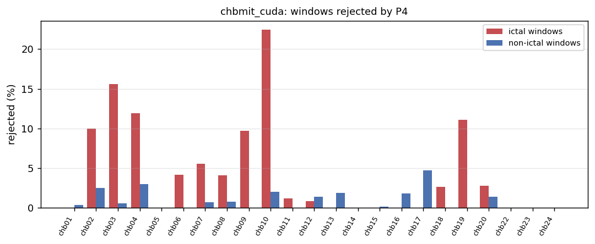
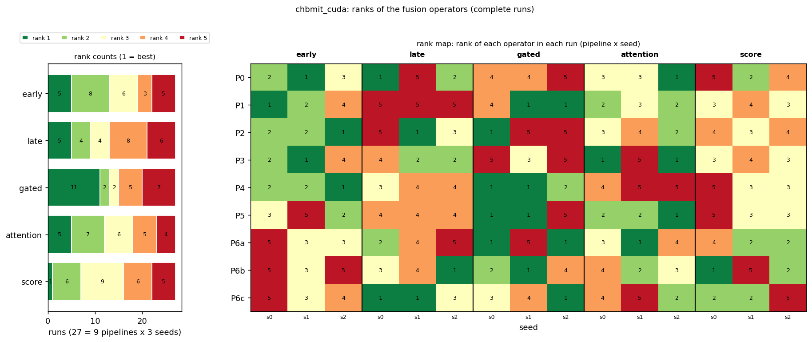

# First results: chbmit_cuda

The three items requested first: P4's rejection distribution, P6's signal retention, and the first rank stability table of the pipelines. Generated from the runs available now; rerun as more arrive (`python -m src.multiverse --dataset chbmit --first-report`).

## Runs included

27 complete run(s) (23 folds each) are included; 0 incomplete run(s) are not. `-` = not run yet.

| pipeline | seed 0 | seed 1 | seed 2 |
|---|---|---|---|
| P0 | yes | yes | yes |
| P1 | yes | yes | yes |
| P2 | yes | yes | yes |
| P3 | yes | yes | yes |
| P4 | yes | yes | yes |
| P5 | yes | yes | yes |
| P6a | yes | yes | yes |
| P6b | yes | yes | yes |
| P6c | yes | yes | yes |

## 1. P4: windows rejected as technical artefacts

Rejected by the rule (from meta.json of 3 P4 run(s), identical in all): 42 of 1276 ictal windows (3.3 %) and 39 of 5104 non-ictal windows (0.8 %). Rejected windows leave training and validation only; the test windows are those of every other pipeline.

Per person (23 persons; 18 with at least one rejected window; median share 1.43 %, maximum 6.1 % (chb10)):

| person | windows | ictal_total | ictal_rejected | nonictal_total | nonictal_rejected | rejected_pct |
|---|---|---|---|---|---|---|
| chb01 | 370 | 74 | 0 | 296 | 1 | 0.27 |
| chb02 | 100 | 20 | 2 | 80 | 2 | 4.00 |
| chb03 | 225 | 45 | 7 | 180 | 1 | 3.56 |
| chb04 | 210 | 42 | 5 | 168 | 5 | 4.76 |
| chb05 | 310 | 62 | 0 | 248 | 0 | 0.00 |
| chb06 | 120 | 24 | 1 | 96 | 0 | 0.83 |
| chb07 | 180 | 36 | 2 | 144 | 1 | 1.67 |
| chb08 | 485 | 97 | 4 | 388 | 3 | 1.44 |
| chb09 | 155 | 31 | 3 | 124 | 0 | 1.94 |
| chb10 | 245 | 49 | 11 | 196 | 4 | 6.12 |
| chb11 | 415 | 83 | 1 | 332 | 0 | 0.24 |
| chb12 | 615 | 123 | 1 | 492 | 7 | 1.30 |
| chb13 | 335 | 67 | 0 | 268 | 5 | 1.49 |
| chb14 | 120 | 24 | 0 | 96 | 0 | 0.00 |
| chb15 | 1070 | 214 | 0 | 856 | 1 | 0.09 |
| chb16 | 70 | 14 | 0 | 56 | 1 | 1.43 |
| chb17 | 160 | 32 | 0 | 128 | 6 | 3.75 |
| chb18 | 190 | 38 | 1 | 152 | 0 | 0.53 |
| chb19 | 135 | 27 | 3 | 108 | 0 | 2.22 |
| chb20 | 180 | 36 | 1 | 144 | 2 | 1.67 |
| chb22 | 120 | 24 | 0 | 96 | 0 | 0.00 |
| chb23 | 245 | 49 | 0 | 196 | 0 | 0.00 |
| chb24 | 325 | 65 | 0 | 260 | 0 | 0.00 |

## 2. P6: signal retention of Infomax, GEDAI and AMICA

Source: A:\Sevgi Hoca Proje20260930\eeg-fusion-benchmark\data\ica_logs (2049 logs). Power kept = signal power after cleaning / before, per recording.

| pipeline | method | recordings | power_kept_median | q25 | q75 | min | share_below_0.5 | share_below_0.9 | components_removed_mean | share_none_removed |
|---|---|---|---|---|---|---|---|---|---|---|
| P6a | Infomax (P6a) | 683 | 0.787 | 0.536 | 0.901 | 0.090 | 0.221 | 0.748 | 1.483 | 0.141 |
| P6b | GEDAI auto- (P6b, used) | 683 | 0.999 | 0.956 | 0.999 | 0.041 | 0.183 | 0.242 |  |  |
| P6c | AMICA (P6c) | 683 | 0.786 | 0.537 | 0.886 | 0.076 | 0.225 | 0.782 | 1.530 | 0.122 |

Computational cost (for the supplementary material; `p6_cost.csv`). Seconds are the logged processing time of each recording, summed for the total:

| pipeline | method | recordings | median_s_per_recording | mean_s_per_recording | total_compute_h | components_removed_median | components_removed_mean |
|---|---|---|---|---|---|---|---|
| P6a | Infomax (P6a) | 683 | 39.30 | 53.04 | 10.06 | 1.00 | 1.48 |
| P6b | GEDAI auto- (P6b, used) | 683 | 33.30 | 48.01 | 9.11 |  |  |
| P6c | AMICA (P6c) | 683 | 257.80 | 362.14 | 68.71 | 1.00 | 1.53 |

## 3. Rank stability of the fusion operators (first table)

Mean macro F1 over 23 folds and the available seeds, with the operator's rank in that pipeline (1 = best) and, where seeds disagree, the range of its single-seed ranks:

| pipeline | seeds | early | late | gated | attention | score | best | Kendall W (seeds) |
|---|---|---|---|---|---|---|---|---|
| P0 | 3 | 0.683 (2; 1-3) | 0.680 (3; 1-5) | 0.663 (5; 4-5) | 0.684 (1; 1-3) | 0.666 (4; 2-5) | attention | 0.38 |
| P1 | 3 | 0.686 (2; 1-4) | 0.660 (5) | 0.690 (1; 1-4) | 0.686 (3; 2-3) | 0.683 (4; 3-4) | gated | 0.60 |
| P2 | 3 | 0.690 (1; 1-2) | 0.688 (2; 1-5) | 0.684 (3; 1-5) | 0.684 (4; 2-4) | 0.677 (5; 3-4) | early | 0.27 |
| P3 | 3 | 0.687 (2; 1-4) | 0.684 (3; 2-4) | 0.672 (5; 3-5) | 0.691 (1; 1-5) | 0.678 (4; 3-4) | attention | 0.29 |
| P4 | 3 | 0.694 (2; 1-2) | 0.675 (3; 3-4) | 0.701 (1; 1-2) | 0.667 (5; 4-5) | 0.667 (4; 3-5) | gated | 0.82 |
| P5 | 3 | 0.676 (4; 2-5) | 0.672 (5) | 0.685 (2; 1-5) | 0.692 (1; 1-2) | 0.679 (3; 3-5) | attention | 0.38 |
| P6a | 3 | 0.671 (5; 3-5) | 0.675 (3; 2-5) | 0.695 (1; 1-5) | 0.674 (4; 1-4) | 0.676 (2; 2-4) | gated | 0.16 |
| P6b | 3 | 0.659 (5; 3-5) | 0.685 (2; 1-4) | 0.697 (1; 1-4) | 0.679 (4; 2-4) | 0.685 (3; 1-5) | gated | 0.24 |
| P6c | 3 | 0.672 (4; 3-5) | 0.693 (1; 1-3) | 0.689 (2; 1-4) | 0.670 (5; 2-5) | 0.677 (3; 2-5) | late | 0.33 |

AUPRC (the second primary metric), seed mean per pipeline and operator:

| pipeline | early | late | gated | attention | score |
|---|---|---|---|---|---|
| P0 | 0.641 | 0.651 | 0.666 | 0.656 | 0.658 |
| P1 | 0.626 | 0.667 | 0.676 | 0.676 | 0.671 |
| P2 | 0.628 | 0.666 | 0.692 | 0.674 | 0.659 |
| P3 | 0.615 | 0.654 | 0.645 | 0.651 | 0.650 |
| P4 | 0.640 | 0.669 | 0.679 | 0.638 | 0.661 |
| P5 | 0.612 | 0.632 | 0.664 | 0.655 | 0.659 |
| P6a | 0.617 | 0.642 | 0.671 | 0.648 | 0.658 |
| P6b | 0.558 | 0.636 | 0.649 | 0.633 | 0.633 |
| P6c | 0.621 | 0.657 | 0.671 | 0.646 | 0.672 |

Over all included runs (rank counts, median, best and worst rank, share of runs won):

| model | rank 1 | rank 2 | rank 3 | rank 4 | rank 5 |
|---|---|---|---|---|---|
| early | 5 | 8 | 6 | 3 | 5 |
| late | 5 | 4 | 4 | 8 | 6 |
| gated | 11 | 2 | 2 | 5 | 7 |
| attention | 5 | 7 | 6 | 5 | 4 |
| score | 1 | 6 | 9 | 6 | 5 |

| model | n_runs | mean_rank | median_rank | best_rank | worst_rank | share_first | share_last |
|---|---|---|---|---|---|---|---|
| early | 27 | 2.81 | 3.00 | 1 | 5 | 0.19 | 0.19 |
| late | 27 | 3.22 | 4.00 | 1 | 5 | 0.19 | 0.22 |
| gated | 27 | 2.81 | 3.00 | 1 | 5 | 0.41 | 0.26 |
| attention | 27 | 2.85 | 3.00 | 1 | 5 | 0.19 | 0.15 |
| score | 27 | 3.30 | 3.00 | 1 | 5 | 0.04 | 0.19 |

Kendall tau between the seed-averaged rankings of the pipelines:

| pipeline | P0 | P1 | P2 | P3 | P4 | P5 | P6a | P6b | P6c |
|---|---|---|---|---|---|---|---|---|---|
| P0 | 1.00 | -0.20 | 0.20 | 1.00 | -0.40 | 0.00 | -0.80 | -0.60 | -0.60 |
| P1 | -0.20 | 1.00 | 0.20 | -0.20 | 0.40 | 0.40 | 0.00 | -0.20 | -0.20 |
| P2 | 0.20 | 0.20 | 1.00 | 0.20 | 0.40 | -0.40 | -0.40 | -0.20 | 0.20 |
| P3 | 1.00 | -0.20 | 0.20 | 1.00 | -0.40 | 0.00 | -0.80 | -0.60 | -0.60 |
| P4 | -0.40 | 0.40 | 0.40 | -0.40 | 1.00 | -0.20 | 0.20 | 0.40 | 0.40 |
| P5 | 0.00 | 0.40 | -0.40 | 0.00 | -0.20 | 1.00 | 0.20 | 0.00 | -0.40 |
| P6a | -0.80 | 0.00 | -0.40 | -0.80 | 0.20 | 0.20 | 1.00 | 0.80 | 0.40 |
| P6b | -0.60 | -0.20 | -0.20 | -0.60 | 0.40 | 0.00 | 0.80 | 1.00 | 0.60 |
| P6c | -0.60 | -0.20 | 0.20 | -0.60 | 0.40 | -0.40 | 0.40 | 0.60 | 1.00 |

Window-level macro F1 (seed means) is the metric here; AUPRC and the full multiverse analysis follow in `python -m src.multiverse` once the balanced block is complete. Event-based metrics are secondary (docs/EVENTS.md).
