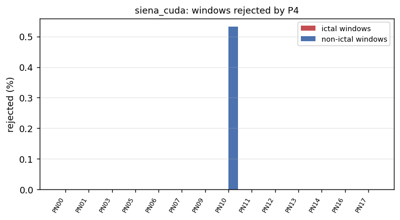
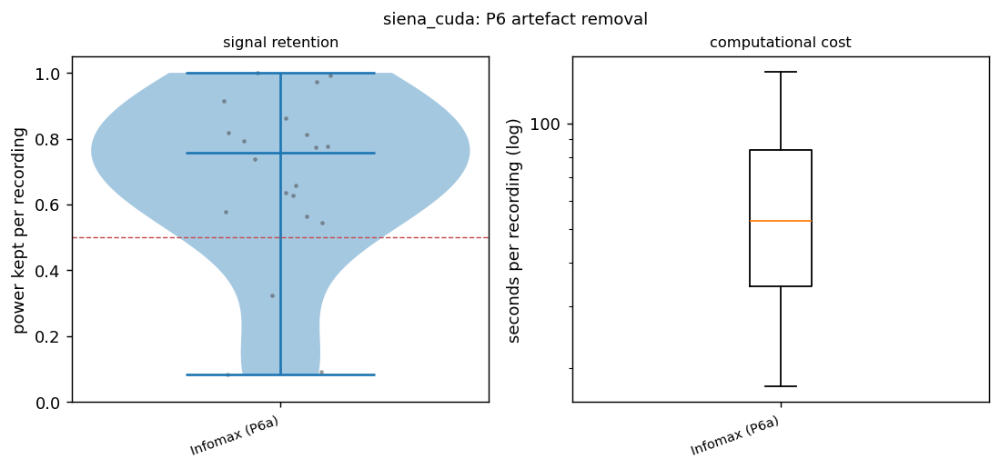
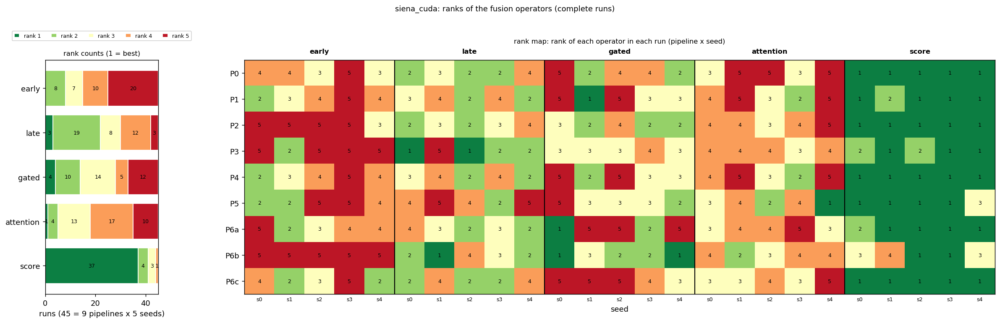

# First results: siena_cuda

The three items requested first: P4's rejection distribution, P6's signal retention, and the first rank stability table of the pipelines. Generated from the runs available now; rerun as more arrive (`python -m src.multiverse --dataset siena --first-report`).

## Runs included

45 complete run(s) (14 folds each) are included; 0 incomplete run(s) are not. `-` = not run yet.

| pipeline | seed 0 | seed 1 | seed 2 | seed 3 | seed 4 |
|---|---|---|---|---|---|
| P0 | yes | yes | yes | yes | yes |
| P1 | yes | yes | yes | yes | yes |
| P2 | yes | yes | yes | yes | yes |
| P3 | yes | yes | yes | yes | yes |
| P4 | yes | yes | yes | yes | yes |
| P5 | yes | yes | yes | yes | yes |
| P6a | yes | yes | yes | yes | yes |
| P6b | yes | yes | yes | yes | yes |
| P6c | yes | yes | yes | yes | yes |

## 1. P4: windows rejected as technical artefacts

Rejected by the rule (from meta.json of 5 P4 run(s), identical in all): 0 of 328 ictal windows (0.0 %) and 1 of 1312 non-ictal windows (0.1 %). Rejected windows leave training and validation only; the test windows are those of every other pipeline.

Per person (14 persons; 1 with at least one rejected window; median share 0.00 %, maximum 0.4 % (PN10)):

| person | windows | ictal_total | ictal_rejected | nonictal_total | nonictal_rejected | rejected_pct |
|---|---|---|---|---|---|---|
| PN00 | 185 | 37 | 0 | 148 | 0 | 0.00 |
| PN01 | 75 | 15 | 0 | 60 | 0 | 0.00 |
| PN03 | 130 | 26 | 0 | 104 | 0 | 0.00 |
| PN05 | 65 | 13 | 0 | 52 | 0 | 0.00 |
| PN06 | 160 | 32 | 0 | 128 | 0 | 0.00 |
| PN07 | 40 | 8 | 0 | 32 | 0 | 0.00 |
| PN09 | 115 | 23 | 0 | 92 | 0 | 0.00 |
| PN10 | 235 | 47 | 0 | 188 | 1 | 0.43 |
| PN11 | 30 | 6 | 0 | 24 | 0 | 0.00 |
| PN12 | 155 | 31 | 0 | 124 | 0 | 0.00 |
| PN13 | 145 | 29 | 0 | 116 | 0 | 0.00 |
| PN14 | 100 | 20 | 0 | 80 | 0 | 0.00 |
| PN16 | 125 | 25 | 0 | 100 | 0 | 0.00 |
| PN17 | 80 | 16 | 0 | 64 | 0 | 0.00 |

## 2. P6: signal retention of Infomax, GEDAI and AMICA

Source: A:\Sevgi Hoca Proje20260930\eeg-fusion-benchmark\data\ica_logs (20 logs). Power kept = signal power after cleaning / before, per recording.

| pipeline | method | recordings | power_kept_median | q25 | q75 | min | share_below_0.5 | share_below_0.9 | components_removed_mean | share_none_removed |
|---|---|---|---|---|---|---|---|---|---|---|
| P6a | Infomax (P6a) | 20 | 0.756 | 0.574 | 0.829 | 0.085 | 0.150 | 0.800 | 1.850 | 0.050 |

Computational cost (for the supplementary material; `p6_cost.csv`). Seconds are the logged processing time of each recording, summed for the total:

| pipeline | method | recordings | median_s_per_recording | mean_s_per_recording | total_compute_h | components_removed_median | components_removed_mean |
|---|---|---|---|---|---|---|---|
| P6a | Infomax (P6a) | 20 | 52.80 | 84.39 | 0.47 | 2.00 | 1.85 |

## 3. Rank stability of the fusion operators (first table)

Mean macro F1 over 14 folds and the available seeds, with the operator's rank in that pipeline (1 = best) and, where seeds disagree, the range of its single-seed ranks:

| pipeline | seeds | early | late | gated | attention | score | best | Kendall W (seeds) |
|---|---|---|---|---|---|---|---|---|
| P0 | 5 | 0.601 (4; 3-5) | 0.616 (2; 2-4) | 0.608 (3; 2-5) | 0.598 (5; 3-5) | 0.639 (1) | score | 0.64 |
| P1 | 5 | 0.616 (5; 2-5) | 0.637 (2; 2-4) | 0.623 (4; 1-5) | 0.628 (3; 2-5) | 0.665 (1; 1-2) | score | 0.44 |
| P2 | 5 | 0.610 (5; 3-5) | 0.639 (2; 2-4) | 0.636 (3; 2-4) | 0.625 (4; 3-5) | 0.674 (1) | score | 0.78 |
| P3 | 5 | 0.613 (4; 2-5) | 0.652 (2; 1-5) | 0.620 (3; 3-4) | 0.613 (5; 3-4) | 0.664 (1; 1-2) | score | 0.58 |
| P4 | 5 | 0.614 (5; 2-5) | 0.637 (2; 2-4) | 0.621 (4; 2-5) | 0.627 (3; 2-5) | 0.666 (1) | score | 0.54 |
| P5 | 5 | 0.637 (5; 2-5) | 0.642 (4; 2-5) | 0.650 (3; 2-5) | 0.652 (2; 1-4) | 0.690 (1; 1-3) | score | 0.40 |
| P6a | 5 | 0.619 (4; 2-5) | 0.622 (2; 2-4) | 0.621 (3; 1-5) | 0.611 (5; 3-5) | 0.672 (1; 1-2) | score | 0.46 |
| P6b | 5 | 0.614 (5) | 0.681 (2; 1-4) | 0.684 (1; 1-3) | 0.652 (4; 2-4) | 0.676 (3; 1-4) | gated | 0.63 |
| P6c | 5 | 0.629 (3; 2-5) | 0.638 (2; 2-4) | 0.613 (5; 3-5) | 0.621 (4; 3-5) | 0.683 (1) | score | 0.64 |

AUPRC (the second primary metric), seed mean per pipeline and operator:

| pipeline | early | late | gated | attention | score |
|---|---|---|---|---|---|
| P0 | 0.453 | 0.556 | 0.527 | 0.522 | 0.571 |
| P1 | 0.498 | 0.613 | 0.615 | 0.601 | 0.649 |
| P2 | 0.494 | 0.624 | 0.594 | 0.599 | 0.642 |
| P3 | 0.492 | 0.633 | 0.611 | 0.588 | 0.650 |
| P4 | 0.497 | 0.613 | 0.614 | 0.601 | 0.648 |
| P5 | 0.540 | 0.611 | 0.610 | 0.582 | 0.641 |
| P6a | 0.510 | 0.587 | 0.574 | 0.575 | 0.621 |
| P6b | 0.460 | 0.590 | 0.585 | 0.571 | 0.637 |
| P6c | 0.522 | 0.563 | 0.585 | 0.578 | 0.618 |

Over all included runs (rank counts, median, best and worst rank, share of runs won):

| model | rank 1 | rank 2 | rank 3 | rank 4 | rank 5 |
|---|---|---|---|---|---|
| early | 0 | 8 | 7 | 10 | 20 |
| late | 3 | 19 | 8 | 12 | 3 |
| gated | 4 | 10 | 14 | 5 | 12 |
| attention | 1 | 4 | 13 | 17 | 10 |
| score | 37 | 4 | 3 | 1 | 0 |

| model | n_runs | mean_rank | median_rank | best_rank | worst_rank | share_first | share_last |
|---|---|---|---|---|---|---|---|
| early | 45 | 3.93 | 4.00 | 2 | 5 | 0.00 | 0.44 |
| late | 45 | 2.84 | 3.00 | 1 | 5 | 0.07 | 0.07 |
| gated | 45 | 3.24 | 3.00 | 1 | 5 | 0.09 | 0.27 |
| attention | 45 | 3.69 | 4.00 | 1 | 5 | 0.02 | 0.22 |
| score | 45 | 1.29 | 1.00 | 1 | 4 | 0.82 | 0.00 |

Kendall tau between the seed-averaged rankings of the pipelines:

| pipeline | P0 | P1 | P2 | P3 | P4 | P5 | P6a | P6b | P6c |
|---|---|---|---|---|---|---|---|---|---|
| P0 | 1.00 | 0.60 | 0.80 | 1.00 | 0.60 | 0.20 | 1.00 | 0.20 | 0.60 |
| P1 | 0.60 | 1.00 | 0.80 | 0.60 | 1.00 | 0.60 | 0.60 | 0.20 | 0.60 |
| P2 | 0.80 | 0.80 | 1.00 | 0.80 | 0.80 | 0.40 | 0.80 | 0.40 | 0.40 |
| P3 | 1.00 | 0.60 | 0.80 | 1.00 | 0.60 | 0.20 | 1.00 | 0.20 | 0.60 |
| P4 | 0.60 | 1.00 | 0.80 | 0.60 | 1.00 | 0.60 | 0.60 | 0.20 | 0.60 |
| P5 | 0.20 | 0.60 | 0.40 | 0.20 | 0.60 | 1.00 | 0.20 | 0.20 | 0.20 |
| P6a | 1.00 | 0.60 | 0.80 | 1.00 | 0.60 | 0.20 | 1.00 | 0.20 | 0.60 |
| P6b | 0.20 | 0.20 | 0.40 | 0.20 | 0.20 | 0.20 | 0.20 | 1.00 | -0.20 |
| P6c | 0.60 | 0.60 | 0.40 | 0.60 | 0.60 | 0.20 | 0.60 | -0.20 | 1.00 |

Window-level macro F1 (seed means) is the metric here; AUPRC and the full multiverse analysis follow in `python -m src.multiverse` once the balanced block is complete. Event-based metrics are secondary (docs/EVENTS.md).
