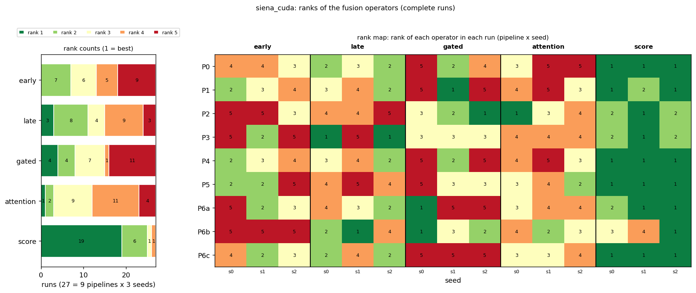

# First results: siena_cuda

The three items requested first: P4's rejection distribution, P6's signal retention, and the first rank stability table of the pipelines. Generated from the runs available now; rerun as more arrive (`python -m src.multiverse --dataset siena --first-report`).

## Runs included

27 complete run(s) (14 folds each) are included; 0 incomplete run(s) are not. `-` = not run yet.

| pipeline | seed 0 | seed 1 | seed 2 |
|---|---|---|---|
| P0 | yes | yes | yes |
| P1 | yes | yes | yes |
| P2 | yes | yes | yes |
| P3 | yes | yes | yes |
| P4 | yes | yes | yes |
| P5 | yes | yes | yes |
| P6a | yes | yes | yes |
| P6b | yes | yes | yes |
| P6c | yes | yes | yes |

## 1. P4: windows rejected as technical artefacts

Rejected by the rule (from meta.json of 3 P4 run(s), identical in all): 0 of 328 ictal windows (0.0 %) and 1 of 1312 non-ictal windows (0.1 %). Rejected windows leave training and validation only; the test windows are those of every other pipeline.

Per person (14 persons; 1 with at least one rejected window; median share 0.00 %, maximum 0.4 % (PN10)):

| person | windows | ictal_total | ictal_rejected | nonictal_total | nonictal_rejected | rejected_pct |
|---|---|---|---|---|---|---|
| PN00 | 185 | 37 | 0 | 148 | 0 | 0.00 |
| PN01 | 75 | 15 | 0 | 60 | 0 | 0.00 |
| PN03 | 130 | 26 | 0 | 104 | 0 | 0.00 |
| PN05 | 65 | 13 | 0 | 52 | 0 | 0.00 |
| PN06 | 160 | 32 | 0 | 128 | 0 | 0.00 |
| PN07 | 40 | 8 | 0 | 32 | 0 | 0.00 |
| PN09 | 115 | 23 | 0 | 92 | 0 | 0.00 |
| PN10 | 235 | 47 | 0 | 188 | 1 | 0.43 |
| PN11 | 30 | 6 | 0 | 24 | 0 | 0.00 |
| PN12 | 155 | 31 | 0 | 124 | 0 | 0.00 |
| PN13 | 145 | 29 | 0 | 116 | 0 | 0.00 |
| PN14 | 100 | 20 | 0 | 80 | 0 | 0.00 |
| PN16 | 125 | 25 | 0 | 100 | 0 | 0.00 |
| PN17 | 80 | 16 | 0 | 64 | 0 | 0.00 |

## 2. P6: signal retention of Infomax, GEDAI and AMICA

Source: A:\Sevgi Hoca Proje20260930\eeg-fusion-benchmark\data\ica_logs (20 logs). Power kept = signal power after cleaning / before, per recording.

| pipeline | method | recordings | power_kept_median | q25 | q75 | min | share_below_0.5 | share_below_0.9 | components_removed_mean | share_none_removed |
|---|---|---|---|---|---|---|---|---|---|---|
| P6a | Infomax (P6a) | 20 | 0.756 | 0.574 | 0.829 | 0.085 | 0.150 | 0.800 | 1.850 | 0.050 |

Computational cost (for the supplementary material; `p6_cost.csv`). Seconds are the logged processing time of each recording, summed for the total:

| pipeline | method | recordings | median_s_per_recording | mean_s_per_recording | total_compute_h | components_removed_median | components_removed_mean |
|---|---|---|---|---|---|---|---|
| P6a | Infomax (P6a) | 20 | 52.80 | 84.39 | 0.47 | 2.00 | 1.85 |

## 3. Rank stability of the fusion operators (first table)

Mean macro F1 over 14 folds and the available seeds, with the operator's rank in that pipeline (1 = best) and, where seeds disagree, the range of its single-seed ranks:

| pipeline | seeds | early | late | gated | attention | score | best | Kendall W (seeds) |
|---|---|---|---|---|---|---|---|---|
| P0 | 3 | 0.615 (3; 3-4) | 0.628 (2; 2-3) | 0.606 (4; 2-5) | 0.600 (5; 3-5) | 0.642 (1) | score | 0.71 |
| P1 | 3 | 0.630 (3; 2-4) | 0.635 (2; 2-4) | 0.617 (5; 1-5) | 0.627 (4; 3-5) | 0.658 (1; 1-2) | score | 0.42 |
| P2 | 3 | 0.601 (5; 3-5) | 0.603 (4; 4-5) | 0.640 (2; 1-3) | 0.627 (3; 1-4) | 0.651 (1; 1-2) | score | 0.64 |
| P3 | 3 | 0.621 (4; 2-5) | 0.655 (1; 1-5) | 0.623 (3) | 0.615 (5) | 0.651 (2; 1-2) | late | 0.42 |
| P4 | 3 | 0.627 (3; 2-4) | 0.635 (2; 2-4) | 0.614 (5; 2-5) | 0.626 (4; 3-5) | 0.658 (1) | score | 0.60 |
| P5 | 3 | 0.645 (4; 2-5) | 0.643 (5; 4-5) | 0.646 (3; 3-5) | 0.652 (2; 2-4) | 0.695 (1) | score | 0.62 |
| P6a | 3 | 0.620 (2; 2-5) | 0.612 (3; 2-4) | 0.609 (4; 1-5) | 0.608 (5; 3-4) | 0.669 (1; 1-2) | score | 0.38 |
| P6b | 3 | 0.617 (5) | 0.680 (3; 1-4) | 0.680 (2; 1-3) | 0.661 (4; 2-4) | 0.682 (1; 1-4) | score | 0.56 |
| P6c | 3 | 0.625 (3; 2-4) | 0.633 (2; 2-4) | 0.604 (5) | 0.622 (4; 3-4) | 0.673 (1) | score | 0.82 |

AUPRC (the second primary metric), seed mean per pipeline and operator:

| pipeline | early | late | gated | attention | score |
|---|---|---|---|---|---|
| P0 | 0.460 | 0.568 | 0.522 | 0.523 | 0.572 |
| P1 | 0.513 | 0.605 | 0.624 | 0.604 | 0.646 |
| P2 | 0.490 | 0.563 | 0.590 | 0.556 | 0.629 |
| P3 | 0.501 | 0.636 | 0.621 | 0.605 | 0.639 |
| P4 | 0.511 | 0.605 | 0.623 | 0.603 | 0.642 |
| P5 | 0.541 | 0.620 | 0.598 | 0.584 | 0.633 |
| P6a | 0.504 | 0.589 | 0.579 | 0.584 | 0.622 |
| P6b | 0.468 | 0.596 | 0.587 | 0.565 | 0.645 |
| P6c | 0.520 | 0.565 | 0.592 | 0.590 | 0.610 |

Over all included runs (rank counts, median, best and worst rank, share of runs won):

| model | rank 1 | rank 2 | rank 3 | rank 4 | rank 5 |
|---|---|---|---|---|---|
| early | 0 | 7 | 6 | 5 | 9 |
| late | 3 | 8 | 4 | 9 | 3 |
| gated | 4 | 4 | 7 | 1 | 11 |
| attention | 1 | 2 | 9 | 11 | 4 |
| score | 19 | 6 | 1 | 1 | 0 |

| model | n_runs | mean_rank | median_rank | best_rank | worst_rank | share_first | share_last |
|---|---|---|---|---|---|---|---|
| early | 27 | 3.59 | 4.00 | 2 | 5 | 0.00 | 0.33 |
| late | 27 | 3.04 | 3.00 | 1 | 5 | 0.11 | 0.11 |
| gated | 27 | 3.41 | 3.00 | 1 | 5 | 0.15 | 0.41 |
| attention | 27 | 3.56 | 4.00 | 1 | 5 | 0.04 | 0.15 |
| score | 27 | 1.41 | 1.00 | 1 | 4 | 0.70 | 0.00 |

Kendall tau between the seed-averaged rankings of the pipelines:

| pipeline | P0 | P1 | P2 | P3 | P4 | P5 | P6a | P6b | P6c |
|---|---|---|---|---|---|---|---|---|---|
| P0 | 1.00 | 0.80 | 0.20 | 0.60 | 0.80 | -0.20 | 0.80 | 0.40 | 0.80 |
| P1 | 0.80 | 1.00 | 0.00 | 0.40 | 1.00 | 0.00 | 0.60 | 0.20 | 1.00 |
| P2 | 0.20 | 0.00 | 1.00 | 0.20 | 0.00 | 0.60 | 0.00 | 0.80 | 0.00 |
| P3 | 0.60 | 0.40 | 0.20 | 1.00 | 0.40 | -0.20 | 0.40 | 0.40 | 0.40 |
| P4 | 0.80 | 1.00 | 0.00 | 0.40 | 1.00 | 0.00 | 0.60 | 0.20 | 1.00 |
| P5 | -0.20 | 0.00 | 0.60 | -0.20 | 0.00 | 1.00 | 0.00 | 0.40 | 0.00 |
| P6a | 0.80 | 0.60 | 0.00 | 0.40 | 0.60 | 0.00 | 1.00 | 0.20 | 0.60 |
| P6b | 0.40 | 0.20 | 0.80 | 0.40 | 0.20 | 0.40 | 0.20 | 1.00 | 0.20 |
| P6c | 0.80 | 1.00 | 0.00 | 0.40 | 1.00 | 0.00 | 0.60 | 0.20 | 1.00 |

Window-level macro F1 (seed means) is the metric here; AUPRC and the full multiverse analysis follow in `python -m src.multiverse` once the balanced block is complete. Event-based metrics are secondary (docs/EVENTS.md).
