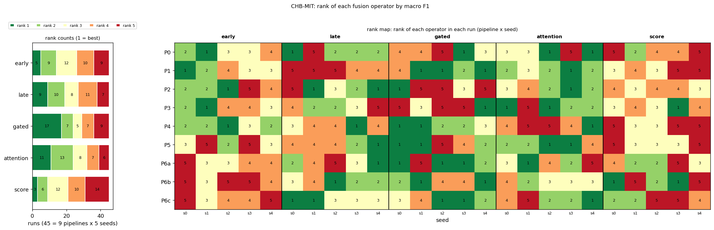
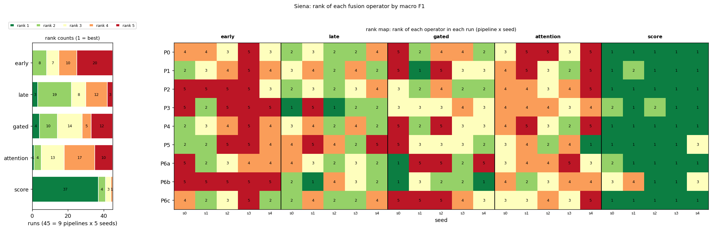

# Results tables and figures

Generated by `python -m src.make_results` from the stored runs; do not edit by hand. Table numbers are placeholders (R1, R2, ...) to be matched to the manuscript's numbering. Every table is also written as CSV next to this file.

## CHB-MIT

Complete runs (45, 23 folds each): P0/seed 0, P0/seed 1, P0/seed 2, P0/seed 3, P0/seed 4, P1/seed 0, P1/seed 1, P1/seed 2, P1/seed 3, P1/seed 4, P2/seed 0, P2/seed 1, P2/seed 2, P2/seed 3, P2/seed 4, P3/seed 0, P3/seed 1, P3/seed 2, P3/seed 3, P3/seed 4, P4/seed 0, P4/seed 1, P4/seed 2, P4/seed 3, P4/seed 4, P5/seed 0, P5/seed 1, P5/seed 2, P5/seed 3, P5/seed 4, P6a/seed 0, P6a/seed 1, P6a/seed 2, P6a/seed 3, P6a/seed 4, P6b/seed 0, P6b/seed 1, P6b/seed 2, P6b/seed 3, P6b/seed 4, P6c/seed 0, P6c/seed 1, P6c/seed 2, P6c/seed 3, P6c/seed 4.

**Table R1. CHB-MIT, window-level macro F1 by preprocessing pipeline and fusion operator, mean ± SD over seed sets.** Mean over the 23 LOSO folds within each run; best operator of each pipeline in bold. Source: `results_v2/chbmit/loso_*/perfold.csv`.

| pipeline | seeds | early | late | gated | attention | score |
|---|---|---|---|---|---|---|
| P0 | 5 | 0.678 ± 0.013 | 0.679 ± 0.012 | 0.671 ± 0.013 | **0.683 ± 0.020** | 0.661 ± 0.014 |
| P1 | 5 | 0.684 ± 0.008 | 0.665 ± 0.015 | **0.691 ± 0.005** | 0.687 ± 0.008 | 0.672 ± 0.017 |
| P2 | 5 | 0.680 ± 0.014 | **0.688 ± 0.009** | 0.680 ± 0.021 | 0.687 ± 0.009 | 0.675 ± 0.008 |
| P3 | 5 | 0.679 ± 0.011 | 0.677 ± 0.017 | 0.676 ± 0.015 | **0.689 ± 0.015** | 0.678 ± 0.014 |
| P4 | 5 | 0.688 ± 0.010 | 0.678 ± 0.008 | **0.694 ± 0.012** | 0.670 ± 0.010 | 0.660 ± 0.024 |
| P5 | 5 | 0.678 ± 0.012 | 0.684 ± 0.019 | 0.690 ± 0.021 | **0.693 ± 0.005** | 0.681 ± 0.008 |
| P6a | 5 | 0.672 ± 0.014 | 0.679 ± 0.014 | **0.692 ± 0.018** | 0.677 ± 0.013 | 0.675 ± 0.012 |
| P6b | 5 | 0.662 ± 0.012 | 0.686 ± 0.018 | **0.691 ± 0.012** | 0.681 ± 0.020 | 0.682 ± 0.028 |
| P6c | 5 | 0.671 ± 0.007 | 0.688 ± 0.019 | **0.688 ± 0.013** | 0.679 ± 0.014 | 0.674 ± 0.010 |

**Table R2. CHB-MIT, AUPRC by preprocessing pipeline and fusion operator, mean ± SD over seed sets.** Mean over the 23 LOSO folds within each run; best operator of each pipeline in bold. Source: `results_v2/chbmit/loso_*/perfold.csv` and `preds/`.

| pipeline | seeds | early | late | gated | attention | score |
|---|---|---|---|---|---|---|
| P0 | 5 | 0.632 ± 0.016 | 0.656 ± 0.018 | **0.662 ± 0.019** | 0.655 ± 0.015 | 0.654 ± 0.011 |
| P1 | 5 | 0.623 ± 0.015 | 0.665 ± 0.011 | **0.673 ± 0.009** | 0.665 ± 0.017 | 0.667 ± 0.019 |
| P2 | 5 | 0.618 ± 0.021 | 0.668 ± 0.007 | **0.683 ± 0.016** | 0.669 ± 0.013 | 0.657 ± 0.021 |
| P3 | 5 | 0.607 ± 0.013 | 0.657 ± 0.012 | 0.655 ± 0.016 | **0.658 ± 0.031** | 0.651 ± 0.011 |
| P4 | 5 | 0.628 ± 0.018 | 0.672 ± 0.018 | **0.673 ± 0.013** | 0.650 ± 0.026 | 0.651 ± 0.018 |
| P5 | 5 | 0.608 ± 0.019 | 0.642 ± 0.017 | **0.664 ± 0.022** | 0.660 ± 0.012 | 0.662 ± 0.005 |
| P6a | 5 | 0.619 ± 0.021 | 0.653 ± 0.028 | **0.668 ± 0.015** | 0.652 ± 0.017 | 0.657 ± 0.010 |
| P6b | 5 | 0.564 ± 0.010 | 0.635 ± 0.011 | **0.643 ± 0.018** | 0.636 ± 0.015 | 0.631 ± 0.015 |
| P6c | 5 | 0.617 ± 0.009 | 0.658 ± 0.023 | **0.671 ± 0.010** | 0.654 ± 0.018 | 0.668 ± 0.012 |

**Table R3. CHB-MIT, balanced accuracy by preprocessing pipeline and fusion operator, mean ± SD over seed sets.** Mean over the 23 LOSO folds within each run; best operator of each pipeline in bold. Source: `results_v2/chbmit/loso_*/perfold.csv`.

| pipeline | seeds | early | late | gated | attention | score |
|---|---|---|---|---|---|---|
| P0 | 5 | **0.684 ± 0.009** | 0.681 ± 0.010 | 0.674 ± 0.010 | 0.684 ± 0.016 | 0.667 ± 0.014 |
| P1 | 5 | 0.684 ± 0.006 | 0.669 ± 0.010 | **0.685 ± 0.008** | 0.684 ± 0.008 | 0.680 ± 0.015 |
| P2 | 5 | 0.684 ± 0.010 | 0.682 ± 0.006 | 0.679 ± 0.022 | **0.685 ± 0.009** | 0.678 ± 0.010 |
| P3 | 5 | **0.687 ± 0.010** | 0.676 ± 0.015 | 0.676 ± 0.012 | 0.687 ± 0.013 | 0.683 ± 0.011 |
| P4 | 5 | **0.690 ± 0.008** | 0.677 ± 0.006 | 0.687 ± 0.008 | 0.667 ± 0.011 | 0.663 ± 0.020 |
| P5 | 5 | 0.686 ± 0.015 | 0.683 ± 0.014 | 0.684 ± 0.019 | **0.694 ± 0.008** | 0.687 ± 0.008 |
| P6a | 5 | 0.676 ± 0.014 | 0.675 ± 0.014 | **0.688 ± 0.017** | 0.680 ± 0.006 | 0.679 ± 0.014 |
| P6b | 5 | 0.670 ± 0.009 | 0.682 ± 0.017 | **0.688 ± 0.012** | 0.680 ± 0.016 | 0.686 ± 0.017 |
| P6c | 5 | 0.677 ± 0.008 | 0.682 ± 0.017 | **0.686 ± 0.009** | 0.680 ± 0.015 | 0.681 ± 0.010 |

**Table R4. CHB-MIT, fusion operators and controls, mean ± SD over the 45 runs** (fold means within a run; Brier: lower is better). Controls: single-branch networks at default width and widened to the fusion budget, and two classical models. Source: as Table R1.

| model | kind | f1_macro | auprc | balanced_accuracy | brier |
|---|---|---|---|---|---|
| early | fusion | 0.677 ± 0.013 | 0.613 ± 0.024 | 0.682 ± 0.011 | 0.330 ± 0.020 |
| late | fusion | 0.681 ± 0.015 | 0.656 ± 0.019 | 0.679 ± 0.012 | 0.299 ± 0.019 |
| gated | fusion | 0.686 ± 0.016 | 0.666 ± 0.018 | 0.683 ± 0.013 | 0.294 ± 0.020 |
| attention | fusion | 0.683 ± 0.014 | 0.655 ± 0.020 | 0.682 ± 0.013 | 0.300 ± 0.017 |
| score | fusion | 0.673 ± 0.017 | 0.655 ± 0.017 | 0.678 ± 0.015 | 0.265 ± 0.010 |
| raw1d | control | 0.663 ± 0.014 | 0.604 ± 0.019 | 0.678 ± 0.013 | 0.332 ± 0.018 |
| spec2d | control | 0.679 ± 0.010 | 0.598 ± 0.017 | 0.676 ± 0.010 | 0.309 ± 0.011 |
| raw1d_wide | control | 0.662 ± 0.012 | 0.605 ± 0.017 | 0.673 ± 0.010 | 0.328 ± 0.016 |
| spec2d_wide | control | 0.683 ± 0.014 | 0.618 ± 0.016 | 0.680 ± 0.013 | 0.302 ± 0.014 |
| logvar | control | 0.631 ± 0.009 | 0.577 ± 0.016 | 0.708 ± 0.006 | 0.402 ± 0.009 |
| shallow | control | 0.690 ± 0.008 | 0.640 ± 0.008 | 0.739 ± 0.007 | 0.339 ± 0.014 |

| control | runs | runs_above_best_fusion | pipelines_above_every_fusion | pipelines |
|---|---|---|---|---|
| raw1d | 45 | 0 | 0 | 9 |
| spec2d | 45 | 1 | 0 | 9 |
| raw1d_wide | 45 | 0 | 0 | 9 |
| spec2d_wide | 45 | 9 | 1 | 9 |
| logvar | 45 | 0 | 0 | 9 |
| shallow | 45 | 12 | 5 | 9 |

**Table R5. CHB-MIT, seizure-level sensitivity (pooled over persons) by pipeline and fusion operator, mean ± SD over seed sets.** SzCORE event scoring of every 10 s window (docs/EVENTS.md). Source: `results_v2/chbmit/<run>/events/perperson.csv`.

| pipeline | seeds | early | late | gated | attention | score |
|---|---|---|---|---|---|---|
| P0 | 5 | **0.787 ± 0.045** | 0.686 ± 0.057 | 0.667 ± 0.047 | 0.678 ± 0.026 | 0.648 ± 0.050 |
| P1 | 5 | **0.774 ± 0.036** | 0.677 ± 0.063 | 0.709 ± 0.053 | 0.732 ± 0.039 | 0.675 ± 0.039 |
| P2 | 5 | **0.789 ± 0.027** | 0.710 ± 0.027 | 0.706 ± 0.022 | 0.706 ± 0.011 | 0.665 ± 0.048 |
| P3 | 5 | **0.824 ± 0.020** | 0.708 ± 0.045 | 0.695 ± 0.023 | 0.725 ± 0.013 | 0.695 ± 0.028 |
| P4 | 5 | **0.801 ± 0.053** | 0.695 ± 0.027 | 0.698 ± 0.048 | 0.702 ± 0.025 | 0.644 ± 0.029 |
| P5 | 5 | **0.827 ± 0.067** | 0.712 ± 0.052 | 0.707 ± 0.048 | 0.753 ± 0.028 | 0.725 ± 0.036 |
| P6a | 5 | **0.750 ± 0.032** | 0.696 ± 0.032 | 0.691 ± 0.020 | 0.688 ± 0.034 | 0.662 ± 0.024 |
| P6b | 5 | **0.797 ± 0.032** | 0.712 ± 0.048 | 0.730 ± 0.032 | 0.749 ± 0.048 | 0.710 ± 0.039 |
| P6c | 5 | **0.758 ± 0.037** | 0.702 ± 0.033 | 0.691 ± 0.033 | 0.703 ± 0.030 | 0.667 ± 0.026 |

**Table R6. CHB-MIT, false alarms per hour (pooled over persons, true recording time) by pipeline and fusion operator, mean ± SD over seed sets.** Lower is better; no bold. Source: as Table R5.

| pipeline | seeds | early | late | gated | attention | score |
|---|---|---|---|---|---|---|
| P0 | 5 | 7.746 ± 0.789 | 5.501 ± 0.500 | 5.324 ± 0.465 | 5.378 ± 0.604 | 5.396 ± 0.455 |
| P1 | 5 | 7.012 ± 0.279 | 5.307 ± 0.617 | 5.157 ± 0.601 | 5.575 ± 0.638 | 5.900 ± 0.368 |
| P2 | 5 | 7.732 ± 0.791 | 5.297 ± 0.413 | 5.093 ± 0.417 | 5.257 ± 0.795 | 5.421 ± 0.407 |
| P3 | 5 | 8.380 ± 0.261 | 5.805 ± 0.518 | 5.668 ± 0.239 | 5.818 ± 0.606 | 5.891 ± 0.561 |
| P4 | 5 | 7.398 ± 0.745 | 5.238 ± 0.396 | 5.260 ± 0.354 | 5.310 ± 0.321 | 5.594 ± 0.297 |
| P5 | 5 | 8.376 ± 0.489 | 5.624 ± 0.427 | 5.207 ± 0.387 | 5.716 ± 0.347 | 5.867 ± 0.503 |
| P6a | 5 | 7.148 ± 0.735 | 5.182 ± 0.235 | 4.856 ± 0.681 | 5.282 ± 0.730 | 5.476 ± 0.377 |
| P6b | 5 | 8.737 ± 0.371 | 5.886 ± 0.442 | 5.717 ± 0.230 | 5.453 ± 0.408 | 6.410 ± 0.704 |
| P6c | 5 | 6.694 ± 0.539 | 4.973 ± 0.385 | 4.758 ± 0.188 | 5.349 ± 0.565 | 5.661 ± 0.217 |

**Figure R (CHB-MIT).** Rank of each fusion operator (1 = best macro F1) in each of the 45 pipeline x seed runs: counts per rank (left) and the rank of every run (right). `paper/figures_manuscript/results_rank_distribution_chbmit.png`

| model | n_runs | mean_rank | median_rank | best_rank | worst_rank | share_first | share_last |
|---|---|---|---|---|---|---|---|
| early | 45 | 3.20 | 3.00 | 1 | 5 | 0.11 | 0.20 |
| late | 45 | 2.93 | 3.00 | 1 | 5 | 0.20 | 0.16 |
| gated | 45 | 2.64 | 2.00 | 1 | 5 | 0.38 | 0.20 |
| attention | 45 | 2.64 | 2.00 | 1 | 5 | 0.24 | 0.13 |
| score | 45 | 3.58 | 4.00 | 1 | 5 | 0.07 | 0.31 |

## Siena

Complete runs (45, 14 folds each): P0/seed 0, P0/seed 1, P0/seed 2, P0/seed 3, P0/seed 4, P1/seed 0, P1/seed 1, P1/seed 2, P1/seed 3, P1/seed 4, P2/seed 0, P2/seed 1, P2/seed 2, P2/seed 3, P2/seed 4, P3/seed 0, P3/seed 1, P3/seed 2, P3/seed 3, P3/seed 4, P4/seed 0, P4/seed 1, P4/seed 2, P4/seed 3, P4/seed 4, P5/seed 0, P5/seed 1, P5/seed 2, P5/seed 3, P5/seed 4, P6a/seed 0, P6a/seed 1, P6a/seed 2, P6a/seed 3, P6a/seed 4, P6b/seed 0, P6b/seed 1, P6b/seed 2, P6b/seed 3, P6b/seed 4, P6c/seed 0, P6c/seed 1, P6c/seed 2, P6c/seed 3, P6c/seed 4.

**Table R7. Siena, window-level macro F1 by preprocessing pipeline and fusion operator, mean ± SD over seed sets.** Mean over the 14 LOSO folds within each run; best operator of each pipeline in bold. Source: `results_v2/siena/loso_*/perfold.csv`.

| pipeline | seeds | early | late | gated | attention | score |
|---|---|---|---|---|---|---|
| P0 | 5 | 0.601 ± 0.021 | 0.616 ± 0.023 | 0.608 ± 0.016 | 0.598 ± 0.020 | **0.639 ± 0.008** |
| P1 | 5 | 0.616 ± 0.024 | 0.637 ± 0.012 | 0.623 ± 0.020 | 0.628 ± 0.026 | **0.665 ± 0.019** |
| P2 | 5 | 0.610 ± 0.016 | 0.639 ± 0.014 | 0.636 ± 0.018 | 0.625 ± 0.016 | **0.674 ± 0.012** |
| P3 | 5 | 0.613 ± 0.014 | 0.652 ± 0.039 | 0.620 ± 0.013 | 0.613 ± 0.010 | **0.664 ± 0.029** |
| P4 | 5 | 0.614 ± 0.020 | 0.637 ± 0.012 | 0.621 ± 0.019 | 0.627 ± 0.025 | **0.666 ± 0.020** |
| P5 | 5 | 0.637 ± 0.029 | 0.642 ± 0.017 | 0.650 ± 0.015 | 0.652 ± 0.008 | **0.690 ± 0.031** |
| P6a | 5 | 0.619 ± 0.018 | 0.622 ± 0.019 | 0.621 ± 0.048 | 0.611 ± 0.013 | **0.672 ± 0.018** |
| P6b | 5 | 0.614 ± 0.010 | 0.681 ± 0.012 | **0.684 ± 0.015** | 0.652 ± 0.018 | 0.676 ± 0.027 |
| P6c | 5 | 0.629 ± 0.027 | 0.638 ± 0.010 | 0.613 ± 0.024 | 0.621 ± 0.013 | **0.683 ± 0.026** |

**Table R8. Siena, AUPRC by preprocessing pipeline and fusion operator, mean ± SD over seed sets.** Mean over the 14 LOSO folds within each run; best operator of each pipeline in bold. Source: `results_v2/siena/loso_*/perfold.csv` and `preds/`.

| pipeline | seeds | early | late | gated | attention | score |
|---|---|---|---|---|---|---|
| P0 | 5 | 0.453 ± 0.018 | 0.556 ± 0.023 | 0.527 ± 0.018 | 0.522 ± 0.003 | **0.571 ± 0.014** |
| P1 | 5 | 0.498 ± 0.025 | 0.613 ± 0.039 | 0.615 ± 0.019 | 0.601 ± 0.021 | **0.649 ± 0.024** |
| P2 | 5 | 0.494 ± 0.036 | 0.624 ± 0.035 | 0.594 ± 0.019 | 0.599 ± 0.020 | **0.642 ± 0.007** |
| P3 | 5 | 0.492 ± 0.020 | 0.633 ± 0.043 | 0.611 ± 0.013 | 0.588 ± 0.032 | **0.650 ± 0.029** |
| P4 | 5 | 0.497 ± 0.026 | 0.613 ± 0.039 | 0.614 ± 0.017 | 0.601 ± 0.022 | **0.648 ± 0.025** |
| P5 | 5 | 0.540 ± 0.021 | 0.611 ± 0.027 | 0.610 ± 0.019 | 0.582 ± 0.023 | **0.641 ± 0.027** |
| P6a | 5 | 0.510 ± 0.030 | 0.587 ± 0.042 | 0.574 ± 0.045 | 0.575 ± 0.041 | **0.621 ± 0.028** |
| P6b | 5 | 0.460 ± 0.020 | 0.590 ± 0.017 | 0.585 ± 0.022 | 0.571 ± 0.028 | **0.637 ± 0.026** |
| P6c | 5 | 0.522 ± 0.034 | 0.563 ± 0.028 | 0.585 ± 0.015 | 0.578 ± 0.034 | **0.618 ± 0.034** |

**Table R9. Siena, balanced accuracy by preprocessing pipeline and fusion operator, mean ± SD over seed sets.** Mean over the 14 LOSO folds within each run; best operator of each pipeline in bold. Source: `results_v2/siena/loso_*/perfold.csv`.

| pipeline | seeds | early | late | gated | attention | score |
|---|---|---|---|---|---|---|
| P0 | 5 | 0.621 ± 0.021 | 0.663 ± 0.018 | 0.652 ± 0.011 | 0.639 ± 0.013 | **0.665 ± 0.007** |
| P1 | 5 | 0.643 ± 0.022 | 0.676 ± 0.014 | 0.673 ± 0.018 | 0.673 ± 0.024 | **0.689 ± 0.022** |
| P2 | 5 | 0.645 ± 0.024 | 0.680 ± 0.008 | 0.684 ± 0.012 | 0.674 ± 0.014 | **0.696 ± 0.010** |
| P3 | 5 | 0.641 ± 0.018 | **0.693 ± 0.031** | 0.671 ± 0.010 | 0.660 ± 0.009 | 0.684 ± 0.021 |
| P4 | 5 | 0.643 ± 0.022 | 0.676 ± 0.014 | 0.673 ± 0.018 | 0.673 ± 0.025 | **0.691 ± 0.024** |
| P5 | 5 | 0.661 ± 0.023 | 0.688 ± 0.015 | 0.691 ± 0.011 | 0.687 ± 0.010 | **0.710 ± 0.038** |
| P6a | 5 | 0.645 ± 0.016 | 0.668 ± 0.016 | 0.664 ± 0.038 | 0.658 ± 0.015 | **0.682 ± 0.011** |
| P6b | 5 | 0.622 ± 0.011 | 0.688 ± 0.017 | **0.694 ± 0.018** | 0.676 ± 0.015 | 0.691 ± 0.022 |
| P6c | 5 | 0.654 ± 0.019 | 0.676 ± 0.006 | 0.660 ± 0.019 | 0.663 ± 0.020 | **0.697 ± 0.018** |

**Table R10. Siena, fusion operators and controls, mean ± SD over the 45 runs** (fold means within a run; Brier: lower is better). Controls: single-branch networks at default width and widened to the fusion budget, and two classical models. Source: as Table R1.

| model | kind | f1_macro | auprc | balanced_accuracy | brier |
|---|---|---|---|---|---|
| early | fusion | 0.617 ± 0.021 | 0.496 ± 0.035 | 0.642 ± 0.022 | 0.419 ± 0.034 |
| late | fusion | 0.640 ± 0.025 | 0.599 ± 0.040 | 0.679 ± 0.018 | 0.409 ± 0.045 |
| gated | fusion | 0.631 ± 0.031 | 0.591 ± 0.034 | 0.674 ± 0.022 | 0.433 ± 0.050 |
| attention | fusion | 0.625 ± 0.023 | 0.580 ± 0.034 | 0.667 ± 0.020 | 0.423 ± 0.031 |
| score | fusion | 0.670 ± 0.024 | 0.631 ± 0.033 | 0.689 ± 0.022 | 0.304 ± 0.027 |
| raw1d | control | 0.609 ± 0.034 | 0.565 ± 0.040 | 0.659 ± 0.024 | 0.443 ± 0.061 |
| spec2d | control | 0.660 ± 0.022 | 0.576 ± 0.031 | 0.680 ± 0.019 | 0.350 ± 0.030 |
| raw1d_wide | control | 0.612 ± 0.028 | 0.577 ± 0.033 | 0.657 ± 0.019 | 0.440 ± 0.056 |
| spec2d_wide | control | 0.663 ± 0.026 | 0.581 ± 0.027 | 0.681 ± 0.021 | 0.352 ± 0.038 |
| logvar | control | 0.630 ± 0.034 | 0.572 ± 0.036 | 0.705 ± 0.027 | 0.455 ± 0.036 |
| shallow | control | 0.720 ± 0.019 | 0.667 ± 0.015 | 0.770 ± 0.017 | 0.338 ± 0.020 |

| control | runs | runs_above_best_fusion | pipelines_above_every_fusion | pipelines |
|---|---|---|---|---|
| raw1d | 45 | 0 | 0 | 9 |
| spec2d | 45 | 12 | 1 | 9 |
| raw1d_wide | 45 | 0 | 0 | 9 |
| spec2d_wide | 45 | 16 | 3 | 9 |
| logvar | 45 | 2 | 0 | 9 |
| shallow | 45 | 43 | 9 | 9 |

**Table R11. Siena, seizure-level sensitivity (pooled over persons) by pipeline and fusion operator, mean ± SD over seed sets.** SzCORE event scoring of every 10 s window (docs/EVENTS.md). Source: `results_v2/siena/<run>/events/perperson.csv`.

| pipeline | seeds | early | late | gated | attention | score |
|---|---|---|---|---|---|---|
| P0 | 5 | 0.911 ± 0.023 | 0.834 ± 0.080 | 0.851 ± 0.064 | 0.872 ± 0.043 | **0.919 ± 0.051** |
| P1 | 5 | 0.821 ± 0.072 | 0.855 ± 0.032 | 0.855 ± 0.070 | **0.860 ± 0.118** | 0.843 ± 0.044 |
| P2 | 5 | **0.847 ± 0.094** | 0.800 ± 0.039 | 0.809 ± 0.040 | 0.830 ± 0.062 | 0.757 ± 0.057 |
| P3 | 5 | 0.877 ± 0.055 | 0.847 ± 0.070 | 0.809 ± 0.037 | **0.877 ± 0.070** | 0.864 ± 0.061 |
| P4 | 5 | 0.821 ± 0.072 | 0.855 ± 0.032 | 0.855 ± 0.070 | **0.860 ± 0.118** | 0.851 ± 0.054 |
| P5 | 5 | **0.885 ± 0.055** | 0.787 ± 0.026 | 0.843 ± 0.012 | 0.838 ± 0.051 | 0.885 ± 0.044 |
| P6a | 5 | 0.826 ± 0.086 | 0.847 ± 0.073 | 0.779 ± 0.063 | 0.736 ± 0.049 | **0.855 ± 0.116** |
| P6b | 5 | **0.936 ± 0.021** | 0.868 ± 0.061 | 0.860 ± 0.036 | 0.911 ± 0.051 | 0.847 ± 0.035 |
| P6c | 5 | 0.872 ± 0.086 | 0.847 ± 0.065 | **0.877 ± 0.028** | 0.826 ± 0.086 | 0.868 ± 0.070 |

Siena: only seizure-level sensitivity is reported. Its recordings are cut around the seizures, so a false alarm rate per hour would not represent clinical use; it is computed by src/events.py but enters no table or comparison (a limitation, docs/EVENTS.md).

**Figure R (Siena).** Rank of each fusion operator (1 = best macro F1) in each of the 45 pipeline x seed runs: counts per rank (left) and the rank of every run (right). `paper/figures_manuscript/results_rank_distribution_siena.png`

| model | n_runs | mean_rank | median_rank | best_rank | worst_rank | share_first | share_last |
|---|---|---|---|---|---|---|---|
| early | 45 | 3.93 | 4.00 | 2 | 5 | 0.00 | 0.44 |
| late | 45 | 2.84 | 3.00 | 1 | 5 | 0.07 | 0.07 |
| gated | 45 | 3.24 | 3.00 | 1 | 5 | 0.09 | 0.27 |
| attention | 45 | 3.69 | 4.00 | 1 | 5 | 0.02 | 0.22 |
| score | 45 | 1.29 | 1.00 | 1 | 4 | 0.82 | 0.00 |

## Cross-dataset: CHB-MIT -> Siena

**Table R12. Trained on CHB-MIT, tested on Siena (P0): macro F1 per Siena patient and fusion operator, mean ± SD over 5 seed set(s).** Window level, all Siena windows of the patient. Source: `results_v2/cross/chbmit_to_siena_P0*/`.

| patient | seeds | early | late | gated | attention | score |
|---|---|---|---|---|---|---|
| PN00 | 5 | 0.720 ± 0.060 | 0.744 ± 0.052 | **0.771 ± 0.051** | 0.741 ± 0.053 | 0.768 ± 0.049 |
| PN01 | 5 | 0.781 ± 0.068 | **0.866 ± 0.032** | 0.835 ± 0.069 | 0.779 ± 0.060 | 0.766 ± 0.080 |
| PN03 | 5 | 0.529 ± 0.085 | **0.662 ± 0.127** | 0.597 ± 0.069 | 0.588 ± 0.148 | 0.561 ± 0.082 |
| PN05 | 5 | **0.764 ± 0.089** | 0.692 ± 0.051 | 0.609 ± 0.058 | 0.543 ± 0.124 | 0.700 ± 0.093 |
| PN06 | 5 | 0.642 ± 0.084 | 0.655 ± 0.059 | 0.668 ± 0.090 | 0.725 ± 0.088 | **0.735 ± 0.072** |
| PN07 | 5 | 0.542 ± 0.088 | 0.534 ± 0.086 | **0.549 ± 0.057** | 0.483 ± 0.064 | 0.526 ± 0.050 |
| PN09 | 5 | 0.614 ± 0.038 | 0.650 ± 0.041 | **0.706 ± 0.078** | 0.672 ± 0.018 | 0.694 ± 0.125 |
| PN10 | 5 | **0.543 ± 0.036** | 0.513 ± 0.054 | 0.543 ± 0.035 | 0.494 ± 0.004 | 0.494 ± 0.041 |
| PN11 | 5 | 0.489 ± 0.092 | **0.680 ± 0.101** | 0.610 ± 0.078 | 0.443 ± 0.078 | 0.630 ± 0.074 |
| PN12 | 5 | **0.604 ± 0.069** | 0.487 ± 0.098 | 0.470 ± 0.116 | 0.318 ± 0.059 | 0.397 ± 0.083 |
| PN13 | 5 | 0.649 ± 0.057 | 0.666 ± 0.052 | **0.670 ± 0.071** | 0.629 ± 0.055 | 0.602 ± 0.058 |
| PN14 | 5 | 0.605 ± 0.056 | **0.657 ± 0.059** | 0.647 ± 0.068 | 0.602 ± 0.034 | 0.623 ± 0.031 |
| PN16 | 5 | 0.565 ± 0.063 | 0.681 ± 0.076 | **0.712 ± 0.083** | 0.672 ± 0.042 | 0.600 ± 0.092 |
| PN17 | 5 | 0.602 ± 0.125 | 0.664 ± 0.060 | 0.694 ± 0.057 | 0.609 ± 0.092 | **0.743 ± 0.078** |
| mean over patients | 5 | 0.618 ± 0.041 | **0.654 ± 0.032** | 0.649 ± 0.035 | 0.593 ± 0.027 | 0.631 ± 0.032 |

**Table R13. Trained on CHB-MIT, tested on Siena (P0): AUPRC per Siena patient and fusion operator, mean ± SD over 5 seed set(s).** Window level, all Siena windows of the patient. Source: `results_v2/cross/chbmit_to_siena_P0*/`.

| patient | seeds | early | late | gated | attention | score |
|---|---|---|---|---|---|---|
| PN00 | 5 | 0.612 ± 0.098 | 0.649 ± 0.086 | 0.658 ± 0.100 | 0.597 ± 0.144 | **0.737 ± 0.056** |
| PN01 | 5 | 0.840 ± 0.062 | 0.871 ± 0.040 | 0.850 ± 0.059 | 0.839 ± 0.053 | **0.877 ± 0.050** |
| PN03 | 5 | 0.421 ± 0.081 | **0.564 ± 0.170** | 0.449 ± 0.173 | 0.511 ± 0.181 | 0.523 ± 0.192 |
| PN05 | 5 | **0.691 ± 0.136** | 0.612 ± 0.161 | 0.445 ± 0.129 | 0.534 ± 0.056 | 0.652 ± 0.046 |
| PN06 | 5 | 0.460 ± 0.091 | 0.606 ± 0.109 | 0.605 ± 0.130 | 0.608 ± 0.082 | **0.634 ± 0.065** |
| PN07 | 5 | 0.342 ± 0.125 | 0.331 ± 0.119 | 0.343 ± 0.038 | 0.267 ± 0.069 | **0.390 ± 0.062** |
| PN09 | 5 | 0.446 ± 0.077 | 0.615 ± 0.054 | 0.664 ± 0.102 | 0.577 ± 0.049 | **0.665 ± 0.078** |
| PN10 | 5 | 0.295 ± 0.056 | 0.320 ± 0.039 | **0.336 ± 0.091** | 0.228 ± 0.047 | 0.312 ± 0.128 |
| PN11 | 5 | 0.296 ± 0.127 | **0.618 ± 0.132** | 0.476 ± 0.126 | 0.332 ± 0.135 | 0.578 ± 0.117 |
| PN12 | 5 | 0.560 ± 0.090 | 0.364 ± 0.090 | 0.488 ± 0.127 | 0.284 ± 0.076 | **0.609 ± 0.070** |
| PN13 | 5 | 0.452 ± 0.119 | 0.509 ± 0.091 | **0.518 ± 0.062** | 0.450 ± 0.125 | 0.457 ± 0.098 |
| PN14 | 5 | 0.457 ± 0.106 | **0.587 ± 0.064** | 0.551 ± 0.099 | 0.566 ± 0.084 | 0.479 ± 0.114 |
| PN16 | 5 | 0.336 ± 0.132 | 0.621 ± 0.058 | 0.652 ± 0.081 | **0.670 ± 0.052** | 0.504 ± 0.126 |
| PN17 | 5 | 0.434 ± 0.133 | 0.517 ± 0.099 | 0.534 ± 0.095 | 0.428 ± 0.064 | **0.711 ± 0.081** |
| mean over patients | 5 | 0.474 ± 0.049 | 0.556 ± 0.018 | 0.541 ± 0.055 | 0.492 ± 0.025 | **0.581 ± 0.047** |

**Table R14. Trained on CHB-MIT, tested on Siena (P0): detected seizures per patient (mean over seed sets) out of the annotated ones.** SzCORE event scoring; sensitivity over all patients: early 0.93, late 0.84, gated 0.91, attention 0.95, score 0.93. False alarms are not reported for Siena. Source: `events/perperson.csv`.

| patient | seizures | early | late | gated | attention | score |
|---|---|---|---|---|---|---|
| PN00 | 5 | 5.00 | 5.00 | 5.00 | 5.00 | 5.00 |
| PN01 | 2 | 2.00 | 2.00 | 2.00 | 2.00 | 2.00 |
| PN03 | 2 | 2.00 | 2.00 | 2.00 | 2.00 | 2.00 |
| PN05 | 3 | 2.80 | 3.00 | 2.80 | 3.00 | 2.80 |
| PN06 | 5 | 4.80 | 4.80 | 4.60 | 5.00 | 5.00 |
| PN07 | 1 | 1.00 | 1.00 | 1.00 | 0.40 | 0.80 |
| PN09 | 3 | 3.00 | 2.20 | 2.80 | 2.60 | 2.20 |
| PN10 | 10 | 7.20 | 3.80 | 6.80 | 8.60 | 8.00 |
| PN11 | 1 | 1.00 | 1.00 | 1.00 | 1.00 | 1.00 |
| PN12 | 4 | 4.00 | 4.00 | 4.00 | 4.00 | 4.00 |
| PN13 | 3 | 2.80 | 3.00 | 3.00 | 3.00 | 3.00 |
| PN14 | 4 | 4.00 | 3.60 | 4.00 | 4.00 | 4.00 |
| PN16 | 2 | 2.00 | 2.00 | 2.00 | 2.00 | 2.00 |
| PN17 | 2 | 2.00 | 2.00 | 2.00 | 2.00 | 2.00 |
| all patients | 47 | 43.60 | 39.40 | 43.00 | 44.60 | 43.80 |

**Table R15. Trained on CHB-MIT, tested on Siena (P1): macro F1 per Siena patient and fusion operator, mean ± SD over 5 seed set(s).** Window level, all Siena windows of the patient. Source: `results_v2/cross/chbmit_to_siena_P1*/`.

| patient | seeds | early | late | gated | attention | score |
|---|---|---|---|---|---|---|
| PN00 | 5 | 0.818 ± 0.032 | 0.826 ± 0.032 | 0.841 ± 0.027 | 0.839 ± 0.046 | **0.850 ± 0.027** |
| PN01 | 5 | 0.776 ± 0.093 | **0.843 ± 0.058** | 0.768 ± 0.108 | 0.812 ± 0.079 | 0.702 ± 0.051 |
| PN03 | 5 | 0.678 ± 0.061 | **0.694 ± 0.107** | 0.631 ± 0.092 | 0.656 ± 0.082 | 0.620 ± 0.100 |
| PN05 | 5 | 0.657 ± 0.081 | **0.782 ± 0.026** | 0.679 ± 0.034 | 0.655 ± 0.051 | 0.672 ± 0.061 |
| PN06 | 5 | 0.798 ± 0.037 | 0.788 ± 0.096 | **0.816 ± 0.059** | 0.746 ± 0.091 | 0.809 ± 0.061 |
| PN07 | 5 | 0.516 ± 0.058 | 0.517 ± 0.087 | 0.523 ± 0.064 | 0.497 ± 0.084 | **0.524 ± 0.065** |
| PN09 | 5 | 0.684 ± 0.038 | **0.691 ± 0.103** | 0.624 ± 0.077 | 0.588 ± 0.098 | 0.537 ± 0.084 |
| PN10 | 5 | **0.576 ± 0.064** | 0.534 ± 0.059 | 0.513 ± 0.095 | 0.501 ± 0.074 | 0.514 ± 0.061 |
| PN11 | 5 | 0.474 ± 0.073 | 0.484 ± 0.107 | 0.477 ± 0.044 | **0.488 ± 0.078** | 0.484 ± 0.100 |
| PN12 | 5 | 0.531 ± 0.086 | **0.563 ± 0.039** | 0.437 ± 0.124 | 0.451 ± 0.085 | 0.417 ± 0.169 |
| PN13 | 5 | 0.711 ± 0.066 | 0.741 ± 0.044 | **0.758 ± 0.036** | 0.701 ± 0.052 | 0.730 ± 0.048 |
| PN14 | 5 | 0.631 ± 0.038 | 0.644 ± 0.136 | 0.623 ± 0.154 | **0.687 ± 0.103** | 0.570 ± 0.143 |
| PN16 | 5 | 0.664 ± 0.072 | 0.718 ± 0.082 | **0.781 ± 0.055** | 0.715 ± 0.068 | 0.725 ± 0.041 |
| PN17 | 5 | 0.734 ± 0.097 | 0.780 ± 0.095 | 0.802 ± 0.073 | 0.762 ± 0.068 | **0.812 ± 0.060** |
| mean over patients | 5 | 0.661 ± 0.022 | **0.686 ± 0.023** | 0.662 ± 0.032 | 0.650 ± 0.024 | 0.641 ± 0.026 |

**Table R16. Trained on CHB-MIT, tested on Siena (P1): AUPRC per Siena patient and fusion operator, mean ± SD over 5 seed set(s).** Window level, all Siena windows of the patient. Source: `results_v2/cross/chbmit_to_siena_P1*/`.

| patient | seeds | early | late | gated | attention | score |
|---|---|---|---|---|---|---|
| PN00 | 5 | 0.814 ± 0.042 | 0.831 ± 0.036 | 0.843 ± 0.018 | **0.858 ± 0.022** | 0.847 ± 0.035 |
| PN01 | 5 | 0.885 ± 0.037 | **0.900 ± 0.029** | 0.888 ± 0.072 | 0.894 ± 0.023 | 0.896 ± 0.039 |
| PN03 | 5 | **0.674 ± 0.084** | 0.621 ± 0.177 | 0.528 ± 0.091 | 0.631 ± 0.076 | 0.629 ± 0.076 |
| PN05 | 5 | 0.584 ± 0.145 | **0.758 ± 0.034** | 0.641 ± 0.054 | 0.705 ± 0.087 | 0.699 ± 0.131 |
| PN06 | 5 | 0.709 ± 0.066 | 0.766 ± 0.039 | 0.763 ± 0.080 | 0.749 ± 0.061 | **0.812 ± 0.046** |
| PN07 | 5 | 0.311 ± 0.073 | **0.373 ± 0.078** | 0.344 ± 0.093 | 0.287 ± 0.040 | 0.357 ± 0.051 |
| PN09 | 5 | 0.571 ± 0.062 | **0.646 ± 0.155** | 0.543 ± 0.179 | 0.517 ± 0.075 | 0.591 ± 0.053 |
| PN10 | 5 | **0.368 ± 0.076** | 0.349 ± 0.132 | 0.325 ± 0.168 | 0.327 ± 0.140 | 0.306 ± 0.093 |
| PN11 | 5 | **0.352 ± 0.160** | 0.299 ± 0.107 | 0.228 ± 0.016 | 0.273 ± 0.069 | 0.252 ± 0.061 |
| PN12 | 5 | 0.587 ± 0.081 | **0.632 ± 0.110** | 0.515 ± 0.136 | 0.410 ± 0.094 | 0.569 ± 0.066 |
| PN13 | 5 | 0.608 ± 0.114 | 0.682 ± 0.092 | **0.710 ± 0.058** | 0.627 ± 0.120 | 0.672 ± 0.075 |
| PN14 | 5 | 0.623 ± 0.020 | 0.636 ± 0.104 | 0.696 ± 0.106 | **0.724 ± 0.096** | 0.565 ± 0.105 |
| PN16 | 5 | 0.607 ± 0.116 | 0.612 ± 0.179 | **0.751 ± 0.042** | 0.699 ± 0.037 | 0.694 ± 0.100 |
| PN17 | 5 | 0.686 ± 0.081 | 0.793 ± 0.127 | 0.813 ± 0.048 | 0.819 ± 0.151 | **0.863 ± 0.045** |
| mean over patients | 5 | 0.598 ± 0.020 | **0.636 ± 0.026** | 0.613 ± 0.040 | 0.608 ± 0.040 | 0.625 ± 0.013 |

**Table R17. Trained on CHB-MIT, tested on Siena (P1): detected seizures per patient (mean over seed sets) out of the annotated ones.** SzCORE event scoring; sensitivity over all patients: early 0.89, late 0.86, gated 0.87, attention 0.83, score 0.88. False alarms are not reported for Siena. Source: `events/perperson.csv`.

| patient | seizures | early | late | gated | attention | score |
|---|---|---|---|---|---|---|
| PN00 | 5 | 5.00 | 5.00 | 5.00 | 5.00 | 5.00 |
| PN01 | 2 | 2.00 | 2.00 | 2.00 | 2.00 | 2.00 |
| PN03 | 2 | 2.00 | 2.00 | 2.00 | 2.00 | 2.00 |
| PN05 | 3 | 2.80 | 3.00 | 3.00 | 2.80 | 3.00 |
| PN06 | 5 | 5.00 | 4.80 | 5.00 | 4.40 | 5.00 |
| PN07 | 1 | 1.00 | 1.00 | 1.00 | 1.00 | 0.80 |
| PN09 | 3 | 2.80 | 2.40 | 1.80 | 1.80 | 1.20 |
| PN10 | 10 | 5.00 | 4.00 | 5.00 | 4.20 | 6.40 |
| PN11 | 1 | 1.00 | 1.00 | 1.00 | 1.00 | 1.00 |
| PN12 | 4 | 4.00 | 4.00 | 4.00 | 4.00 | 4.00 |
| PN13 | 3 | 3.00 | 3.00 | 3.00 | 3.00 | 3.00 |
| PN14 | 4 | 4.00 | 4.00 | 4.00 | 4.00 | 4.00 |
| PN16 | 2 | 2.00 | 2.00 | 2.00 | 2.00 | 2.00 |
| PN17 | 2 | 2.00 | 2.00 | 2.00 | 2.00 | 2.00 |
| all patients | 47 | 41.60 | 40.20 | 40.80 | 39.20 | 41.40 |

**Table R18. Trained on CHB-MIT, tested on Siena (P2): macro F1 per Siena patient and fusion operator, mean ± SD over 5 seed set(s).** Window level, all Siena windows of the patient. Source: `results_v2/cross/chbmit_to_siena_P2*/`.

| patient | seeds | early | late | gated | attention | score |
|---|---|---|---|---|---|---|
| PN00 | 5 | 0.835 ± 0.025 | 0.831 ± 0.017 | **0.841 ± 0.034** | 0.835 ± 0.050 | 0.834 ± 0.031 |
| PN01 | 5 | 0.796 ± 0.104 | **0.835 ± 0.032** | 0.754 ± 0.121 | 0.835 ± 0.050 | 0.774 ± 0.094 |
| PN03 | 5 | 0.725 ± 0.050 | **0.731 ± 0.025** | 0.613 ± 0.148 | 0.692 ± 0.029 | 0.632 ± 0.062 |
| PN05 | 5 | 0.686 ± 0.104 | **0.742 ± 0.038** | 0.666 ± 0.050 | 0.646 ± 0.054 | 0.668 ± 0.102 |
| PN06 | 5 | 0.758 ± 0.052 | 0.812 ± 0.076 | 0.828 ± 0.042 | 0.787 ± 0.030 | **0.837 ± 0.035** |
| PN07 | 5 | 0.482 ± 0.075 | 0.469 ± 0.078 | **0.532 ± 0.138** | 0.473 ± 0.056 | 0.487 ± 0.071 |
| PN09 | 5 | 0.648 ± 0.036 | **0.710 ± 0.070** | 0.665 ± 0.132 | 0.513 ± 0.036 | 0.583 ± 0.147 |
| PN10 | 5 | **0.564 ± 0.053** | 0.536 ± 0.031 | 0.520 ± 0.041 | 0.542 ± 0.043 | 0.509 ± 0.043 |
| PN11 | 5 | 0.516 ± 0.065 | **0.550 ± 0.099** | 0.464 ± 0.051 | 0.488 ± 0.123 | 0.484 ± 0.086 |
| PN12 | 5 | **0.602 ± 0.112** | 0.545 ± 0.055 | 0.438 ± 0.187 | 0.446 ± 0.121 | 0.462 ± 0.149 |
| PN13 | 5 | 0.707 ± 0.079 | 0.736 ± 0.025 | 0.724 ± 0.092 | **0.738 ± 0.047** | 0.727 ± 0.075 |
| PN14 | 5 | 0.620 ± 0.141 | **0.757 ± 0.081** | 0.635 ± 0.115 | 0.656 ± 0.128 | 0.566 ± 0.094 |
| PN16 | 5 | 0.685 ± 0.077 | **0.774 ± 0.053** | 0.708 ± 0.026 | 0.762 ± 0.044 | 0.676 ± 0.037 |
| PN17 | 5 | 0.794 ± 0.114 | 0.786 ± 0.092 | 0.786 ± 0.050 | **0.801 ± 0.046** | 0.789 ± 0.053 |
| mean over patients | 5 | 0.673 ± 0.038 | **0.701 ± 0.025** | 0.655 ± 0.035 | 0.658 ± 0.029 | 0.645 ± 0.031 |

**Table R19. Trained on CHB-MIT, tested on Siena (P2): AUPRC per Siena patient and fusion operator, mean ± SD over 5 seed set(s).** Window level, all Siena windows of the patient. Source: `results_v2/cross/chbmit_to_siena_P2*/`.

| patient | seeds | early | late | gated | attention | score |
|---|---|---|---|---|---|---|
| PN00 | 5 | 0.809 ± 0.027 | 0.850 ± 0.024 | **0.855 ± 0.032** | 0.823 ± 0.044 | 0.840 ± 0.016 |
| PN01 | 5 | 0.878 ± 0.063 | **0.921 ± 0.021** | 0.893 ± 0.028 | 0.888 ± 0.033 | 0.865 ± 0.024 |
| PN03 | 5 | **0.725 ± 0.052** | 0.722 ± 0.078 | 0.613 ± 0.103 | 0.630 ± 0.050 | 0.605 ± 0.048 |
| PN05 | 5 | 0.654 ± 0.083 | **0.730 ± 0.070** | 0.631 ± 0.067 | 0.599 ± 0.057 | 0.671 ± 0.138 |
| PN06 | 5 | 0.677 ± 0.077 | 0.737 ± 0.071 | 0.803 ± 0.061 | 0.738 ± 0.048 | **0.818 ± 0.057** |
| PN07 | 5 | 0.284 ± 0.065 | 0.398 ± 0.039 | **0.504 ± 0.089** | 0.379 ± 0.069 | 0.440 ± 0.123 |
| PN09 | 5 | 0.573 ± 0.140 | **0.681 ± 0.123** | 0.628 ± 0.139 | 0.512 ± 0.096 | 0.572 ± 0.240 |
| PN10 | 5 | **0.419 ± 0.175** | 0.371 ± 0.088 | 0.319 ± 0.137 | 0.392 ± 0.083 | 0.419 ± 0.172 |
| PN11 | 5 | 0.318 ± 0.097 | **0.516 ± 0.217** | 0.236 ± 0.046 | 0.298 ± 0.101 | 0.305 ± 0.118 |
| PN12 | 5 | **0.616 ± 0.109** | 0.614 ± 0.085 | 0.612 ± 0.078 | 0.428 ± 0.095 | 0.541 ± 0.057 |
| PN13 | 5 | 0.610 ± 0.106 | 0.697 ± 0.041 | **0.715 ± 0.079** | 0.635 ± 0.102 | 0.653 ± 0.100 |
| PN14 | 5 | 0.547 ± 0.140 | **0.724 ± 0.100** | 0.676 ± 0.064 | 0.670 ± 0.105 | 0.541 ± 0.125 |
| PN16 | 5 | 0.554 ± 0.155 | **0.748 ± 0.054** | 0.616 ± 0.058 | 0.725 ± 0.074 | 0.553 ± 0.116 |
| PN17 | 5 | 0.780 ± 0.218 | 0.816 ± 0.073 | 0.817 ± 0.080 | 0.800 ± 0.052 | **0.868 ± 0.050** |
| mean over patients | 5 | 0.603 ± 0.049 | **0.680 ± 0.032** | 0.637 ± 0.036 | 0.608 ± 0.038 | 0.621 ± 0.026 |

**Table R20. Trained on CHB-MIT, tested on Siena (P2): detected seizures per patient (mean over seed sets) out of the annotated ones.** SzCORE event scoring; sensitivity over all patients: early 0.88, late 0.83, gated 0.92, attention 0.85, score 0.87. False alarms are not reported for Siena. Source: `events/perperson.csv`.

| patient | seizures | early | late | gated | attention | score |
|---|---|---|---|---|---|---|
| PN00 | 5 | 5.00 | 5.00 | 5.00 | 5.00 | 5.00 |
| PN01 | 2 | 2.00 | 2.00 | 2.00 | 2.00 | 2.00 |
| PN03 | 2 | 2.00 | 2.00 | 2.00 | 2.00 | 2.00 |
| PN05 | 3 | 2.80 | 3.00 | 3.00 | 3.00 | 3.00 |
| PN06 | 5 | 5.00 | 5.00 | 5.00 | 5.00 | 5.00 |
| PN07 | 1 | 0.60 | 1.00 | 1.00 | 0.80 | 0.80 |
| PN09 | 3 | 2.80 | 2.60 | 2.20 | 1.00 | 1.60 |
| PN10 | 10 | 5.00 | 2.60 | 7.20 | 5.20 | 5.80 |
| PN11 | 1 | 1.00 | 0.80 | 1.00 | 1.00 | 1.00 |
| PN12 | 4 | 4.00 | 4.00 | 4.00 | 4.00 | 4.00 |
| PN13 | 3 | 3.00 | 3.00 | 3.00 | 2.80 | 2.80 |
| PN14 | 4 | 4.00 | 4.00 | 4.00 | 4.00 | 4.00 |
| PN16 | 2 | 2.00 | 2.00 | 2.00 | 2.00 | 2.00 |
| PN17 | 2 | 2.00 | 2.00 | 2.00 | 2.00 | 2.00 |
| all patients | 47 | 41.20 | 39.00 | 43.40 | 39.80 | 41.00 |

**Table R21. Trained on CHB-MIT, tested on Siena (P3): macro F1 per Siena patient and fusion operator, mean ± SD over 5 seed set(s).** Window level, all Siena windows of the patient. Source: `results_v2/cross/chbmit_to_siena_P3*/`.

| patient | seeds | early | late | gated | attention | score |
|---|---|---|---|---|---|---|
| PN00 | 5 | 0.806 ± 0.025 | 0.870 ± 0.044 | 0.870 ± 0.020 | 0.864 ± 0.049 | **0.876 ± 0.016** |
| PN01 | 5 | 0.676 ± 0.217 | 0.701 ± 0.091 | **0.784 ± 0.088** | 0.679 ± 0.123 | 0.653 ± 0.078 |
| PN03 | 5 | 0.670 ± 0.077 | 0.637 ± 0.052 | **0.700 ± 0.043** | 0.661 ± 0.089 | 0.614 ± 0.061 |
| PN05 | 5 | **0.710 ± 0.060** | 0.643 ± 0.091 | 0.696 ± 0.099 | 0.630 ± 0.133 | 0.694 ± 0.070 |
| PN06 | 5 | 0.757 ± 0.049 | 0.828 ± 0.021 | 0.794 ± 0.085 | 0.829 ± 0.046 | **0.837 ± 0.031** |
| PN07 | 5 | 0.553 ± 0.069 | 0.540 ± 0.072 | **0.587 ± 0.085** | 0.538 ± 0.110 | 0.584 ± 0.091 |
| PN09 | 5 | 0.627 ± 0.052 | 0.616 ± 0.110 | **0.639 ± 0.121** | 0.606 ± 0.097 | 0.601 ± 0.102 |
| PN10 | 5 | 0.572 ± 0.050 | 0.530 ± 0.071 | 0.536 ± 0.041 | 0.485 ± 0.026 | **0.576 ± 0.086** |
| PN11 | 5 | **0.515 ± 0.080** | 0.496 ± 0.101 | 0.462 ± 0.072 | 0.500 ± 0.085 | 0.510 ± 0.064 |
| PN12 | 5 | **0.486 ± 0.097** | 0.414 ± 0.129 | 0.383 ± 0.074 | 0.368 ± 0.102 | 0.357 ± 0.038 |
| PN13 | 5 | 0.708 ± 0.072 | 0.714 ± 0.089 | **0.757 ± 0.044** | 0.711 ± 0.063 | 0.683 ± 0.059 |
| PN14 | 5 | 0.602 ± 0.127 | **0.626 ± 0.155** | 0.606 ± 0.144 | 0.559 ± 0.145 | 0.556 ± 0.078 |
| PN16 | 5 | 0.670 ± 0.026 | 0.696 ± 0.153 | 0.761 ± 0.038 | **0.767 ± 0.031** | 0.679 ± 0.025 |
| PN17 | 5 | 0.697 ± 0.096 | 0.786 ± 0.088 | 0.839 ± 0.047 | 0.858 ± 0.049 | **0.882 ± 0.032** |
| mean over patients | 5 | 0.646 ± 0.051 | 0.650 ± 0.055 | **0.672 ± 0.021** | 0.647 ± 0.049 | 0.650 ± 0.009 |

**Table R22. Trained on CHB-MIT, tested on Siena (P3): AUPRC per Siena patient and fusion operator, mean ± SD over 5 seed set(s).** Window level, all Siena windows of the patient. Source: `results_v2/cross/chbmit_to_siena_P3*/`.

| patient | seeds | early | late | gated | attention | score |
|---|---|---|---|---|---|---|
| PN00 | 5 | 0.830 ± 0.018 | **0.900 ± 0.024** | 0.892 ± 0.026 | 0.853 ± 0.073 | 0.876 ± 0.031 |
| PN01 | 5 | 0.890 ± 0.033 | 0.902 ± 0.069 | 0.869 ± 0.069 | **0.936 ± 0.053** | 0.862 ± 0.043 |
| PN03 | 5 | 0.578 ± 0.083 | 0.563 ± 0.123 | 0.605 ± 0.080 | **0.643 ± 0.069** | 0.574 ± 0.075 |
| PN05 | 5 | 0.678 ± 0.127 | 0.628 ± 0.109 | 0.698 ± 0.090 | **0.726 ± 0.089** | 0.718 ± 0.126 |
| PN06 | 5 | 0.670 ± 0.124 | 0.780 ± 0.067 | 0.762 ± 0.070 | 0.767 ± 0.065 | **0.833 ± 0.031** |
| PN07 | 5 | **0.423 ± 0.093** | 0.361 ± 0.085 | 0.302 ± 0.034 | 0.360 ± 0.097 | 0.372 ± 0.039 |
| PN09 | 5 | 0.489 ± 0.126 | 0.626 ± 0.120 | 0.519 ± 0.153 | 0.628 ± 0.104 | **0.638 ± 0.138** |
| PN10 | 5 | 0.356 ± 0.079 | 0.379 ± 0.126 | 0.393 ± 0.128 | 0.309 ± 0.187 | **0.456 ± 0.092** |
| PN11 | 5 | 0.265 ± 0.037 | 0.269 ± 0.057 | 0.247 ± 0.068 | 0.233 ± 0.039 | **0.269 ± 0.049** |
| PN12 | 5 | **0.589 ± 0.097** | 0.420 ± 0.172 | 0.431 ± 0.105 | 0.298 ± 0.061 | 0.523 ± 0.107 |
| PN13 | 5 | 0.671 ± 0.079 | 0.689 ± 0.047 | **0.714 ± 0.048** | 0.592 ± 0.125 | 0.621 ± 0.049 |
| PN14 | 5 | 0.606 ± 0.171 | 0.744 ± 0.043 | **0.772 ± 0.111** | 0.719 ± 0.098 | 0.636 ± 0.048 |
| PN16 | 5 | 0.661 ± 0.067 | 0.738 ± 0.075 | **0.774 ± 0.021** | 0.742 ± 0.063 | 0.607 ± 0.039 |
| PN17 | 5 | 0.699 ± 0.128 | 0.803 ± 0.085 | 0.899 ± 0.066 | 0.859 ± 0.064 | **0.901 ± 0.072** |
| mean over patients | 5 | 0.600 ± 0.023 | 0.629 ± 0.039 | 0.634 ± 0.024 | 0.619 ± 0.050 | **0.635 ± 0.020** |

**Table R23. Trained on CHB-MIT, tested on Siena (P3): detected seizures per patient (mean over seed sets) out of the annotated ones.** SzCORE event scoring; sensitivity over all patients: early 0.93, late 0.86, gated 0.86, attention 0.89, score 0.91. False alarms are not reported for Siena. Source: `events/perperson.csv`.

| patient | seizures | early | late | gated | attention | score |
|---|---|---|---|---|---|---|
| PN00 | 5 | 5.00 | 5.00 | 5.00 | 5.00 | 5.00 |
| PN01 | 2 | 2.00 | 2.00 | 2.00 | 2.00 | 2.00 |
| PN03 | 2 | 2.00 | 2.00 | 2.00 | 2.00 | 2.00 |
| PN05 | 3 | 3.00 | 3.00 | 3.00 | 3.00 | 3.00 |
| PN06 | 5 | 5.00 | 5.00 | 5.00 | 5.00 | 5.00 |
| PN07 | 1 | 1.00 | 1.00 | 1.00 | 1.00 | 1.00 |
| PN09 | 3 | 2.60 | 1.60 | 2.20 | 1.80 | 1.60 |
| PN10 | 10 | 7.00 | 4.80 | 4.20 | 5.80 | 7.20 |
| PN11 | 1 | 1.00 | 1.00 | 1.00 | 1.00 | 1.00 |
| PN12 | 4 | 4.00 | 4.00 | 4.00 | 4.00 | 4.00 |
| PN13 | 3 | 3.00 | 3.00 | 3.00 | 3.00 | 3.00 |
| PN14 | 4 | 4.00 | 4.00 | 4.00 | 4.00 | 4.00 |
| PN16 | 2 | 2.00 | 2.00 | 2.00 | 2.00 | 2.00 |
| PN17 | 2 | 2.00 | 2.00 | 2.00 | 2.00 | 2.00 |
| all patients | 47 | 43.60 | 40.40 | 40.40 | 41.60 | 42.80 |

**Table R24. Trained on CHB-MIT, tested on Siena (P4): macro F1 per Siena patient and fusion operator, mean ± SD over 5 seed set(s).** Window level, all Siena windows of the patient. Source: `results_v2/cross/chbmit_to_siena_P4*/`.

| patient | seeds | early | late | gated | attention | score |
|---|---|---|---|---|---|---|
| PN00 | 5 | 0.823 ± 0.020 | 0.850 ± 0.019 | **0.868 ± 0.033** | 0.836 ± 0.039 | 0.832 ± 0.016 |
| PN01 | 5 | 0.801 ± 0.077 | **0.803 ± 0.090** | 0.748 ± 0.087 | 0.726 ± 0.094 | 0.718 ± 0.048 |
| PN03 | 5 | **0.734 ± 0.057** | 0.712 ± 0.063 | 0.664 ± 0.037 | 0.645 ± 0.086 | 0.656 ± 0.061 |
| PN05 | 5 | 0.671 ± 0.083 | 0.728 ± 0.054 | **0.747 ± 0.046** | 0.615 ± 0.109 | 0.669 ± 0.105 |
| PN06 | 5 | 0.693 ± 0.080 | 0.811 ± 0.055 | 0.827 ± 0.080 | 0.799 ± 0.061 | **0.835 ± 0.043** |
| PN07 | 5 | 0.531 ± 0.053 | 0.448 ± 0.047 | **0.559 ± 0.124** | 0.533 ± 0.041 | 0.529 ± 0.107 |
| PN09 | 5 | **0.643 ± 0.063** | 0.599 ± 0.102 | 0.575 ± 0.067 | 0.623 ± 0.099 | 0.576 ± 0.054 |
| PN10 | 5 | **0.610 ± 0.075** | 0.530 ± 0.072 | 0.497 ± 0.039 | 0.533 ± 0.020 | 0.497 ± 0.015 |
| PN11 | 5 | **0.576 ± 0.104** | 0.528 ± 0.047 | 0.461 ± 0.117 | 0.466 ± 0.136 | 0.458 ± 0.060 |
| PN12 | 5 | **0.529 ± 0.027** | 0.492 ± 0.104 | 0.400 ± 0.073 | 0.411 ± 0.084 | 0.395 ± 0.054 |
| PN13 | 5 | 0.732 ± 0.042 | 0.752 ± 0.040 | **0.776 ± 0.016** | 0.767 ± 0.083 | 0.761 ± 0.035 |
| PN14 | 5 | 0.685 ± 0.069 | 0.668 ± 0.111 | **0.689 ± 0.044** | 0.565 ± 0.120 | 0.593 ± 0.041 |
| PN16 | 5 | 0.733 ± 0.067 | 0.749 ± 0.017 | 0.755 ± 0.059 | 0.677 ± 0.038 | **0.759 ± 0.059** |
| PN17 | 5 | 0.744 ± 0.081 | 0.793 ± 0.066 | 0.769 ± 0.050 | **0.793 ± 0.056** | 0.762 ± 0.073 |
| mean over patients | 5 | **0.679 ± 0.008** | 0.676 ± 0.005 | 0.667 ± 0.019 | 0.642 ± 0.042 | 0.646 ± 0.015 |

**Table R25. Trained on CHB-MIT, tested on Siena (P4): AUPRC per Siena patient and fusion operator, mean ± SD over 5 seed set(s).** Window level, all Siena windows of the patient. Source: `results_v2/cross/chbmit_to_siena_P4*/`.

| patient | seeds | early | late | gated | attention | score |
|---|---|---|---|---|---|---|
| PN00 | 5 | 0.796 ± 0.048 | 0.849 ± 0.044 | **0.869 ± 0.050** | 0.840 ± 0.085 | 0.838 ± 0.017 |
| PN01 | 5 | 0.894 ± 0.027 | 0.900 ± 0.022 | 0.861 ± 0.075 | **0.908 ± 0.021** | 0.903 ± 0.013 |
| PN03 | 5 | **0.686 ± 0.069** | 0.655 ± 0.094 | 0.597 ± 0.151 | 0.616 ± 0.069 | 0.597 ± 0.127 |
| PN05 | 5 | 0.530 ± 0.151 | **0.736 ± 0.041** | 0.696 ± 0.076 | 0.677 ± 0.089 | 0.677 ± 0.092 |
| PN06 | 5 | 0.625 ± 0.093 | 0.783 ± 0.026 | 0.766 ± 0.026 | 0.738 ± 0.052 | **0.795 ± 0.063** |
| PN07 | 5 | 0.419 ± 0.142 | 0.374 ± 0.142 | 0.312 ± 0.052 | 0.349 ± 0.038 | **0.434 ± 0.108** |
| PN09 | 5 | 0.552 ± 0.090 | 0.512 ± 0.153 | 0.424 ± 0.054 | 0.548 ± 0.063 | **0.654 ± 0.083** |
| PN10 | 5 | **0.427 ± 0.106** | 0.310 ± 0.133 | 0.273 ± 0.097 | 0.296 ± 0.122 | 0.286 ± 0.041 |
| PN11 | 5 | **0.387 ± 0.051** | 0.335 ± 0.073 | 0.281 ± 0.124 | 0.331 ± 0.134 | 0.308 ± 0.082 |
| PN12 | 5 | **0.583 ± 0.032** | 0.511 ± 0.075 | 0.482 ± 0.106 | 0.371 ± 0.163 | 0.571 ± 0.042 |
| PN13 | 5 | 0.619 ± 0.078 | 0.705 ± 0.025 | **0.732 ± 0.049** | 0.730 ± 0.123 | 0.635 ± 0.024 |
| PN14 | 5 | 0.637 ± 0.106 | 0.687 ± 0.048 | **0.763 ± 0.046** | 0.657 ± 0.070 | 0.604 ± 0.076 |
| PN16 | 5 | 0.693 ± 0.112 | 0.668 ± 0.053 | **0.730 ± 0.079** | 0.630 ± 0.106 | 0.725 ± 0.072 |
| PN17 | 5 | 0.751 ± 0.091 | 0.820 ± 0.048 | 0.762 ± 0.075 | **0.846 ± 0.068** | 0.779 ± 0.074 |
| mean over patients | 5 | 0.614 ± 0.024 | **0.632 ± 0.021** | 0.611 ± 0.029 | 0.610 ± 0.040 | 0.629 ± 0.013 |

**Table R26. Trained on CHB-MIT, tested on Siena (P4): detected seizures per patient (mean over seed sets) out of the annotated ones.** SzCORE event scoring; sensitivity over all patients: early 0.90, late 0.86, gated 0.87, attention 0.86, score 0.90. False alarms are not reported for Siena. Source: `events/perperson.csv`.

| patient | seizures | early | late | gated | attention | score |
|---|---|---|---|---|---|---|
| PN00 | 5 | 5.00 | 5.00 | 5.00 | 5.00 | 5.00 |
| PN01 | 2 | 2.00 | 2.00 | 2.00 | 2.00 | 2.00 |
| PN03 | 2 | 2.00 | 2.00 | 2.00 | 2.00 | 2.00 |
| PN05 | 3 | 3.00 | 3.00 | 3.00 | 3.00 | 3.00 |
| PN06 | 5 | 4.60 | 5.00 | 5.00 | 5.00 | 5.00 |
| PN07 | 1 | 1.00 | 1.00 | 1.00 | 1.00 | 1.00 |
| PN09 | 3 | 2.40 | 2.20 | 2.80 | 2.00 | 1.80 |
| PN10 | 10 | 6.40 | 4.00 | 4.00 | 4.60 | 6.80 |
| PN11 | 1 | 1.00 | 1.00 | 1.00 | 1.00 | 1.00 |
| PN12 | 4 | 4.00 | 4.00 | 4.00 | 4.00 | 4.00 |
| PN13 | 3 | 3.00 | 3.00 | 3.00 | 3.00 | 2.80 |
| PN14 | 4 | 4.00 | 4.00 | 4.00 | 4.00 | 4.00 |
| PN16 | 2 | 2.00 | 2.00 | 2.00 | 2.00 | 2.00 |
| PN17 | 2 | 2.00 | 2.00 | 2.00 | 2.00 | 2.00 |
| all patients | 47 | 42.40 | 40.20 | 40.80 | 40.60 | 42.40 |

**Table R27. Trained on CHB-MIT, tested on Siena (P5): macro F1 per Siena patient and fusion operator, mean ± SD over 5 seed set(s).** Window level, all Siena windows of the patient. Source: `results_v2/cross/chbmit_to_siena_P5*/`.

| patient | seeds | early | late | gated | attention | score |
|---|---|---|---|---|---|---|
| PN00 | 5 | 0.797 ± 0.036 | 0.844 ± 0.008 | **0.851 ± 0.031** | 0.835 ± 0.041 | 0.819 ± 0.033 |
| PN01 | 5 | 0.723 ± 0.052 | **0.764 ± 0.051** | 0.740 ± 0.079 | 0.763 ± 0.077 | 0.631 ± 0.137 |
| PN03 | 5 | **0.791 ± 0.037** | 0.756 ± 0.035 | 0.774 ± 0.020 | 0.738 ± 0.055 | 0.710 ± 0.115 |
| PN05 | 5 | 0.757 ± 0.037 | **0.788 ± 0.077** | 0.747 ± 0.066 | 0.759 ± 0.065 | 0.672 ± 0.109 |
| PN06 | 5 | 0.752 ± 0.025 | 0.775 ± 0.054 | 0.782 ± 0.062 | 0.682 ± 0.113 | **0.802 ± 0.048** |
| PN07 | 5 | **0.541 ± 0.080** | 0.539 ± 0.049 | 0.514 ± 0.094 | 0.539 ± 0.089 | 0.470 ± 0.042 |
| PN09 | 5 | 0.626 ± 0.091 | **0.673 ± 0.063** | 0.652 ± 0.096 | 0.586 ± 0.062 | 0.643 ± 0.128 |
| PN10 | 5 | **0.580 ± 0.055** | 0.530 ± 0.037 | 0.526 ± 0.041 | 0.521 ± 0.047 | 0.510 ± 0.062 |
| PN11 | 5 | **0.550 ± 0.037** | 0.474 ± 0.068 | 0.421 ± 0.111 | 0.381 ± 0.034 | 0.424 ± 0.094 |
| PN12 | 5 | **0.510 ± 0.069** | 0.496 ± 0.094 | 0.467 ± 0.101 | 0.493 ± 0.086 | 0.443 ± 0.123 |
| PN13 | 5 | 0.710 ± 0.028 | **0.755 ± 0.043** | 0.735 ± 0.055 | 0.722 ± 0.051 | 0.708 ± 0.059 |
| PN14 | 5 | 0.625 ± 0.133 | 0.734 ± 0.043 | **0.762 ± 0.069** | 0.729 ± 0.079 | 0.645 ± 0.059 |
| PN16 | 5 | 0.729 ± 0.061 | 0.808 ± 0.049 | 0.809 ± 0.024 | **0.811 ± 0.044** | 0.784 ± 0.038 |
| PN17 | 5 | 0.641 ± 0.093 | 0.764 ± 0.051 | **0.810 ± 0.040** | 0.723 ± 0.084 | 0.756 ± 0.102 |
| mean over patients | 5 | 0.667 ± 0.025 | **0.693 ± 0.012** | 0.685 ± 0.022 | 0.663 ± 0.025 | 0.644 ± 0.045 |

**Table R28. Trained on CHB-MIT, tested on Siena (P5): AUPRC per Siena patient and fusion operator, mean ± SD over 5 seed set(s).** Window level, all Siena windows of the patient. Source: `results_v2/cross/chbmit_to_siena_P5*/`.

| patient | seeds | early | late | gated | attention | score |
|---|---|---|---|---|---|---|
| PN00 | 5 | 0.750 ± 0.055 | **0.845 ± 0.011** | 0.833 ± 0.037 | 0.823 ± 0.016 | 0.824 ± 0.019 |
| PN01 | 5 | **0.849 ± 0.032** | 0.835 ± 0.025 | 0.794 ± 0.050 | 0.794 ± 0.022 | 0.846 ± 0.032 |
| PN03 | 5 | **0.810 ± 0.036** | 0.733 ± 0.068 | 0.713 ± 0.022 | 0.641 ± 0.088 | 0.766 ± 0.094 |
| PN05 | 5 | 0.691 ± 0.069 | **0.797 ± 0.050** | 0.707 ± 0.143 | 0.729 ± 0.057 | 0.688 ± 0.136 |
| PN06 | 5 | 0.638 ± 0.032 | 0.711 ± 0.022 | 0.681 ± 0.054 | 0.648 ± 0.092 | **0.769 ± 0.064** |
| PN07 | 5 | **0.353 ± 0.129** | 0.272 ± 0.007 | 0.307 ± 0.093 | 0.300 ± 0.062 | 0.315 ± 0.063 |
| PN09 | 5 | 0.543 ± 0.110 | 0.548 ± 0.059 | **0.615 ± 0.113** | 0.515 ± 0.103 | 0.568 ± 0.125 |
| PN10 | 5 | 0.351 ± 0.078 | 0.311 ± 0.040 | 0.338 ± 0.161 | 0.373 ± 0.194 | **0.422 ± 0.163** |
| PN11 | 5 | **0.366 ± 0.161** | 0.291 ± 0.088 | 0.222 ± 0.055 | 0.200 ± 0.025 | 0.234 ± 0.046 |
| PN12 | 5 | **0.606 ± 0.046** | 0.540 ± 0.112 | 0.545 ± 0.107 | 0.478 ± 0.083 | 0.595 ± 0.044 |
| PN13 | 5 | 0.621 ± 0.078 | **0.667 ± 0.091** | 0.628 ± 0.075 | 0.628 ± 0.078 | 0.591 ± 0.096 |
| PN14 | 5 | 0.637 ± 0.112 | **0.786 ± 0.048** | 0.739 ± 0.094 | 0.702 ± 0.041 | 0.658 ± 0.039 |
| PN16 | 5 | 0.720 ± 0.081 | **0.808 ± 0.024** | 0.802 ± 0.023 | 0.776 ± 0.058 | 0.766 ± 0.058 |
| PN17 | 5 | 0.647 ± 0.140 | 0.739 ± 0.068 | **0.794 ± 0.044** | 0.694 ± 0.095 | 0.790 ± 0.071 |
| mean over patients | 5 | 0.613 ± 0.018 | **0.634 ± 0.017** | 0.623 ± 0.023 | 0.593 ± 0.027 | 0.631 ± 0.022 |

**Table R29. Trained on CHB-MIT, tested on Siena (P5): detected seizures per patient (mean over seed sets) out of the annotated ones.** SzCORE event scoring; sensitivity over all patients: early 0.94, late 0.87, gated 0.82, attention 0.82, score 0.86. False alarms are not reported for Siena. Source: `events/perperson.csv`.

| patient | seizures | early | late | gated | attention | score |
|---|---|---|---|---|---|---|
| PN00 | 5 | 5.00 | 5.00 | 5.00 | 5.00 | 5.00 |
| PN01 | 2 | 2.00 | 2.00 | 2.00 | 2.00 | 2.00 |
| PN03 | 2 | 2.00 | 2.00 | 2.00 | 2.00 | 2.00 |
| PN05 | 3 | 3.00 | 3.00 | 3.00 | 3.00 | 3.00 |
| PN06 | 5 | 5.00 | 5.00 | 5.00 | 4.20 | 5.00 |
| PN07 | 1 | 1.00 | 1.00 | 1.00 | 1.00 | 1.00 |
| PN09 | 3 | 3.00 | 2.80 | 2.40 | 2.20 | 2.40 |
| PN10 | 10 | 7.20 | 4.00 | 2.40 | 3.20 | 4.00 |
| PN11 | 1 | 1.00 | 1.00 | 1.00 | 1.00 | 1.00 |
| PN12 | 4 | 4.00 | 4.00 | 4.00 | 4.00 | 4.00 |
| PN13 | 3 | 3.00 | 3.00 | 2.80 | 2.80 | 3.00 |
| PN14 | 4 | 4.00 | 4.00 | 4.00 | 4.00 | 4.00 |
| PN16 | 2 | 2.00 | 2.00 | 2.00 | 2.00 | 2.00 |
| PN17 | 2 | 2.00 | 2.00 | 2.00 | 2.00 | 2.00 |
| all patients | 47 | 44.20 | 40.80 | 38.60 | 38.40 | 40.40 |

**Table R30. Trained on CHB-MIT, tested on Siena (P6a): macro F1 per Siena patient and fusion operator, mean ± SD over 5 seed set(s).** Window level, all Siena windows of the patient. Source: `results_v2/cross/chbmit_to_siena_P6a*/`.

| patient | seeds | early | late | gated | attention | score |
|---|---|---|---|---|---|---|
| PN00 | 5 | 0.821 ± 0.033 | **0.865 ± 0.011** | 0.851 ± 0.045 | 0.815 ± 0.089 | 0.840 ± 0.041 |
| PN01 | 5 | **0.826 ± 0.067** | 0.730 ± 0.059 | 0.774 ± 0.038 | 0.647 ± 0.092 | 0.792 ± 0.062 |
| PN03 | 5 | 0.671 ± 0.089 | 0.669 ± 0.094 | **0.739 ± 0.043** | 0.685 ± 0.091 | 0.729 ± 0.073 |
| PN05 | 5 | 0.751 ± 0.072 | 0.801 ± 0.025 | **0.818 ± 0.073** | 0.614 ± 0.106 | 0.818 ± 0.093 |
| PN06 | 5 | 0.711 ± 0.070 | **0.826 ± 0.051** | 0.759 ± 0.104 | 0.824 ± 0.047 | 0.745 ± 0.109 |
| PN07 | 5 | **0.534 ± 0.132** | 0.414 ± 0.032 | 0.464 ± 0.082 | 0.492 ± 0.118 | 0.467 ± 0.076 |
| PN09 | 5 | **0.704 ± 0.059** | 0.683 ± 0.048 | 0.648 ± 0.075 | 0.653 ± 0.078 | 0.585 ± 0.071 |
| PN10 | 5 | **0.610 ± 0.047** | 0.519 ± 0.055 | 0.568 ± 0.023 | 0.489 ± 0.087 | 0.576 ± 0.059 |
| PN11 | 5 | 0.607 ± 0.077 | 0.623 ± 0.019 | 0.650 ± 0.063 | 0.592 ± 0.103 | **0.678 ± 0.090** |
| PN12 | 5 | 0.569 ± 0.142 | 0.498 ± 0.106 | 0.555 ± 0.077 | 0.302 ± 0.075 | **0.612 ± 0.103** |
| PN13 | 5 | **0.748 ± 0.085** | 0.731 ± 0.028 | 0.746 ± 0.057 | 0.643 ± 0.134 | 0.672 ± 0.110 |
| PN14 | 5 | 0.637 ± 0.078 | 0.685 ± 0.026 | **0.750 ± 0.045** | 0.567 ± 0.113 | 0.667 ± 0.074 |
| PN16 | 5 | 0.740 ± 0.061 | 0.763 ± 0.031 | **0.784 ± 0.022** | 0.730 ± 0.047 | 0.752 ± 0.064 |
| PN17 | 5 | **0.792 ± 0.015** | 0.747 ± 0.070 | 0.769 ± 0.072 | 0.765 ± 0.053 | 0.770 ± 0.046 |
| mean over patients | 5 | 0.694 ± 0.029 | 0.682 ± 0.006 | **0.705 ± 0.015** | 0.630 ± 0.049 | 0.693 ± 0.022 |

**Table R31. Trained on CHB-MIT, tested on Siena (P6a): AUPRC per Siena patient and fusion operator, mean ± SD over 5 seed set(s).** Window level, all Siena windows of the patient. Source: `results_v2/cross/chbmit_to_siena_P6a*/`.

| patient | seeds | early | late | gated | attention | score |
|---|---|---|---|---|---|---|
| PN00 | 5 | 0.802 ± 0.046 | 0.870 ± 0.010 | **0.879 ± 0.032** | 0.851 ± 0.045 | 0.846 ± 0.038 |
| PN01 | 5 | **0.889 ± 0.027** | 0.826 ± 0.044 | 0.836 ± 0.048 | 0.832 ± 0.062 | 0.855 ± 0.073 |
| PN03 | 5 | 0.548 ± 0.148 | 0.632 ± 0.131 | **0.685 ± 0.104** | 0.608 ± 0.151 | 0.648 ± 0.086 |
| PN05 | 5 | 0.767 ± 0.088 | 0.793 ± 0.078 | **0.817 ± 0.062** | 0.702 ± 0.063 | 0.795 ± 0.064 |
| PN06 | 5 | 0.580 ± 0.063 | 0.763 ± 0.036 | 0.739 ± 0.076 | **0.773 ± 0.034** | 0.738 ± 0.048 |
| PN07 | 5 | **0.326 ± 0.058** | 0.302 ± 0.052 | 0.280 ± 0.025 | 0.324 ± 0.064 | 0.282 ± 0.074 |
| PN09 | 5 | **0.622 ± 0.122** | 0.587 ± 0.120 | 0.531 ± 0.055 | 0.553 ± 0.140 | 0.493 ± 0.116 |
| PN10 | 5 | 0.444 ± 0.057 | 0.272 ± 0.071 | 0.385 ± 0.061 | 0.197 ± 0.053 | **0.448 ± 0.125** |
| PN11 | 5 | 0.529 ± 0.133 | 0.553 ± 0.113 | 0.542 ± 0.086 | 0.458 ± 0.232 | **0.604 ± 0.159** |
| PN12 | 5 | 0.593 ± 0.107 | 0.528 ± 0.073 | 0.598 ± 0.099 | 0.464 ± 0.086 | **0.631 ± 0.102** |
| PN13 | 5 | **0.697 ± 0.121** | 0.691 ± 0.104 | 0.670 ± 0.097 | 0.475 ± 0.239 | 0.509 ± 0.146 |
| PN14 | 5 | 0.540 ± 0.084 | 0.588 ± 0.048 | **0.665 ± 0.082** | 0.565 ± 0.143 | 0.507 ± 0.067 |
| PN16 | 5 | 0.705 ± 0.058 | 0.735 ± 0.028 | **0.745 ± 0.029** | 0.714 ± 0.063 | 0.665 ± 0.101 |
| PN17 | 5 | 0.780 ± 0.042 | 0.745 ± 0.070 | 0.819 ± 0.045 | 0.795 ± 0.084 | **0.862 ± 0.053** |
| mean over patients | 5 | 0.630 ± 0.022 | 0.635 ± 0.020 | **0.656 ± 0.023** | 0.594 ± 0.063 | 0.635 ± 0.039 |

**Table R32. Trained on CHB-MIT, tested on Siena (P6a): detected seizures per patient (mean over seed sets) out of the annotated ones.** SzCORE event scoring; sensitivity over all patients: early 0.93, late 0.87, gated 0.87, attention 0.94, score 0.85. False alarms are not reported for Siena. Source: `events/perperson.csv`.

| patient | seizures | early | late | gated | attention | score |
|---|---|---|---|---|---|---|
| PN00 | 5 | 5.00 | 5.00 | 5.00 | 5.00 | 4.80 |
| PN01 | 2 | 2.00 | 2.00 | 2.00 | 2.00 | 2.00 |
| PN03 | 2 | 2.00 | 2.00 | 2.00 | 2.00 | 2.00 |
| PN05 | 3 | 2.80 | 3.00 | 3.00 | 3.00 | 3.00 |
| PN06 | 5 | 4.80 | 5.00 | 5.00 | 5.00 | 4.20 |
| PN07 | 1 | 1.00 | 1.00 | 1.00 | 1.00 | 0.80 |
| PN09 | 3 | 2.80 | 3.00 | 2.80 | 2.60 | 2.40 |
| PN10 | 10 | 7.20 | 4.00 | 4.00 | 7.60 | 5.00 |
| PN11 | 1 | 1.00 | 1.00 | 1.00 | 1.00 | 1.00 |
| PN12 | 4 | 4.00 | 4.00 | 4.00 | 4.00 | 4.00 |
| PN13 | 3 | 3.00 | 3.00 | 3.00 | 2.80 | 2.80 |
| PN14 | 4 | 4.00 | 4.00 | 4.00 | 4.00 | 3.80 |
| PN16 | 2 | 2.00 | 2.00 | 2.00 | 2.00 | 2.00 |
| PN17 | 2 | 2.00 | 2.00 | 2.00 | 2.00 | 2.00 |
| all patients | 47 | 43.60 | 41.00 | 40.80 | 44.00 | 39.80 |

**Table R33. Trained on CHB-MIT, tested on Siena (P6b): macro F1 per Siena patient and fusion operator, mean ± SD over 5 seed set(s).** Window level, all Siena windows of the patient. Source: `results_v2/cross/chbmit_to_siena_P6b*/`.

| patient | seeds | early | late | gated | attention | score |
|---|---|---|---|---|---|---|
| PN00 | 5 | 0.751 ± 0.023 | **0.821 ± 0.030** | 0.781 ± 0.038 | 0.810 ± 0.025 | 0.803 ± 0.044 |
| PN01 | 5 | 0.679 ± 0.044 | **0.784 ± 0.130** | 0.690 ± 0.109 | 0.736 ± 0.102 | 0.776 ± 0.122 |
| PN03 | 5 | **0.677 ± 0.030** | 0.629 ± 0.122 | 0.566 ± 0.046 | 0.567 ± 0.126 | 0.572 ± 0.061 |
| PN05 | 5 | 0.736 ± 0.069 | **0.743 ± 0.052** | 0.690 ± 0.068 | 0.618 ± 0.128 | 0.674 ± 0.052 |
| PN06 | 5 | 0.613 ± 0.058 | 0.681 ± 0.078 | **0.740 ± 0.065** | 0.679 ± 0.053 | 0.719 ± 0.039 |
| PN07 | 5 | 0.529 ± 0.081 | 0.492 ± 0.081 | **0.594 ± 0.127** | 0.523 ± 0.141 | 0.527 ± 0.130 |
| PN09 | 5 | 0.588 ± 0.061 | **0.617 ± 0.069** | 0.572 ± 0.043 | 0.568 ± 0.058 | 0.603 ± 0.059 |
| PN10 | 5 | **0.669 ± 0.024** | 0.592 ± 0.091 | 0.565 ± 0.035 | 0.602 ± 0.093 | 0.586 ± 0.064 |
| PN11 | 5 | **0.568 ± 0.076** | 0.484 ± 0.087 | 0.408 ± 0.108 | 0.428 ± 0.065 | 0.491 ± 0.064 |
| PN12 | 5 | **0.662 ± 0.046** | 0.655 ± 0.020 | 0.599 ± 0.039 | 0.624 ± 0.036 | 0.624 ± 0.031 |
| PN13 | 5 | 0.699 ± 0.033 | **0.799 ± 0.067** | 0.733 ± 0.113 | 0.764 ± 0.080 | 0.786 ± 0.085 |
| PN14 | 5 | **0.643 ± 0.047** | 0.501 ± 0.032 | 0.528 ± 0.069 | 0.551 ± 0.064 | 0.549 ± 0.047 |
| PN16 | 5 | 0.644 ± 0.066 | 0.665 ± 0.062 | 0.675 ± 0.076 | 0.656 ± 0.098 | **0.720 ± 0.058** |
| PN17 | 5 | 0.742 ± 0.040 | 0.759 ± 0.033 | 0.694 ± 0.066 | 0.727 ± 0.061 | **0.766 ± 0.059** |
| mean over patients | 5 | 0.657 ± 0.014 | **0.659 ± 0.033** | 0.631 ± 0.022 | 0.632 ± 0.021 | 0.657 ± 0.017 |

**Table R34. Trained on CHB-MIT, tested on Siena (P6b): AUPRC per Siena patient and fusion operator, mean ± SD over 5 seed set(s).** Window level, all Siena windows of the patient. Source: `results_v2/cross/chbmit_to_siena_P6b*/`.

| patient | seeds | early | late | gated | attention | score |
|---|---|---|---|---|---|---|
| PN00 | 5 | 0.716 ± 0.077 | 0.817 ± 0.037 | 0.788 ± 0.017 | **0.818 ± 0.034** | 0.790 ± 0.034 |
| PN01 | 5 | 0.661 ± 0.154 | **0.782 ± 0.067** | 0.733 ± 0.061 | 0.724 ± 0.180 | 0.770 ± 0.050 |
| PN03 | 5 | 0.658 ± 0.090 | 0.545 ± 0.097 | 0.585 ± 0.130 | 0.491 ± 0.124 | **0.672 ± 0.025** |
| PN05 | 5 | 0.729 ± 0.022 | 0.784 ± 0.071 | 0.794 ± 0.043 | **0.819 ± 0.074** | 0.811 ± 0.086 |
| PN06 | 5 | 0.446 ± 0.083 | **0.752 ± 0.057** | 0.665 ± 0.087 | 0.654 ± 0.067 | 0.673 ± 0.056 |
| PN07 | 5 | 0.352 ± 0.044 | 0.537 ± 0.175 | 0.548 ± 0.177 | 0.542 ± 0.190 | **0.615 ± 0.081** |
| PN09 | 5 | **0.398 ± 0.096** | 0.363 ± 0.083 | 0.362 ± 0.101 | 0.347 ± 0.096 | 0.373 ± 0.048 |
| PN10 | 5 | **0.515 ± 0.071** | 0.436 ± 0.170 | 0.333 ± 0.087 | 0.407 ± 0.123 | 0.391 ± 0.093 |
| PN11 | 5 | **0.453 ± 0.131** | 0.294 ± 0.046 | 0.248 ± 0.042 | 0.229 ± 0.058 | 0.358 ± 0.075 |
| PN12 | 5 | **0.661 ± 0.032** | 0.554 ± 0.063 | 0.539 ± 0.125 | 0.371 ± 0.037 | 0.605 ± 0.072 |
| PN13 | 5 | 0.642 ± 0.091 | 0.836 ± 0.060 | 0.818 ± 0.036 | 0.785 ± 0.078 | **0.853 ± 0.051** |
| PN14 | 5 | **0.469 ± 0.124** | 0.352 ± 0.071 | 0.387 ± 0.073 | 0.371 ± 0.106 | 0.332 ± 0.070 |
| PN16 | 5 | 0.545 ± 0.127 | 0.616 ± 0.042 | 0.622 ± 0.063 | **0.658 ± 0.056** | 0.559 ± 0.171 |
| PN17 | 5 | 0.730 ± 0.071 | 0.718 ± 0.059 | 0.706 ± 0.085 | 0.696 ± 0.057 | **0.826 ± 0.070** |
| mean over patients | 5 | 0.570 ± 0.029 | 0.599 ± 0.027 | 0.581 ± 0.025 | 0.565 ± 0.052 | **0.616 ± 0.027** |

**Table R35. Trained on CHB-MIT, tested on Siena (P6b): detected seizures per patient (mean over seed sets) out of the annotated ones.** SzCORE event scoring; sensitivity over all patients: early 0.97, late 0.86, gated 0.94, attention 0.86, score 0.88. False alarms are not reported for Siena. Source: `events/perperson.csv`.

| patient | seizures | early | late | gated | attention | score |
|---|---|---|---|---|---|---|
| PN00 | 5 | 5.00 | 4.80 | 4.80 | 4.80 | 5.00 |
| PN01 | 2 | 2.00 | 2.00 | 2.00 | 2.00 | 2.00 |
| PN03 | 2 | 2.00 | 2.00 | 2.00 | 2.00 | 2.00 |
| PN05 | 3 | 3.00 | 3.00 | 3.00 | 3.00 | 3.00 |
| PN06 | 5 | 5.00 | 3.80 | 4.60 | 3.80 | 3.80 |
| PN07 | 1 | 1.00 | 0.60 | 1.00 | 0.40 | 0.40 |
| PN09 | 3 | 2.40 | 2.20 | 2.60 | 2.00 | 2.00 |
| PN10 | 10 | 9.40 | 8.00 | 9.00 | 7.80 | 8.00 |
| PN11 | 1 | 1.00 | 1.00 | 1.00 | 1.00 | 1.00 |
| PN12 | 4 | 4.00 | 4.00 | 4.00 | 4.00 | 4.00 |
| PN13 | 3 | 3.00 | 3.00 | 3.00 | 3.00 | 3.00 |
| PN14 | 4 | 4.00 | 2.00 | 3.00 | 3.00 | 3.20 |
| PN16 | 2 | 2.00 | 2.00 | 2.00 | 2.00 | 2.00 |
| PN17 | 2 | 2.00 | 2.00 | 2.00 | 1.80 | 2.00 |
| all patients | 47 | 45.80 | 40.40 | 44.00 | 40.60 | 41.40 |

**Table R36. Trained on CHB-MIT, tested on Siena (P6c): macro F1 per Siena patient and fusion operator, mean ± SD over 5 seed set(s).** Window level, all Siena windows of the patient. Source: `results_v2/cross/chbmit_to_siena_P6c*/`.

| patient | seeds | early | late | gated | attention | score |
|---|---|---|---|---|---|---|
| PN00 | 5 | 0.826 ± 0.065 | **0.869 ± 0.022** | 0.869 ± 0.014 | 0.811 ± 0.045 | 0.806 ± 0.024 |
| PN01 | 5 | **0.839 ± 0.042** | 0.787 ± 0.030 | 0.814 ± 0.058 | 0.751 ± 0.078 | 0.759 ± 0.105 |
| PN03 | 5 | 0.711 ± 0.053 | **0.776 ± 0.064** | 0.733 ± 0.067 | 0.657 ± 0.149 | 0.684 ± 0.079 |
| PN05 | 5 | 0.739 ± 0.075 | 0.755 ± 0.091 | **0.797 ± 0.062** | 0.686 ± 0.065 | 0.741 ± 0.069 |
| PN06 | 5 | 0.752 ± 0.033 | 0.695 ± 0.121 | 0.659 ± 0.117 | **0.803 ± 0.077** | 0.783 ± 0.078 |
| PN07 | 5 | **0.497 ± 0.035** | 0.464 ± 0.063 | 0.482 ± 0.099 | 0.460 ± 0.055 | 0.424 ± 0.008 |
| PN09 | 5 | 0.621 ± 0.093 | **0.666 ± 0.098** | 0.615 ± 0.088 | 0.633 ± 0.073 | 0.658 ± 0.041 |
| PN10 | 5 | 0.565 ± 0.035 | 0.507 ± 0.032 | **0.576 ± 0.038** | 0.507 ± 0.059 | 0.525 ± 0.032 |
| PN11 | 5 | 0.581 ± 0.083 | 0.620 ± 0.092 | **0.632 ± 0.058** | 0.608 ± 0.103 | 0.511 ± 0.081 |
| PN12 | 5 | 0.539 ± 0.044 | 0.563 ± 0.115 | **0.642 ± 0.041** | 0.431 ± 0.107 | 0.579 ± 0.087 |
| PN13 | 5 | 0.746 ± 0.050 | **0.779 ± 0.037** | 0.760 ± 0.032 | 0.752 ± 0.056 | 0.677 ± 0.064 |
| PN14 | 5 | 0.552 ± 0.061 | 0.707 ± 0.092 | **0.756 ± 0.080** | 0.631 ± 0.103 | 0.603 ± 0.057 |
| PN16 | 5 | 0.693 ± 0.027 | 0.728 ± 0.080 | **0.770 ± 0.038** | 0.673 ± 0.056 | 0.683 ± 0.075 |
| PN17 | 5 | 0.744 ± 0.057 | **0.809 ± 0.067** | 0.766 ± 0.082 | 0.805 ± 0.069 | 0.765 ± 0.082 |
| mean over patients | 5 | 0.672 ± 0.021 | 0.695 ± 0.027 | **0.705 ± 0.019** | 0.658 ± 0.044 | 0.657 ± 0.013 |

**Table R37. Trained on CHB-MIT, tested on Siena (P6c): AUPRC per Siena patient and fusion operator, mean ± SD over 5 seed set(s).** Window level, all Siena windows of the patient. Source: `results_v2/cross/chbmit_to_siena_P6c*/`.

| patient | seeds | early | late | gated | attention | score |
|---|---|---|---|---|---|---|
| PN00 | 5 | 0.793 ± 0.105 | **0.874 ± 0.012** | 0.866 ± 0.025 | 0.803 ± 0.076 | 0.829 ± 0.022 |
| PN01 | 5 | **0.848 ± 0.052** | 0.808 ± 0.046 | 0.809 ± 0.058 | 0.795 ± 0.089 | 0.829 ± 0.053 |
| PN03 | 5 | 0.637 ± 0.104 | **0.739 ± 0.075** | 0.626 ± 0.130 | 0.614 ± 0.174 | 0.638 ± 0.060 |
| PN05 | 5 | 0.741 ± 0.069 | 0.735 ± 0.091 | **0.760 ± 0.099** | 0.666 ± 0.086 | 0.743 ± 0.074 |
| PN06 | 5 | 0.656 ± 0.054 | 0.732 ± 0.112 | 0.736 ± 0.096 | 0.753 ± 0.083 | **0.776 ± 0.070** |
| PN07 | 5 | 0.333 ± 0.076 | 0.302 ± 0.062 | 0.277 ± 0.038 | **0.358 ± 0.091** | 0.267 ± 0.042 |
| PN09 | 5 | 0.449 ± 0.112 | **0.533 ± 0.174** | 0.416 ± 0.103 | 0.459 ± 0.128 | 0.448 ± 0.084 |
| PN10 | 5 | 0.383 ± 0.028 | 0.288 ± 0.108 | **0.450 ± 0.040** | 0.253 ± 0.128 | 0.404 ± 0.102 |
| PN11 | 5 | 0.432 ± 0.065 | 0.545 ± 0.171 | **0.608 ± 0.158** | 0.453 ± 0.232 | 0.383 ± 0.133 |
| PN12 | 5 | 0.592 ± 0.049 | 0.623 ± 0.091 | 0.577 ± 0.110 | 0.539 ± 0.177 | **0.697 ± 0.046** |
| PN13 | 5 | 0.713 ± 0.096 | **0.751 ± 0.047** | 0.729 ± 0.058 | 0.678 ± 0.103 | 0.548 ± 0.069 |
| PN14 | 5 | 0.504 ± 0.136 | 0.709 ± 0.099 | **0.769 ± 0.063** | 0.642 ± 0.111 | 0.571 ± 0.028 |
| PN16 | 5 | 0.591 ± 0.124 | **0.689 ± 0.073** | 0.682 ± 0.061 | 0.585 ± 0.059 | 0.554 ± 0.054 |
| PN17 | 5 | 0.696 ± 0.077 | **0.793 ± 0.081** | 0.729 ± 0.092 | 0.790 ± 0.045 | 0.762 ± 0.064 |
| mean over patients | 5 | 0.598 ± 0.044 | **0.652 ± 0.052** | 0.645 ± 0.023 | 0.599 ± 0.067 | 0.603 ± 0.023 |

**Table R38. Trained on CHB-MIT, tested on Siena (P6c): detected seizures per patient (mean over seed sets) out of the annotated ones.** SzCORE event scoring; sensitivity over all patients: early 0.89, late 0.85, gated 0.86, attention 0.88, score 0.85. False alarms are not reported for Siena. Source: `events/perperson.csv`.

| patient | seizures | early | late | gated | attention | score |
|---|---|---|---|---|---|---|
| PN00 | 5 | 5.00 | 5.00 | 5.00 | 5.00 | 5.00 |
| PN01 | 2 | 2.00 | 2.00 | 2.00 | 2.00 | 2.00 |
| PN03 | 2 | 2.00 | 2.00 | 2.00 | 2.00 | 2.00 |
| PN05 | 3 | 2.80 | 3.00 | 3.00 | 3.00 | 3.00 |
| PN06 | 5 | 5.00 | 4.20 | 3.60 | 4.80 | 5.00 |
| PN07 | 1 | 0.80 | 1.00 | 1.00 | 0.80 | 0.20 |
| PN09 | 3 | 3.00 | 3.00 | 3.00 | 2.80 | 2.80 |
| PN10 | 10 | 5.20 | 3.60 | 4.60 | 4.80 | 4.40 |
| PN11 | 1 | 1.00 | 1.00 | 1.00 | 1.00 | 1.00 |
| PN12 | 4 | 4.00 | 4.00 | 4.00 | 4.00 | 4.00 |
| PN13 | 3 | 3.00 | 3.00 | 3.00 | 3.00 | 2.40 |
| PN14 | 4 | 4.00 | 4.00 | 4.00 | 4.00 | 4.00 |
| PN16 | 2 | 2.00 | 2.00 | 2.00 | 2.00 | 2.00 |
| PN17 | 2 | 2.00 | 2.00 | 2.00 | 2.00 | 2.00 |
| all patients | 47 | 41.80 | 39.80 | 40.20 | 41.20 | 39.80 |
